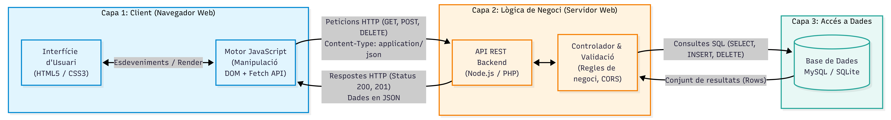

# DWEC — Unitat 1: Activitat Puntuable

## Anàlisi i disseny d'arquitectura d'una aplicació web simple

**Alumne:** Noé Conde Vila  
**Curs:** 2n DAW (Semipresencial) — IES Maria Enríquez  
**Data:** 16 de setembre de 2026

---

## 1. Introducció i Descripció de l'Aplicació

> **Enunciat:** _Escolliu una aplicació web molt simple (ex.: una llista de tasques, un comptador, o una pàgina de galeria). L'objectiu és entendre com s'organitzen els components i com interaccionen entre ells._

ToDoList.

Una aplicación de lista de tareas es un ejemplo perfecto para explicar como funciona una aplicación web ya que tiene las funciones básicas de cualquier app:

- Consultar
- Actualizar
- Añadir
- Eliminar

---

## 2. Model d'Arquitectura i 3 Capes

> **Enunciat:** _Documenteu l'arquitectura: model client-servidor, model en 3 capes si és possible, i tipus d'arquitectura (monolítica o basada en serveis)._

### 2.1. Model en 3 Capes

El modelo de tres capas funciona con tres componentes funcionando juntos.

- La capa de presentación se encarga de mostrar el contenido en la pantalla permitiendo que el usuario interactue con ella.
- La capa de lógica gestiona toda la información y ejecuta las funciones de la aplicación.
- La capa de datos es la encargada de almacenar y proporcionar todos los datos que necesita la aplicación.

### 2.2. Tipus d'Arquitectura: Monolítica vs Basada en Serveis

Existen dos tipos de arquitectura:

- Monolítica: Todo el codigo está en un solo sitio. Es mas sencilla de desplegar pero mas difícil de escalar.
- Basada en servicios / API REST: Es la que se usa normalmente en la mayoría de servicios ya que permite escalar y mantener la aplicación, manteniendo separados el frontend, el backend y la base de datos y comunicandse con peticiones HTTP.

---

## 3. Diagrama de Components i Comunicacions

> **Enunciat:** _Proporcioneu un diagrama simple de components (que incloga el client, el servidor, la base de dades i les comunicacions)._

_Figura 1: Diagrama de components i comunicacions de l'aplicació de llista de tasques._

Como se acaba de explicar, las tres capas de la aplicación trabajan juntas, la capafrontend se comunica con la capa lógica con peticiones HTTP y esta con la capa de datos con peticiones SQL.

---

## 4. Flux d'Execució i Renderització en el Navegador

> **Enunciat:** _Flux de codi en el navegador: com s'interpreta HTML, com es construeix DOM, com s'apliquen estils CSS i com s'executa JavaScript (incloent càrrega de recursos i utilització d'AJAX/FETCH si aplica)._

Cada interacción con la aplicación ejecuta una serie de procesos consecutivos en un instante:

- Parsing: El navegador lee e interpreta el html y css convirtiendo el código en DOM y CSSOM respectivamente, modelos que representan la estructura de la página.
- Render tree: Se combinan el DOM y CSSOM para crear el árbol de renderizado definiendo el estilo y la posición de cada elemento.
- Layout y Paint: El navegador dibuja los elementos en la pantalla calculando el tamaño y reposicionando los elementos cada vez que se redimensiona.
- Scripts: Cualquier aplicación del tipo ToDoList necesita scripts para ejecutar funciones, que puede hacerlo de dos formas, interpretando el código línea a línea o en tiempo real (JIT), donde convierte el código a código máquina en tiempo de ejecución siendo más rápido, que es la forma que usan los navegadores actuales.
- Todas las comunicaciones se hacen de forma asíncrona permitiendo que la aplicación siga funcionando mientras se cargan los datos usando Fetch API, AJAX y promesas.

---

## 5. Comunicació amb el Servidor i Format de Dades

> **Enunciat:** _Comunicació amb el servidor: quins tipus de peticions s'utilitzen i quina dada es comparteix entre el client i el servidor._

Las peticiones básicas y más comunes son:

- GET: Se usa para leer información.
- POST: Se usa para crear información.
- PUT: Se usa para modificar información.
- DELETE: Se usa para eliminar información.

Se usa JSON como formato de intercambio de datos entre cliente y servidor de forma asíncrona.

---

## 6. Escalabilitat i Mantenibilitat

> **Enunciat:** _Quins elements poden escalar o canviar de forma independent (si és un sistema de serveis, quins serveis existiran; si és monolític, per què és més senzill o més difícil)._

Si usamos la arquitectura basada en servicios de tres capas, cualquiera de las tres puede escalar de forma independiente sin modificar las otras.

Si es monolítico, todo el código está en un solo sitio, lo que hace que sea más difícil escalar y mantener la aplicación ya que si se modifica una parte, como mínimo habria que adaptar o modificar las otras.

---

## 7. Consideracions de Seguretat Bàsica

> **Enunciat:** _Seguretat bàsica: política de mateix origen (SOP), CORS, i consideracions mínimes de seguretat._

### 7.1. Política del Mateix Origen (Same-Origin Policy - SOP)

Es una restricción de seguridad del propio navegador que evita que una web cargue informacion de otro sitio diferente.

### 7.2. Mecanisme CORS (Cross-Origin Resource Sharing)

Es el encargado de controlar los accesos permitidos por encima de SOP.

### 7.3. Altres Mesures Bàsiques

Las buenas prácticas cobran mas importancia cuando se trata de seguridad.

- Evitar innerHTML para textos de usuarios para prevenir XSS (Cross site scripting)
- Usar HTTPS para cifrar la comunicación

---

## 8. Conclusions

Cualquier aplicación por muy básica y sencilla que sea, requiere de conocer cada proceso que se ejectuta, como se estructura de fomra correcta y como funciona toda la mecánica que hay debajo, para asegurar un buen funcionamiento sin fallos, cuelgues ni pérdida o filtrado de datos sensibles.
