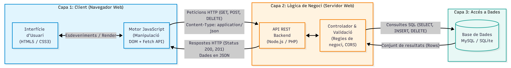

# DWEC — Unitat 1: Activitat Puntuable
**Títol:** Anàlisi i disseny d'arquitectura d'una aplicació web simple  
**Alumne:** Noé Conde Vila  
**Curs:** 2n DAW (Semipresencial) — IES Maria Enríquez  
**Data:** 16 de setembre de 2026  

---

## 1. Introducció i Descripció de l'Aplicació

> **Enunciat:** *Escolliu una aplicació web molt simple (ex.: una llista de tasques, un comptador, o una pàgina de galeria). L'objectiu és entendre com s'organitzen els components i com interaccionen entre ells.*

<!-- Escriu ací la descripció amb les teues paraules: -->
<!-- - Aplicació escollida: Llista de tasques (To-Do List). -->
<!-- - Funcionalitat principal: llistar, afegir, marcar com a completada i esborrar tasques de manera dinàmica sense recarregar la pàgina. -->

---

## 2. Model d'Arquitectura i 3 Capes

> **Enunciat:** *Documenteu l'arquitectura: model client-servidor, model en 3 capes si és possible, i tipus d'arquitectura (monolítica o basada en serveis).*

### 2.1. Model en 3 Capes
<!-- - Capa 1: Presentació / Client (HTML5, CSS3, JavaScript en el navegador). -->
<!-- - Capa 2: Lògica de Negoci (Servidor web / API REST que processa i valida dades). -->
<!-- - Capa 3: Accés a Dades (Base de dades per a persistir les tasques). -->

### 2.2. Tipus d'Arquitectura: Monolítica vs Basada en Serveis
<!-- - Diferència entre arquitectura monolítica i arquitectura basada en serveis (desacoblada / API REST). -->
<!-- - Per què s'utilitza una API REST independent per a este tipus d'aplicació web. -->

---

## 3. Diagrama de Components i Comunicacions

> **Enunciat:** *Proporcioneu un diagrama simple de components (que incloga el client, el servidor, la base de dades i les comunicacions).*

*Figura 1: Diagrama de components i comunicacions de l'aplicació de llista de tasques.*

<!-- Breu explicació de la interacció representada al diagrama entre client, servidor i BD. -->

---

## 4. Flux d'Execució i Renderització en el Navegador

> **Enunciat:** *Flux de codi en el navegador: com s'interpreta HTML, com es construeix DOM, com s'apliquen estils CSS i com s'executa JavaScript (incloent càrrega de recursos i utilització d'AJAX/FETCH si aplica).*

<!-- Explica el procés pas a pas segons la UD1 del temari: -->
<!-- 1. Recepció de l'HTML i construcció del DOM (Document Object Model). -->
<!-- 2. Descàrrega i construcció del CSSOM (CSS Object Model). -->
<!-- 3. Arbre de Renderitzat (Render Tree): unió del DOM i CSSOM. -->
<!-- 4. Fase de Layout (Reflow): càlcul de geometria, mides i posicions. -->
<!-- 5. Fase de Pintat (Paint) i Composició (Compositing): dibuixat a la pantalla. -->
<!-- 6. Execució de JavaScript: motor JS (compilació JIT), Event Loop, manipulació del DOM i peticions asíncrones fetch(). -->

---

## 5. Comunicació amb el Servidor i Format de Dades

> **Enunciat:** *Comunicació amb el servidor: quins tipus de peticions s'utilitzen i quina dada es comparteix entre el client i el servidor.*

<!-- - Mètodes HTTP utilitzats: GET (consultar tasques), POST (crear nova tasca), PUT/PATCH (modificar estat), DELETE (eliminar). -->
<!-- - Format d'intercanvi de dades: JSON (application/json) de forma asíncrona (Fetch API / AJAX). -->

---

## 6. Escalabilitat i Mantenibilitat

> **Enunciat:** *Quins elements poden escalar o canviar de forma independent (si és un sistema de serveis, quins serveis existiran; si és monolític, per què és més senzill o més difícil).*

<!-- - Com el desacoblament entre frontend i backend permet escalar o substituir components de forma independent. -->
<!-- - Avantatges de manteniment de tindre la lògica separada de la interfície. -->

---

## 7. Consideracions de Seguretat Bàsica

> **Enunciat:** *Seguretat bàsica: política de mateix origen (SOP), CORS, i consideracions mínimes de seguretat.*

### 7.1. Política del Mateix Origen (Same-Origin Policy - SOP)
<!-- - Definició: restricció del navegador basada en esquema, domini i port. -->

### 7.2. Mecanisme CORS (Cross-Origin Resource Sharing)
<!-- - Com el servidor autoritza peticions provinents d'altres orígens mitjançant capçaleres (Access-Control-Allow-Origin). -->

### 7.3. Altres Mesures Bàsiques
<!-- - Prevenció de XSS (Cross-Site Scripting) evitant innerHTML per a textos d'usuaris. -->
<!-- - Ús d'HTTPS per xifrar la comunicació. -->

---

## 8. Conclusions

<!-- Breu conclusió sintetitzant la importància d'entendre el cicle de vida complet al navegador i la separació en capes en el desenvolupament web en entorn client. -->
