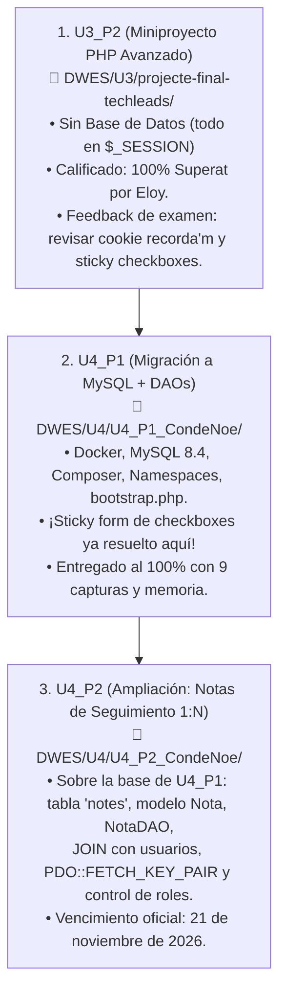
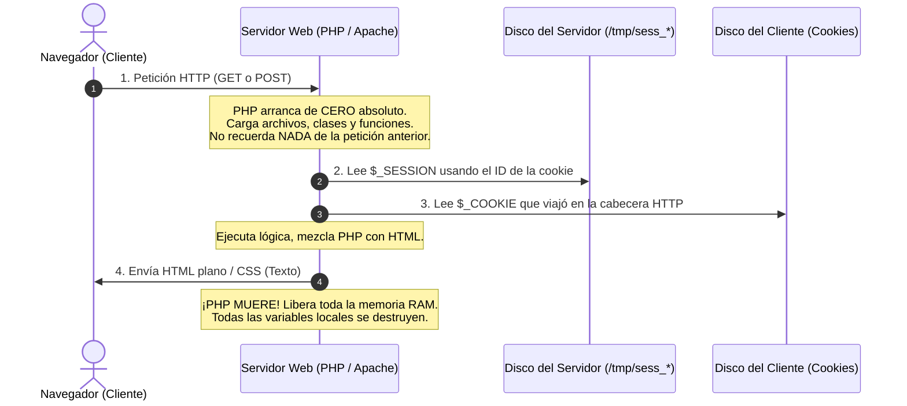
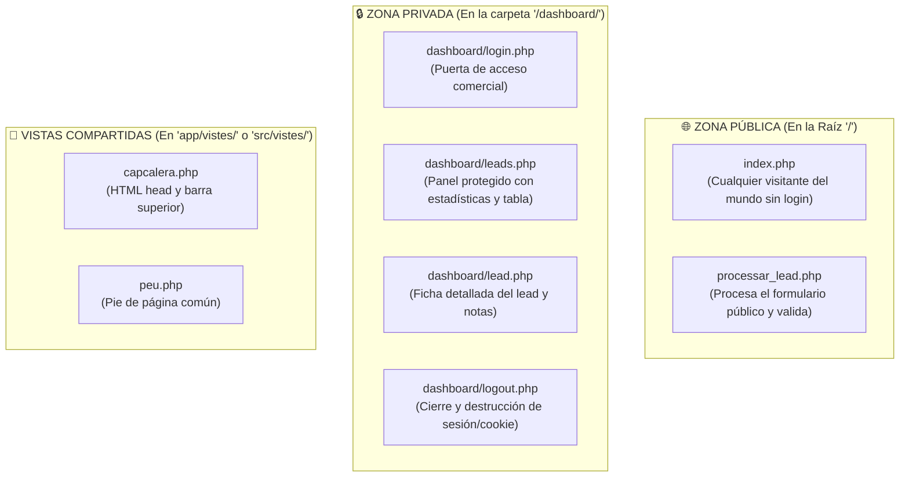
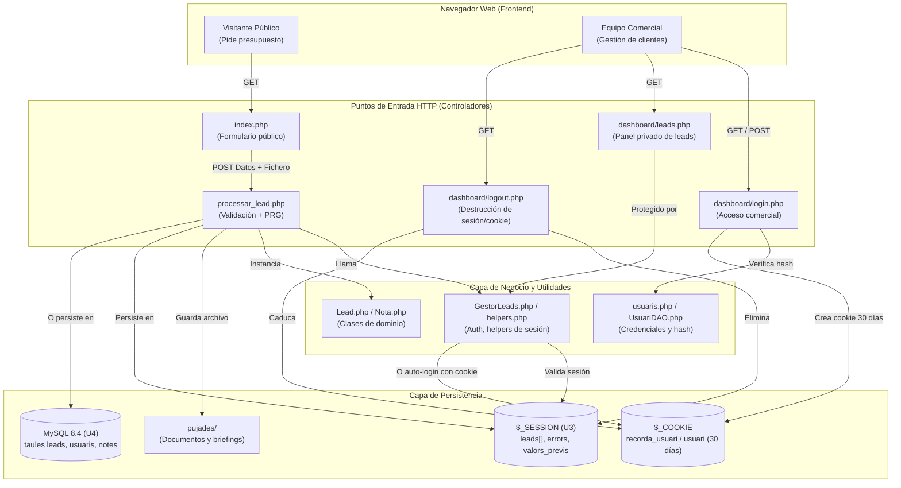
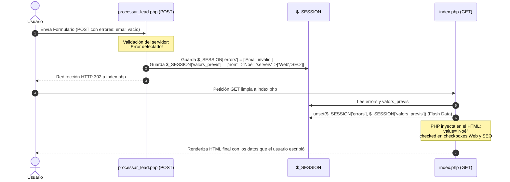
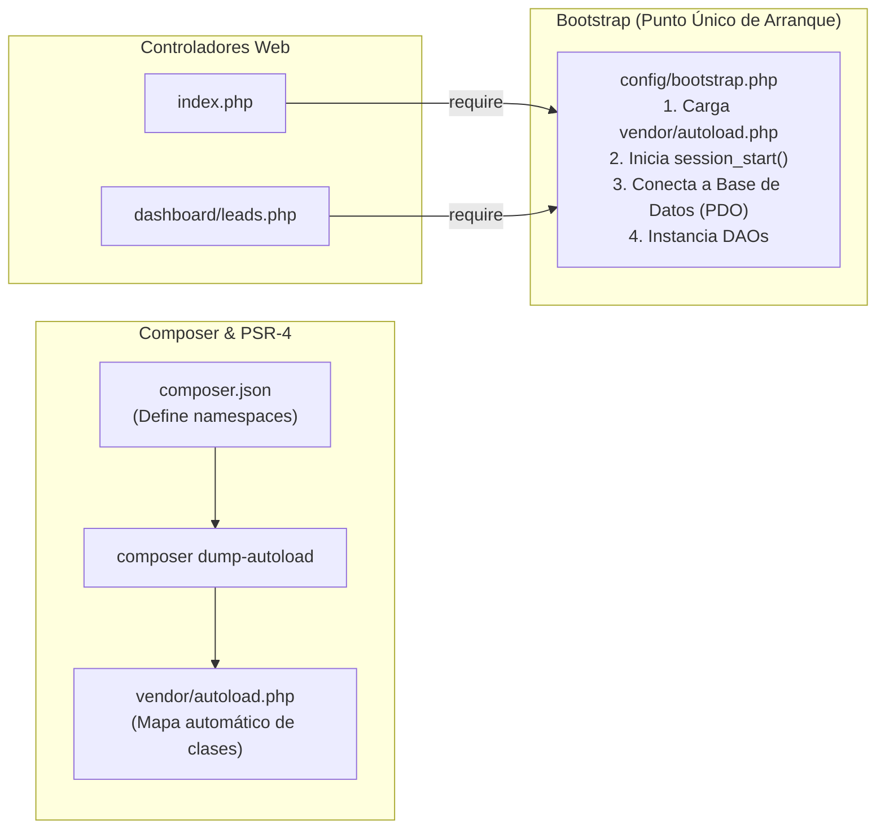

# 🚀 Memoria Técnica y Guía de Arquitectura Web — DWES
> **Módulo:** Desenvolupament Web en Entorn Servidor (DWES — 2º DAW)  
> **Proyecto:** Evolución TechLeads (U3_P2, U4_P1 y U4_P2)  
> **Autor:** Noé Conde Vila  
> **Enfoque Pedagógico:** De Desarrollador a Cliente / Arquitectura Web para perfiles que vienen de DAM

---

## 🗺️ 1. El Árbol Genealógico de TechLeads (De U3 a U4)

Para entender este proyecto, lo primero es saber en qué punto de la evolución estamos:



---

## 🎯 2. El Gran Choque Mental: ¿Por qué la Web no funciona como DAM?

Si vienes de programar en escritorio o móvil (Java, C#, Android), tu aplicación arranca una vez, se carga en la memoria RAM, los objetos viven durante horas y la interfaz gráfica responde a eventos en tiempo real dentro del mismo proceso.

En el desarrollo web con PHP el paradigma es radicalmente diferente: **el protocolo HTTP es STATELESS (sin estado)**.



> 💡 **La Regla de Oro de la Web:**  
> Ninguna variable PHP sobrevive entre dos clics o dos envíos de formulario. Para que algo "se recuerde", debe guardarse explícitamente en:
> 1. **`$_SESSION`:** Se guarda en el disco del servidor (archivo temporal).
> 2. **`$_COOKIE`:** Se guarda en el disco del navegador del usuario (cliente).
> 3. **Base de Datos (MySQL):** Persistencia definitiva en disco.

---

## ❓ 3. Preguntas Clave: ¿Dónde viven las variables y qué hay en el disco?

### A. ¿Dónde están las superglobales (`$_SESSION`, `$_COOKIE`, `$_POST`, `$_GET`)?
* **En tiempo de ejecución:** Son **variables de PHP en la memoria RAM del SERVIDOR**. El navegador cliente jamás ve ni una sola línea de PHP.
* **En reposo (entre clics):**
  - **`$_COOKIE`:** Los datos residen en el **disco duro del cliente (navegador)**. En cada clic, el navegador envía esas cookies en la cabecera HTTP oculta. PHP las lee al arrancar y las copia en su array `$_COOKIE`.
  - **`$_SESSION`:** Los datos residen **100% en el servidor**. El cliente solo tiene un "ticket" o puntero llamado `PHPSESSID`.

#### 🎟️ La metáfora del guardarropa de la discoteca:
* **El cliente (navegador)** solo lleva en el bolsillo un ticket de papel con un número: la cookie `PHPSESSID=d7a89f...`.
* **El servidor** tiene la taquilla física `d7a89f...` en su guardarropa donde está tu abrigo y tu cartera (`$_SESSION['leads']`, `$_SESSION['usuari']`).
* El navegador nunca lleva el abrigo encima; solo enseña el ticket en cada petición para que PHP busque su taquilla en el servidor.

### B. ¿Qué es "Disco / Sesión" cuando no hay Base de Datos (como en U3)?
Cuando no hay MySQL, PHP guarda las sesiones en **archivos físicos de texto plano dentro del disco duro del servidor** (normalmente en la carpeta `/tmp/` de Linux o Docker):
```text
Servidor Web (Linux / Docker)
└── /tmp/ (Carpeta temporal en el disco duro del servidor)
    ├── sess_4a8f9c1b...  ← Archivo de texto plano con los datos de la sesión del usuario A
    └── sess_9e2d7a04...  ← Archivo de texto plano con los datos de la sesión del usuario B
```
Cuando llamas a `session_start()`, PHP busca el archivo correspondiente al `PHPSESSID`, lo lee del disco, lo deserializa y te lo deja listo en `$_SESSION`. Al terminar el script, lo vuelve a guardar en disco y vacía la RAM.

### C. ¿Por qué las vistas están separadas: unas en la raíz (`/`) y otras en `dashboard/`?
Por una estricta separación de **roles, seguridad y experiencia de usuario (Público vs Privado)**:



1. **En la raíz (`/`):** Acceso público sin contraseña. URLs directas (`techleads.com/`).
2. **En `/dashboard/`:** Intranet comercial. Todo archivo aquí está blindado por `requereixLogin()` o `assegurarAutenticacio()`. Si no estás logueado, te expulsa al login.
3. **En `app/vistes/`:** No son páginas completas, son trozos de plantilla (`header`, `footer`) que se cargan con `require_once`. Nunca se visitan directamente desde el navegador.

---

## 🏗️ 4. Arquitectura de Componentes de TechLeads



---

## 🔄 5. El Patrón PRG (Post-Redirect-Get) y los *Sticky Forms*

### ¿Por qué existe el patrón PRG?
Si procesas un formulario y devuelves HTML directamente en la misma petición POST, cuando el usuario pulsa **F5 (Recargar)** en su navegador, el navegador muestra la clásica alerta: *"¿Desea volver a enviar el formulario?"*, duplicando registros o ventas.

Para evitarlo, se usa **Post-Redirect-Get**:
1. El usuario envía por **POST**.
2. El servidor procesa y responde con un código de redirección **HTTP 302** (cabecera `Location`).
3. El navegador hace un **GET limpio**. Si pulsa F5, solo recarga el GET.



### ¿Cómo funciona la sincronía HTML + PHP en los Sticky Forms?
El navegador **NUNCA** ejecuta PHP. PHP se ejecuta al 100% en el servidor y "escribe texto" en los atributos del HTML antes de enviarlo:

```php
<!-- Si el servicio está en el array previo, PHP escribe la palabra 'checked' -->
<input type="checkbox" name="serveis[]" value="Web" 
       <?= in_array('Web', $serveisPrevis, true) ? 'checked' : '' ?>>
```
Si la condición es verdadera, el navegador del cliente recibe literalmente:
`<input type="checkbox" name="serveis[]" value="Web" checked>`

---

## 🔐 6. Sesiones vs Cookies: El Sistema de Autenticación "Recorda'm"

### La gran diferencia técnica
- **`PHPSESSID` (Cookie de Sesión normal):** Se crea al hacer `session_start()`. Por defecto no tiene fecha de caducidad fijada (`expires: Session`), lo que significa que **cuando el usuario cierra el navegador por completo, el navegador destruye la cookie**. Al reabrir, el servidor no reconoce al usuario.
- **`recorda_usuari` (Cookie Persistente):** Se crea con `setcookie(..., time() + 30*24*3600)`. Se guarda físicamente en el disco duro del cliente durante 30 días, aunque cierre el navegador o apague el PC.

```mermaid
flowchart TD
    Inicio([Usuario intenta entrar a dashboard/leads.php]) --> CheckSesion{¿Existe $_SESSION['usuari']?}
    
    CheckSesion -- SÍ --> AccesoConcedido[Acceso Permitido al Panell de Leads]
    
    CheckSesion -- NO (Cerró el navegador) --> CheckCookie{¿Existe cookie persistente?}
    
    CheckCookie -- SÍ --> ValidaUser{¿El usuario existe en el sistema / BD?}
    
    ValidaUser -- SÍ --> AutoLogin[1. session_regenerate_id<br/>2. Recrea $_SESSION['usuari'] = cookie<br/>Auto-login transparente]
    AutoLogin --> AccesoConcedido
    
    ValidaUser -- NO --> RedirigeLogin[header Location: login.php]
    CheckCookie -- NO --> RedirigeLogin
    
    RedirigeLogin --> Fin([Muestra formulario de login])
```

---

## 🧩 7. ¿Qué son `bootstrap`, `vendor` y `autoload` en PHP?

En la Unidad 3 hacíamos `require_once` a mano en cada archivo. Pero en proyectos con bases de datos y DAOs (Unidad 4), tener 30 `require_once` al principio de cada fichero es inmanejable y propenso a errores.

Aquí es donde entra el ecosistema profesional de PHP:



### Conceptos Clave explicados fácil:
1. **`vendor/`:** Es la carpeta donde **Composer** descarga librerías de terceros (como si fuera el `node_modules` de Node o las librerías `.jar` de Maven/Gradle en DAM).
2. **`vendor/autoload.php`:** Un script generado automáticamente. En lugar de hacer `require 'Lead.php'`, PHP detecta cuándo usas `new Lead()` o `new App\DAO\LeadDAO()`, busca el fichero en disco y lo carga en milisegundos bajo demanda siguiendo el estándar PSR-4.
3. **`bootstrap.php`:** Es la "lista de verificación previa al despegue". Un único archivo central que todo controlador incluye para no repetir código:
   - Carga el autoload.
   - Arranca la sesión.
   - Carga las credenciales de la base de datos.
   - Configura la zona horaria y reporte de errores.

---

## 🛠️ 8. Análisis de los 2 Errores Señalados por Eloy (Para el Examen)

### ❌ Error 1: Bypass de la Cookie "Recorda'm" al cerrar el navegador
* **El síntoma que vio Eloy en U3_P2:** Marcaba "Recorda'm", cerraba el navegador por completo, escribía la URL directa `dashboard/leads.php` y la web lo expulsaba a `login.php`.
* **La causa:** En `leads.php` solo se comprobaba `if (!isset($_SESSION['usuari'])) { header('Location: login.php'); }`. Como el navegador destruyó la cookie de sesión al cerrarse, la sesión estaba vacía y `leads.php` lo echaba fuera sin comprobar si existía la cookie persistente `$_COOKIE['recorda_usuari']`.
* **La Solución de Examen:**
  ```php
  // Si no hay sesión pero hay cookie persistente válida, auto-login transparente:
  if (empty($_SESSION['usuari']) && !empty($_COOKIE['recorda_usuari'])) {
      $usuarioValido = $dao->findByUsuari($_COOKIE['recorda_usuari']);
      if ($usuarioValido !== null) {
          session_regenerate_id(true);
          $_SESSION['usuari'] = $usuarioValido->getUsuari();
      }
  }
  ```

### ❌ Error 2: Sticky Form ausente en los checkboxes `serveis[]`
* **El síntoma que vio Eloy en U3_P2:** Si el usuario marcaba *App mòbil* y *SEO*, pero cometía un error en el email, el formulario recargaba con sus datos de texto pero los checkboxes volvían a su estado inicial.
* **La causa:** Los checkboxes en `index.php` tenían valores estáticos en el HTML (el de *Web* tenía `checked` escrito a fuego).
* **La Solución (que ya aplicaste con éxito en U4_P1):**
  ```html
  <input type="checkbox" name="serveis[]" value="Web" 
         <?= in_array('Web', $old['serveis']) ? 'checked' : '' ?>>
  <input type="checkbox" name="serveis[]" value="App mòbil" 
         <?= in_array('App mòbil', $old['serveis']) ? 'checked' : '' ?>>
  ```

---

## 🏁 9. Checklist Resumen para el Examen Presencial de DWES

1. **Formularios con errores:** Siempre **PRG** (`$_SESSION['errors']`, `$_SESSION['valors_previs']`, `Location: index.php`). En la vista: `value="<?= e($valors['camp']) ?>"`, `in_array(...) ? 'checked' : ''`.
2. **Subida de archivos:** Validar siempre con `$_FILES['doc']['error'] === UPLOAD_ERR_OK`, comprobar tamaño en bytes y tipo MIME real con `new finfo(FILEINFO_MIME_TYPE)`.
3. **Cookies y Sesión:**
   - Sesión = `session_start()`, para datos volátiles o autenticación de navegación.
   - Cookie = `setcookie(nombre, valor, caducidad, '/')`, para recordar preferencias o auto-login.
   - Seguridad: Siempre `session_regenerate_id(true)` tras validar un login para evitar ataques de fijación de sesión (*Session Fixation*).
4. **Base de Datos y DAOs (U4):**
   - Siempre **consultas preparadas** (`$stmt->prepare()` y `$stmt->execute()`). Jamás concatenar variables en el SQL.
   - Usar `PDO::FETCH_CLASS` para mapear directamente a modelos, y `PDO::FETCH_KEY_PAIR` para conteos rápidos clave-valor (evitando el problema N+1).
