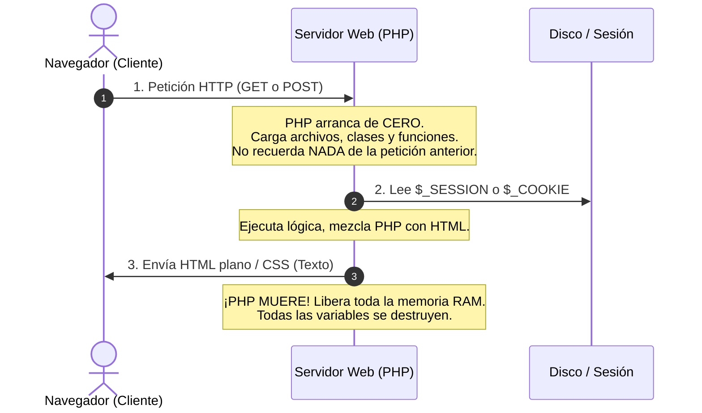
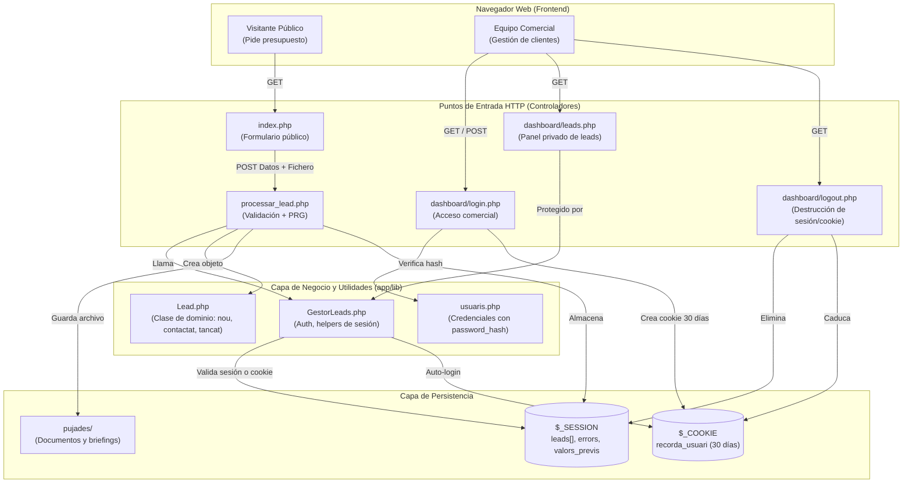
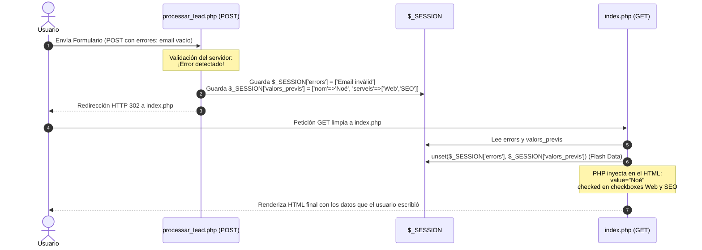
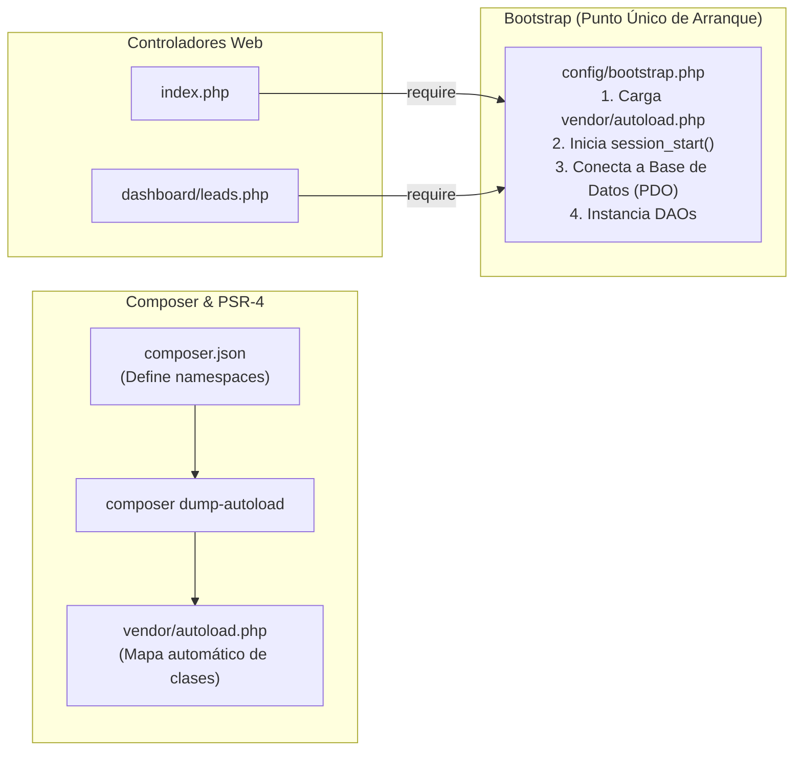

# 🚀 Memoria Técnica y Guía de Arquitectura — TechLeads
> **Módulo:** Desenvolupament Web en Entorn Servidor (DWES — 2º DAW)  
> **Proyecto:** Miniproyecto U3_P2 — TechLeads (Gestión Comercial y Captación Web)  
> **Autor:** Noé Conde Vila  
> **Enfoque Pedagógico:** De Desarrollador a Cliente / Arquitectura Web para desarrolladores que vienen de DAM

---

## 🎯 1. El Gran Cambio Mental: ¿Por qué la Web no funciona como DAM?

Si vienes de programar en escritorio o móvil (Java, C#, Android), tu aplicación arranca, se carga en la memoria RAM, los objetos viven durante horas y la interfaz gráfica responde a eventos en tiempo real dentro del mismo proceso.

En el desarrollo web con PHP el paradigma es radicalmente diferente: **el protocolo HTTP es STATELESS (sin estado)**.



> 💡 **La Regla de Oro de la Web:**  
> Ninguna variable PHP sobrevive entre dos clics o dos envíos de formulario. Para que algo "se recuerde", debe guardarse explícitamente en:
> 1. **`$_SESSION`:** Se guarda en el servidor (en un archivo temporal en disco).
> 2. **`$_COOKIE`:** Se guarda en el navegador del usuario (en el cliente).
> 3. **Base de Datos (MySQL):** Persistencia definitiva en disco.

---

## 🏗️ 2. Arquitectura Global del Sistema

TechLeads se divide en dos mundos claramente separados: la **Web Pública** (captación) y el **Panell Intern** (gestión comercial privada).



---

## 📂 3. Mapa de Carpetas y Responsabilidad de Ficheros

| Ruta del Fichero | Responsabilidad Única (Qué hace y por qué existe) |
| :--- | :--- |
| `index.php` | **Vista y formulario público:** Muestra la landing comercial. Recupera errores y valores previos de `$_SESSION` para hacer el formulario *Sticky* y los limpia (`unset`) inmediatamente. |
| `processar_lead.php` | **Controlador de procesamiento (Sin HTML):** Valida datos obligatorios, sanea strings, audita el tipo MIME real del archivo adjunto con `finfo` (máx. 2MB), crea la instancia `Lead` y redirige aplicando el patrón **PRG**. |
| `pujades/` | **Almacenamiento de archivos:** Directorio físico donde se guardan los PDFs o imágenes subidos con un nombre aleatorio único (`doc_uniqid.ext`) para evitar sobreescrituras y hackeos. |
| `dashboard/login.php` | **Puerta de acceso comercial:** Valida credenciales contra `usuaris.php` con `password_verify()`. Gestiona la cookie persistente `recorda_usuari` (30 días) y auto-redirige si ya hay cookie activa. |
| `dashboard/leads.php` | **Panel de control privado:** Protegido contra accesos no autorizados mediante `assegurarAutenticacio()`. Muestra estadísticas, tabla de leads y el botón de transición de estado (`nou` ➔ `contactat` ➔ `tancat`). |
| `dashboard/logout.php` | **Cierre seguro:** Limpia el array `$_SESSION = []`, destruye la sesión con `session_destroy()` y caduca la cookie persistente enviando una fecha pasada (`time() - 3600`). |
| `app/lib/Lead.php` | **Clase Modelo (POPO):** Objeto con propiedades estrictas tipadas, estados en constantes (`ESTAT_NOU`, `ESTAT_CONTACTAT`, `ESTAT_TANCAT`) y método de avance `avancarEstat()`. |
| `app/lib/GestorLeads.php` | **Capa de Servicio / Helper:** Arranca la sesión de forma segura (`iniciarSesioLead`), gestiona el array `$_SESSION['leads']`, calcula IDs incrementales y autentica vía sesión o cookie (`assegurarAutenticacio`). |
| `app/lib/usuaris.php` | **Almacén de Usuarios:** Array asociativo con usuarios comerciales y sus contraseñas encriptadas con `PASSWORD_DEFAULT`. |
| `app/vistes/capcalera.php` | **Layout común (Header):** HTML5 compartido, metadatos, Tailwind CSS y barra superior. |
| `app/vistes/peu.php` | **Layout común (Footer):** Cierre semántico y pie de página común. |

---

## 🔄 4. El Patrón PRG (Post-Redirect-Get) y los *Sticky Forms*

### ¿Por qué existe el patrón PRG?
Si procesas un formulario y devuelves HTML directamente en la misma petición POST, cuando el usuario pulsa **F5 (Recargar)** en su navegador, el navegador muestra la clásica alerta: *"¿Desea volver a enviar el formulario?"*, duplicando registros o ventas.

Para evitarlo, se usa **Post-Redirect-Get**:
1. El usuario envía por **POST**.
2. El servidor procesa y responde con un código de redirección **HTTP 302** (cabecera `Location`).
3. El navegador hace un **GET limpio**. Si pulsa F5, solo recarga el GET.



### ¿Cómo funciona la sincronía HTML + PHP en los Sticky Forms?
El navegador **NUNCA** ejecuta PHP. PHP se ejecuta al 100% en el servidor y "escribe texto" en los atributos del HTML antes de enviarlo:

```php
<!-- Si el servicio está en el array previo, PHP escribe la palabra 'checked' -->
<input type="checkbox" name="serveis[]" value="Web" 
       <?= in_array('Web', $serveisPrevis, true) ? 'checked' : '' ?>>
```
Si la condición es verdadera, el navegador del cliente recibe literalmente:
`<input type="checkbox" name="serveis[]" value="Web" checked>`

---

## 🔐 5. Sesiones vs Cookies: El Sistema de Autenticación "Recorda'm"

### La gran diferencia técnica
- **`PHPSESSID` (Cookie de Sesión normal):** Se crea al hacer `session_start()`. Por defecto no tiene fecha de caducidad fijada (`expires: Session`), lo que significa que **cuando el usuario cierra el navegador por completo, el navegador destruye la cookie**. Al reabrir, el servidor no reconoce al usuario.
- **`recorda_usuari` (Cookie Persistente):** Se crea con `setcookie(..., time() + 30*24*3600)`. Se guarda físicamente en el disco duro del cliente durante 30 días, aunque cierre el navegador o apague el PC.

```mermaid
flowchart TD
    Inicio([Usuario intenta entrar a dashboard/leads.php]) --> CheckSesion{¿Existe $_SESSION['usuari']?}
    
    CheckSesion -- SÍ --> AccesoConcedido[Acceso Permitido al Panell de Leads]
    
    CheckSesion -- NO (Cerró el navegador) --> CheckCookie{¿Existe $_COOKIE['recorda_usuari']?}
    
    CheckCookie -- SÍ --> ValidaUser{¿El usuario existe en usuaris.php?}
    
    ValidaUser -- SÍ --> AutoLogin[1. session_regenerate_id<br/>2. Recrea $_SESSION['usuari'] = cookie<br/>Auto-login transparente]
    AutoLogin --> AccesoConcedido
    
    ValidaUser -- NO --> RedirigeLogin[header Location: login.php]
    CheckCookie -- NO --> RedirigeLogin
    
    RedirigeLogin --> Fin([Muestra formulario de login])
```

---

## 🧩 6. ¿Qué son `bootstrap`, `vendor` y `autoload` en PHP?

En la Unidad 3 hacíamos `require_once` a mano en cada archivo. Pero en proyectos medianos o en la Unidad 4 (Bases de datos con DAOs), tener 30 `require_once` al principio de cada fichero es inmanejable y propenso a errores.

Aquí es donde entra el ecosistema profesional de PHP:



### Conceptos Clave explicados fácil:
1. **`vendor/`:** Es la carpeta donde **Composer** descarga librerías de terceros (como si fuera el `node_modules` de Node o las librerías `.jar` de Maven/Gradle en DAM).
2. **`vendor/autoload.php`:** Un script generado automáticamente. En lugar de hacer `require 'Lead.php'`, PHP detecta cuándo usas `new Lead()` o `new App\DAO\LeadDAO()`, busca el fichero en disco y lo carga en milisegundos bajo demanda.
3. **`bootstrap.php`:** Es la "lista de verificación previa al despegue". Un único archivo central que todo controlador incluye para no repetir código:
   - Carga el autoload.
   - Arranca la sesión.
   - Carga las credenciales de la base de datos.
   - Configura la zona horaria y reporte de errores.

---

## 🛠️ 7. Los 2 Errores Señalados por Eloy: Diagnóstico y Solución

### ❌ Error 1: Bypass de la Cookie "Recorda'm" al cerrar el navegador

* **El síntoma que vio Eloy:**  
  Marcaba "Recorda'm", cerraba el navegador por completo, escribía la URL directa `dashboard/leads.php` y la web lo expulsaba a `login.php`.
* **La causa en el código original:**  
  En `leads.php` solo se comprobaba `if (!isset($_SESSION['usuari'])) { header('Location: login.php'); }`. Como el navegador destruyó la cookie de sesión al cerrarse, la sesión estaba vacía y `leads.php` lo echaba fuera sin mirar si existía la cookie persistente `$_COOKIE['recorda_usuari']`.
* **La Solución Implementada:**  
  Creamos la función centralizada `assegurarAutenticacio()` en `GestorLeads.php`:
  ```php
  function assegurarAutenticacio(string $rutaLogin = 'login.php'): string {
      iniciarSesioLead();
      // 1. Si hay sesión, pasa
      if (isset($_SESSION['usuari'])) return $_SESSION['usuari'];

      // 2. Si no hay sesión pero hay cookie válida, REGENERA LA SESIÓN automáticamente
      if (!empty($_COOKIE['recorda_usuari'])) {
          $llistaUsuaris = require __DIR__ . '/usuaris.php';
          if (isset($llistaUsuaris[$_COOKIE['recorda_usuari']])) {
              session_regenerate_id(true);
              $_SESSION['usuari'] = $_COOKIE['recorda_usuari'];
              return $_SESSION['usuari']; // ¡Acceso concedido!
          }
      }
      header("Location: $rutaLogin");
      exit;
  }
  ```

---

### ❌ Error 2: Sticky Form ausente en los checkboxes `serveis[]`

* **El síntoma que vio Eloy:**  
  Si el usuario marcaba *App mòbil* y *SEO*, pero cometía un error en el email, el formulario recargaba con sus datos de texto pero los checkboxes volvían a su estado inicial (solo *Web* marcado).
* **La causa en el código original:**  
  Los checkboxes en `index.php` tenían valores estáticos en el HTML: el de *Web* tenía `checked` escrito a fuego y los demás no tenían ninguna directiva PHP.
* **La Solución Implementada:**  
  Recuperamos el array de servicios previos enviados y usamos `in_array()` en cada input:
  ```php
  // En la cabecera de index.php:
  $serveisPrevis = isset($valors['serveis']) 
      ? (array) $valors['serveis'] 
      : (empty($valors) ? ['Web'] : []);
  ```
  ```html
  <!-- En cada checkbox del formulario: -->
  <input type="checkbox" name="serveis[]" value="Web" 
         <?= in_array('Web', $serveisPrevis, true) ? 'checked' : '' ?>>

  <input type="checkbox" name="serveis[]" value="App mòbil" 
         <?= in_array('App mòbil', $serveisPrevis, true) ? 'checked' : '' ?>>

  <input type="checkbox" name="serveis[]" value="SEO" 
         <?= in_array('SEO', $serveisPrevis, true) ? 'checked' : '' ?>>

  <input type="checkbox" name="serveis[]" value="Cloud" 
         <?= in_array('Cloud', $serveisPrevis, true) ? 'checked' : '' ?>>
  ```

---

## 🏁 8. Conclusión para el Examen Presencial

Para el examen práctico de DWES:
1. **Formularios con errores:** Siempre **PRG** (`$_SESSION['errors']`, `$_SESSION['valors_previs']`, `Location: index.php`). En la vista: `value="<?= e($valors['camp']) ?>"`, `in_array(...) ? 'checked' : ''`.
2. **Subida de archivos:** Validar siempre con `$_FILES['doc']['error'] === UPLOAD_ERR_OK`, comprobar tamaño en bytes y tipo MIME real con `new finfo(FILEINFO_MIME_TYPE)`.
3. **Cookies y Sesión:**
   - Sesión = `session_start()`, para datos volátiles o autenticación de navegación.
   - Cookie = `setcookie(nombre, valor, caducidad, '/')`, para recordar preferencias o auto-login.
   - Seguridad: Siempre `session_regenerate_id(true)` tras validar un login para evitar ataques de fijación de sesión (*Session Fixation*).
