

    Desenvolupament Web en Entorn Servidor · 2n DAW

<h1 style="font-size: 30px; font-weight: 800; color: #0f172a; margin: 0 0 8px 0; letter-spacing: -0.5px;">
    Unitat 4 · Accés a Dades
</h1>

<h2 style="font-size: 17px; font-weight: 500; color: #475569; margin: 0 0 30px 0;">
    Pràctica U4_P1 · Projecte TechLeads amb MySQL i PDO
</h2>

    
<strong>Alumne:</strong> Noé Conde Vila

    
<strong>Mòdul:</strong> DWES · IES Maria Enríquez

    
<strong>Curs acadèmic:</strong> 2026 / 2027

## 1. Proves de funcionament intern (Punts 5 a 11)

### 1.1. `prova-model.php` (Punt 5.5)
Comprovem la instanciació dels models `Lead` i `Usuari`, el cicle d'estats i la verificació de contrasenyes amb hash.

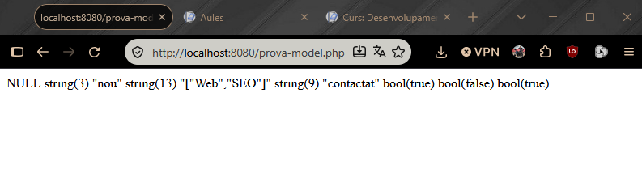

---

### 1.2. `prova-connexio.php` (Punt 7.6)
Verifiquem la connexió amb èxit al servei MySQL de Docker mitjançant PDO i la classe `DBConnection`.

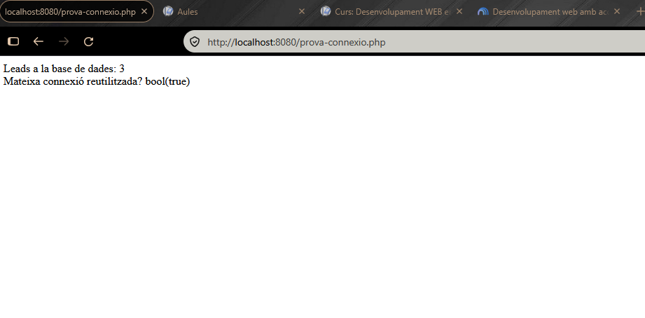

---

### 1.3. `prova-dao.php` (Punt 8.6)
Comprovem les operacions CRUD dels DAO recuperant objectes reals directament amb `FETCH_CLASS`.

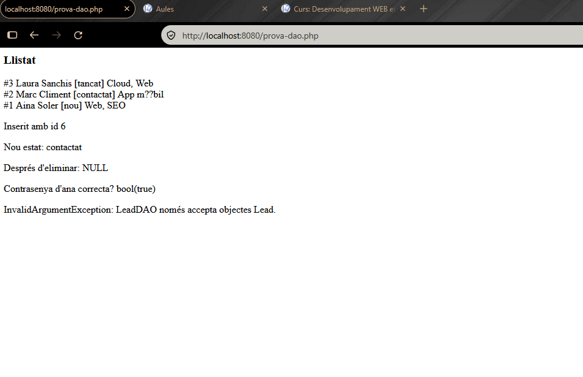

---

### 1.4. `prova-arxiu.php` (Punt 9.6)
Validem la pujada segura d'arxius (formats, grandària màxima i noms únics) i la seua eliminació del disc.

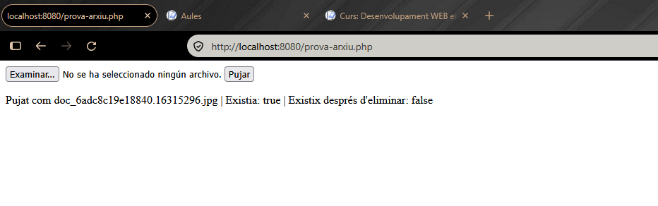

---

### 1.5. `prova-usuari.php` (Punt 11.4)
Inserció d'un usuari nou a la base de dades amb contrasenya xifrada i comprovació de la restricció `UNIQUE`.

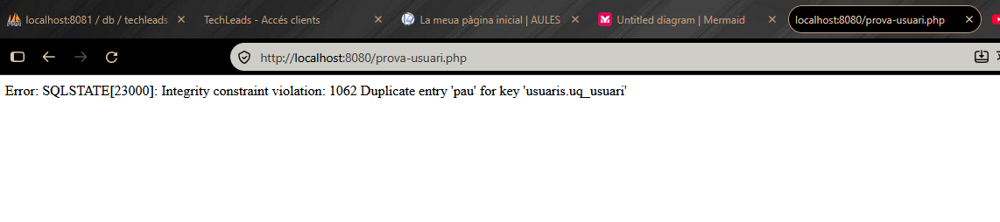

## 2. Vistes finals de l'aplicació web

### 2.1. Formulari públic (`index.php`)
Pàgina pública on el client envia la sol·licitud i els documents, guardant-se de forma persistent a MySQL.

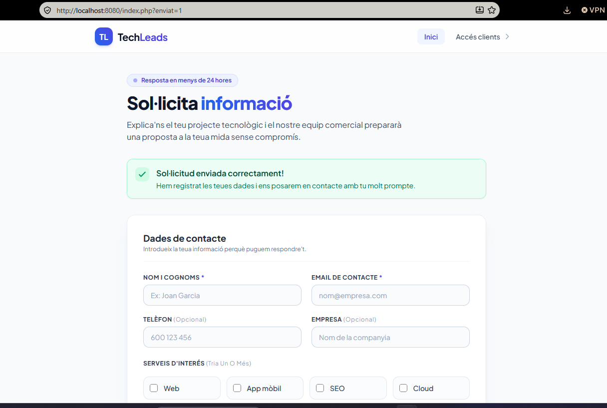

---

### 2.2. Panell general de leads (`dashboard/leads.php`)
Llistat protegit per sessió amb la taula de leads, estats per colors i les accions de detall, avançar estat i eliminar.

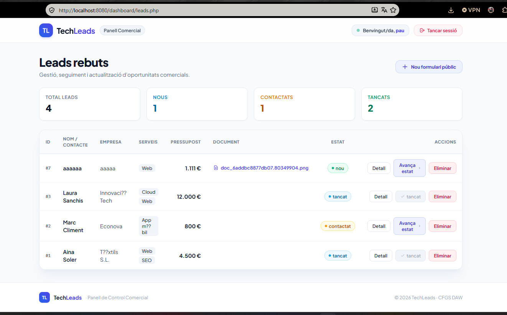

---

### 2.3. Fitxa de detall (`dashboard/lead.php`)
Vista completa de tota la informació d'un lead concret recuperat per ID, amb accés a l'arxiu adjunt i botó d'editar.

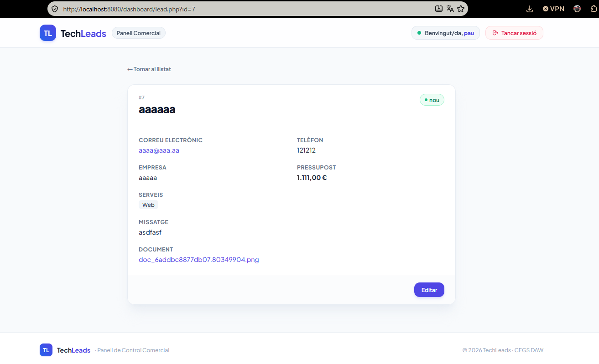

---

### 2.4. Edició del lead (`dashboard/editar.php`)
Formulari per a modificar les dades del lead i substituir l'arxiu adjunt eliminant automàticament el fitxer vell.

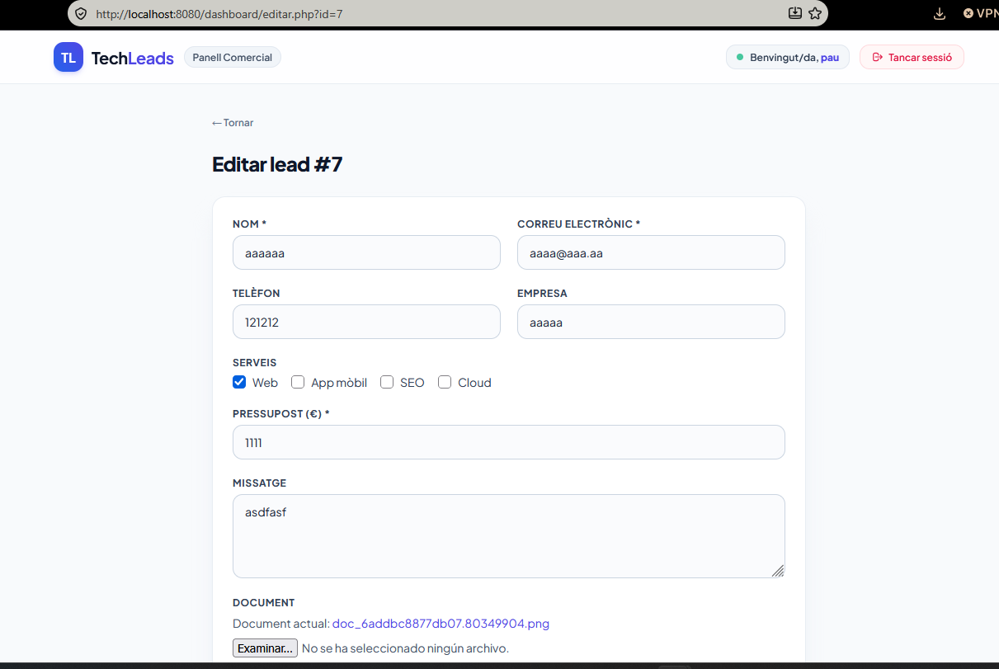

*Confirmació al guardar canvis:*

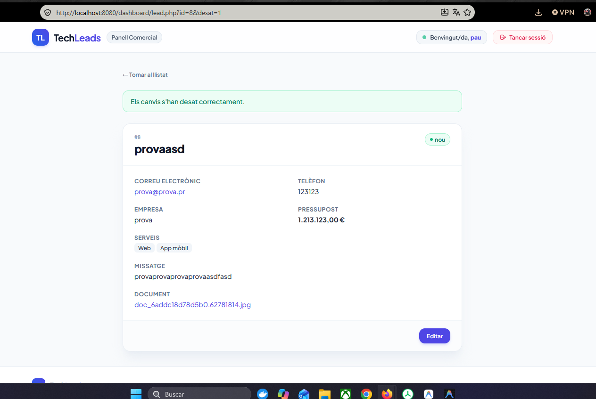

## 3. Diagrames d'ajuda

> Aquests dos diagrames els he anat fent durant la pràctica per a aclarirme millor amb l'estructura i el fluxe, ja que al inici amb tants fitxers i carpetes noves em feia un lio.

---

### 3.1. Arquitectura de capes
Visió general de les capes del projecte, des del navegador fins a la persistència en MySQL i disc.

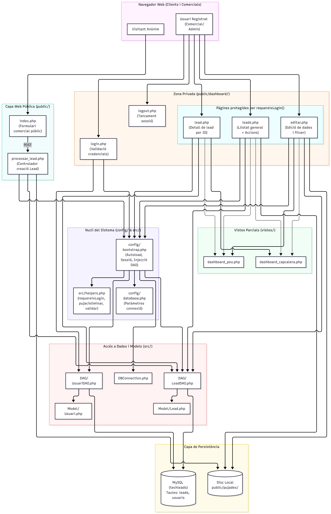

---

### 3.2. Diagrama de classes UML
Estructura de classes, interfície `IDbAccess`, injecció de dependències i models de dades.

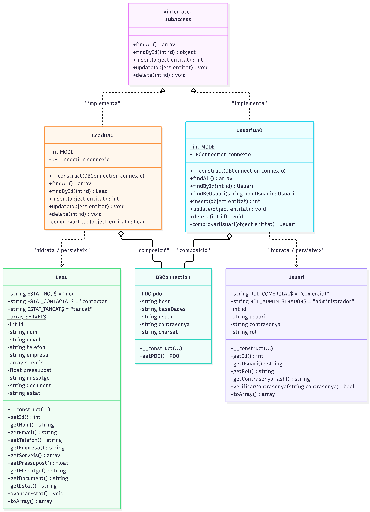
