<style>
  body {
    font-family: Arial, Helvetica, sans-serif;
    line-height: 1.5;
    color: #24292f;
  }
  /* Evitar líneas huérfanas o viudas en párrafos */
  p {
    orphans: 3;
    widows: 3;
  }
  /* Bloques de código completos sin partirse */
  pre, pre code {
    page-break-inside: avoid;
    break-inside: avoid;
  }
  /* Imágenes que no se corten entre páginas */
  img {
    max-width: 85%;
    max-height: 300px;
    object-fit: contain;
    display: block;
    margin: 10px auto 4px auto;
    border: 1px solid #d0d7de;
    border-radius: 4px;
    page-break-inside: avoid;
    break-inside: avoid;
  }
  /* Pie de foto: siempre unido a la imagen precedente sin saltar solo de página */
  small {
    display: block;
    text-align: center;
    color: #57606a;
    margin-bottom: 16px;
    font-size: 0.85em;
    page-break-before: avoid;
    break-before: avoid;
    page-break-inside: avoid;
    break-inside: avoid;
  }
  /* Títulos: nunca al final de una página sin contenido */
  h1, h2, h3, h4 {
    page-break-after: avoid;
    break-after: avoid;
  }
  /* Cuadros de enunciado íntegros */
  blockquote {
    background-color: #f6f8fa;
    border-left: 4px solid #0969da;
    padding: 6px 12px;
    margin: 8px 0 16px 0;
    color: #57606a;
    page-break-inside: avoid;
    break-inside: avoid;
  }
  /* Reglas de impresión / PDF */
  @media print {
    pre, blockquote, img, small {
      page-break-inside: avoid;
      break-inside: avoid;
    }
    h1, h2, h3, h4 {
      page-break-after: avoid;
      break-after: avoid;
    }
  }
</style>

# DAW — Unidad 1: PEC 1

**Alumno:** Noé Conde Vila

---

## Ejercicio 1

> _Como habrás podido observar, cuando el servidor no encuentra una página web arroja un error 404 y muestra una página web por defecto. Busca cómo cambiar esta página web e incluye una tuya personalizada que incluya tu nombre tanto para Apache como para Nginx. Incluye capturas de los ficheros de configuración y navegador._

- **Apache:** `192.168.0.22`
- **Nginx:** `192.168.0.23`

### Apache

Primero creamos un archivo HTML llamado `404.html` en la carpeta `miproyecto` (creada previamente) y luego modificamos el archivo de configuración de Apache para añadir la directiva de error 404 por defecto.

```bash
# Crear el archivo 404.html personalizado
sudo nano /var/www/miproyecto/404.html

# Una vez creado el 404, verificar sintaxis y reiniciar Apache
sudo apachectl configtest
sudo systemctl restart apache2
curl http://localhost:8080/pagina
```

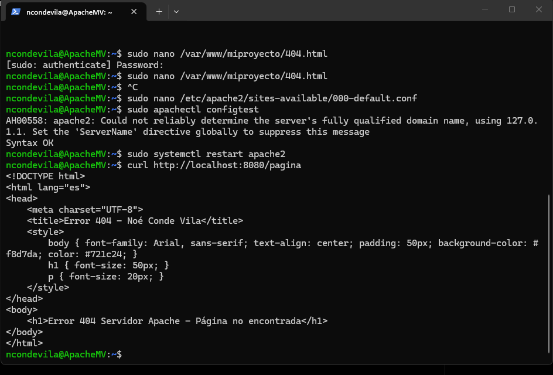  
<small>_Comandos para crear el HTML, configurar el archivo default, comprobar sintaxis, recargar servidor y comprobar con curl._</small>

```bash
# Contenido del archivo 404.html (editado con nano):
# /var/www/miproyecto/404.html
```

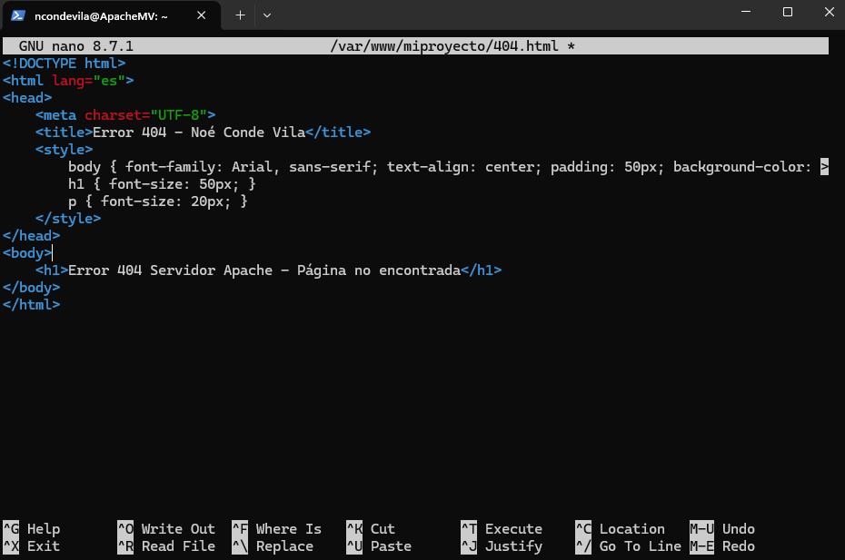  
<small>_Contenido HTML del archivo de error 404._</small>

```bash
# Añadir directiva en 000-default.conf dentro de <VirtualHost>:
sudo nano /etc/apache2/sites-available/000-default.conf
# → ErrorDocument 404 /404.html
```

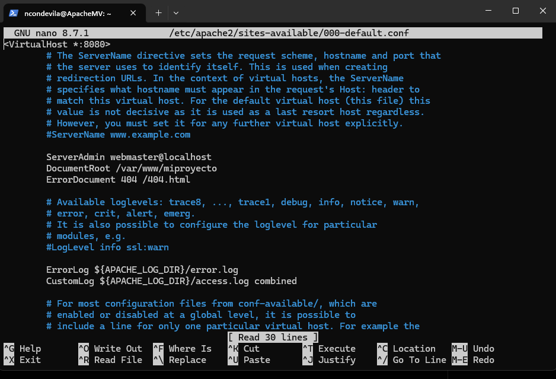  
<small>_Archivo de configuración default (`000-default.conf`) con la directiva ErrorDocument._</small>

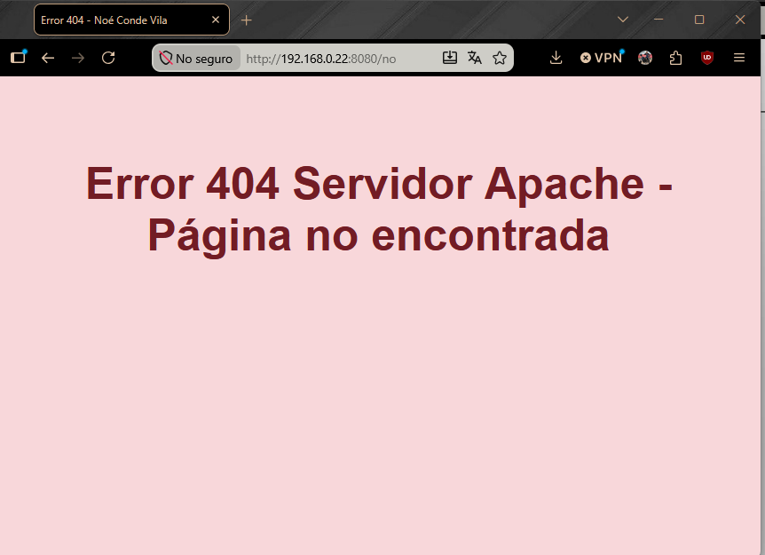  
<small>_Comprobación desde el navegador accediendo a una ruta inexistente._</small>

### Nginx

Con Nginx los pasos son similares, creando el mismo archivo error 404 en la misma ruta de `miproyecto` y modificando el archivo de configuración `default` aunque con otro tipo de sintaxis.

```bash
# Crear el archivo 404.html personalizado para Nginx
sudo nano /var/www/miproyecto/404.html
# Editar configuración de Nginx
sudo nano /etc/nginx/sites-available/default
# → Añadir dentro del bloque server: error_page 404 /404.html;
# Verificar sintaxis y reiniciar Nginx
sudo nginx -t
sudo systemctl restart nginx
curl http://localhost:8081/noexiste
```

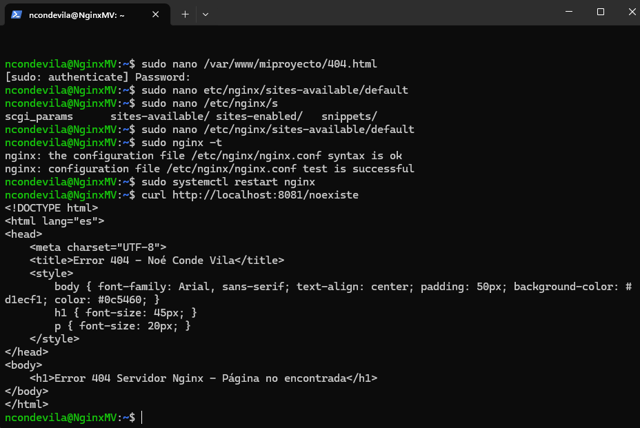  
<small>_Comandos realizados en Nginx._</small>

```bash
# Editar configuración de Nginx: añadir directiva error_page
sudo nano /etc/nginx/sites-available/default
# → error_page 404 /404.html;
```

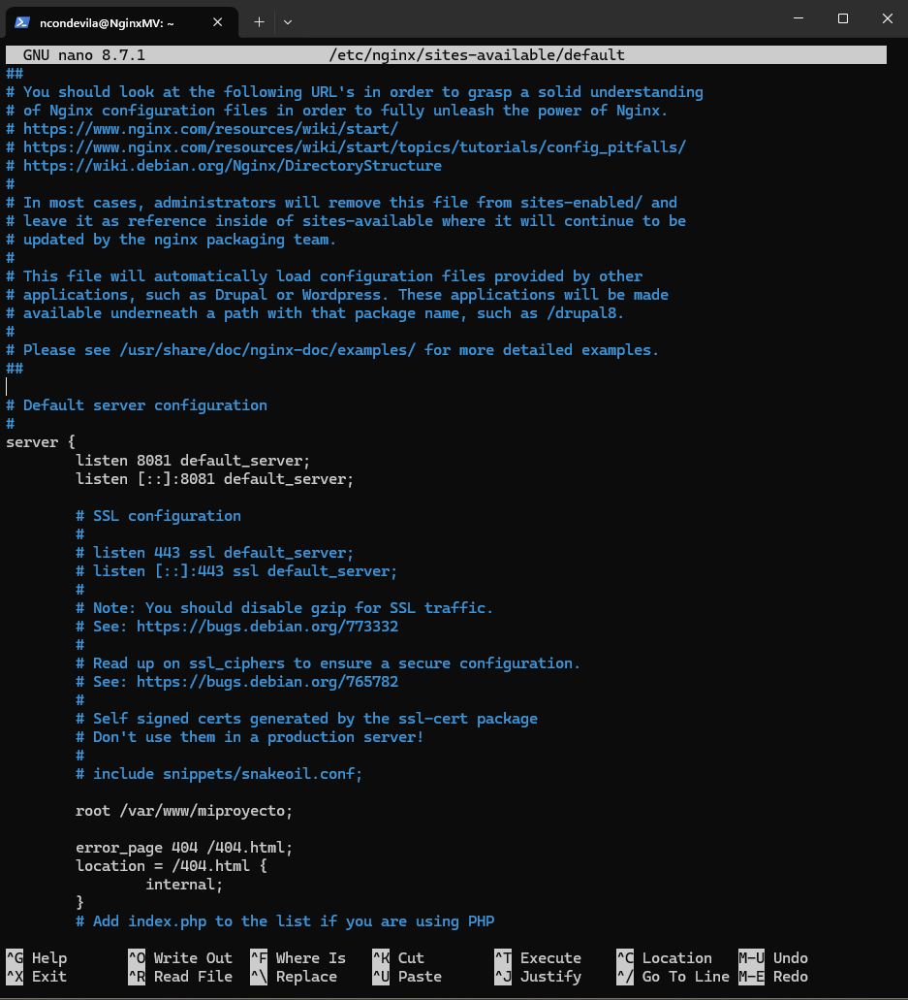  
<small>_Archivo de configuración de Nginx con error_page._</small>

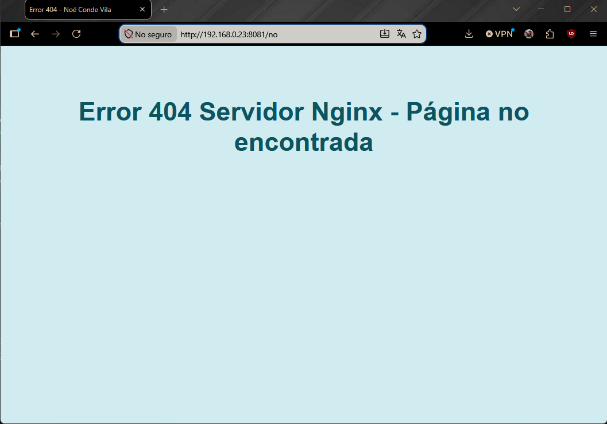  
<small>_Comprobación desde el navegador en Nginx._</small>

<div style="page-break-after: always;"></div>

---

## Ejercicio 2

> _Modifica los servidores para que el sitio web por defecto escuche en el 8989. Incluye capturas de los ficheros de configuración y navegador._

_(Juanra, en les captures del navegador apareixen ports 8080 8081 dels html dels exercicis anteriors, no faxes cas la url esta be)_

### Apache

Para cambiar el puerto en Apache hay que hacerlo en dos archivos.

En el archivo `ports.conf` cambiamos la directiva `Listen` al puerto 8089:
```bash
sudo nano /etc/apache2/ports.conf
# → Listen 8089
```

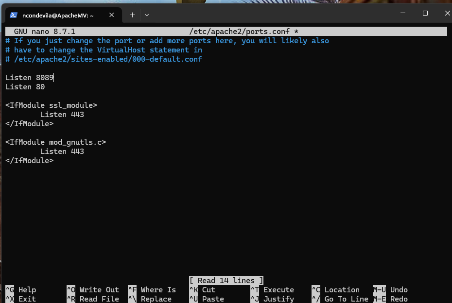  
<small>_Archivo de configuración con el puerto 8089._</small>

Y en el archivo `default` que modificamos en anteriores ejercicios, cambiamos la primera línea de `VirtualHost` al puerto 8089:

```bash
sudo nano /etc/apache2/sites-available/000-default.conf
# → <VirtualHost *:8089>
```

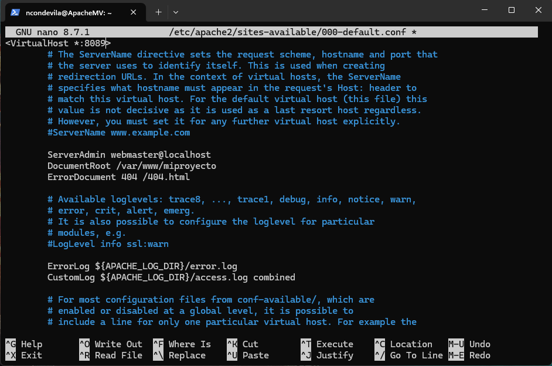  
<small>_Archivo de configuración con el puerto 8089._</small>

```bash
# Verificar y recargar Apache
sudo apachectl configtest && sudo systemctl reload apache2
```

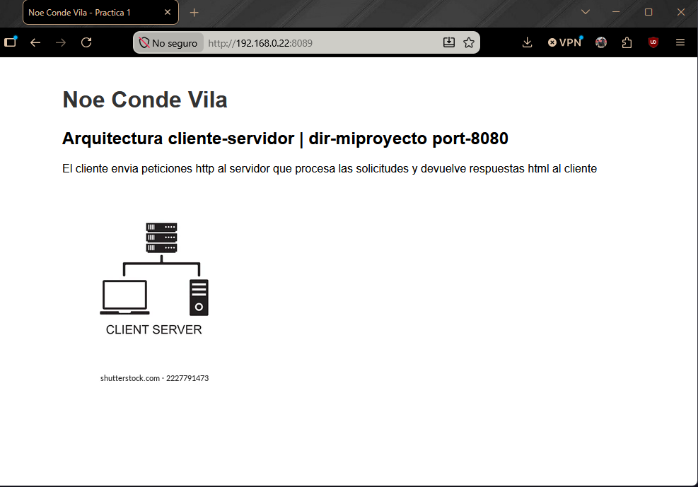  
<small>_Comprobación desde el navegador en el puerto 8089._</small>

### Nginx

En Nginx tan solo hace falta modificar el archivo `default` cambiando ambas líneas de `listen` al puerto 8089 y recargar el servidor.

```bash
sudo nano /etc/nginx/sites-available/default
# → listen 8089 default_server;
# → listen [::]:8089 default_server;
```

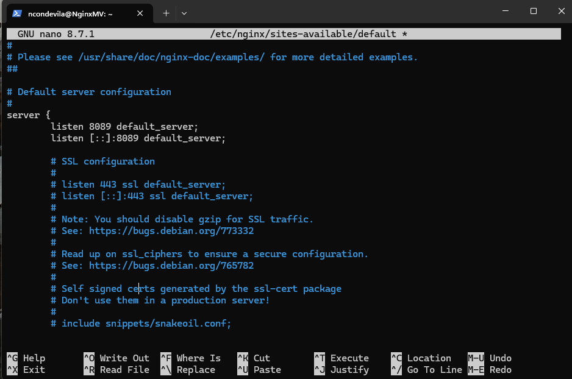  
<small>_Archivo de configuración default con el puerto 8089._</small>

```bash
# Verificar y recargar Nginx
sudo nginx -t && sudo systemctl reload nginx
```

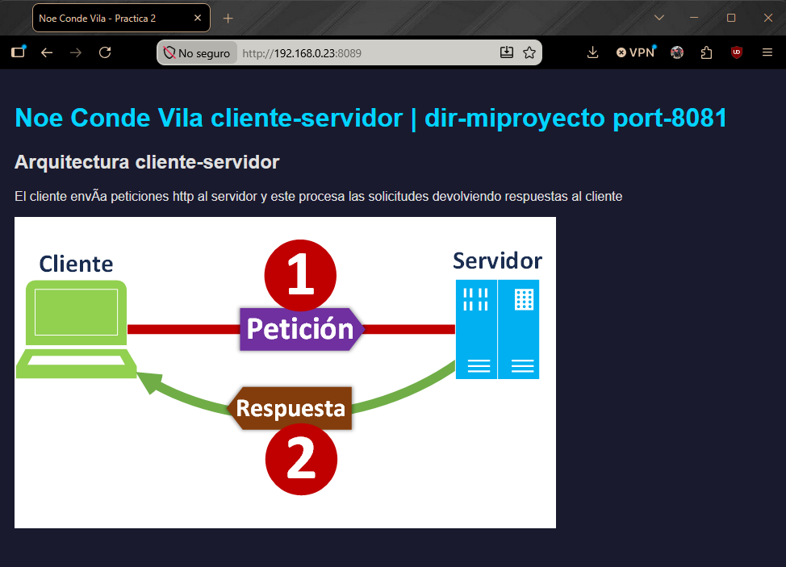  
<small>_Comprobación desde el navegador en el puerto 8089._</small>

<div style="page-break-after: always;"></div>

---

## Ejercicio 3

> _Sobre la NginxMV, investiga cómo podemos tener varios sitios (al menos 2) en la misma máquina e impleméntalo. Haz un tutorial paso a paso con capturas de los pasos seguidos y muestra capturas de los sitios funcionando simultáneamente._

### Paso 1: Creación de carpetas y permisos

Creamos dos carpetas para cada sitio y les otorgamos permisos de lectura y escritura al usuario `www-data`.

```bash
sudo mkdir -p /var/www/sitio1 /var/www/sitio2
sudo chown -R www-data:www-data /var/www/sitio1 /var/www/sitio2
ls -l /var/www/
```

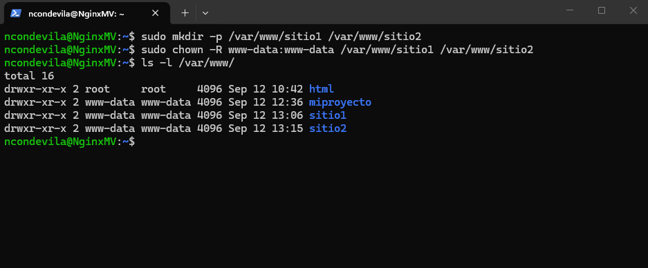  
<small>_Creación de directorios y asignación de permisos._</small>

### Paso 2: Creación de los index.html

Creamos los index con `sudo nano`, aquí uso `cat` para mostrarlos ya que se crearon previamente.

```bash
sudo nano /var/www/sitio1/index.html
sudo nano /var/www/sitio2/index.html
# Verificar contenido:
cat /var/www/sitio1/index.html
cat /var/www/sitio2/index.html
```

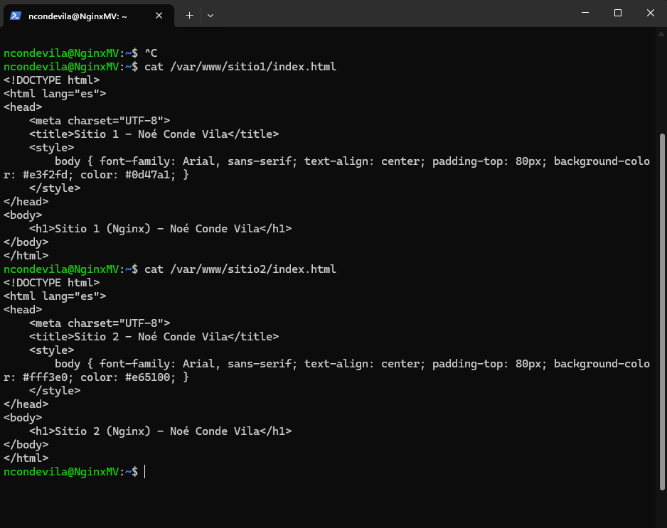  
<small>_Creación y contenido de los archivos index.html._</small>

### Paso 3: Ficheros de configuración en sites-available

Creamos los archivos de configuración en `sites-available`, definimos la escucha en el puerto 80 para HTTP, asignamos el nombre del sitio con `server_name`, el directorio raíz, el index y los logs de error y acceso.

```bash
sudo nano /etc/nginx/sites-available/sitio1.conf
# server { listen 80; server_name sitio1.daw; root /var/www/sitio1; ... }
sudo nano /etc/nginx/sites-available/sitio2.conf
# server { listen 80; server_name sitio2.daw; root /var/www/sitio2; ... }
# Verificar:
cat /etc/nginx/sites-available/sitio1.conf
cat /etc/nginx/sites-available/sitio2.conf
```

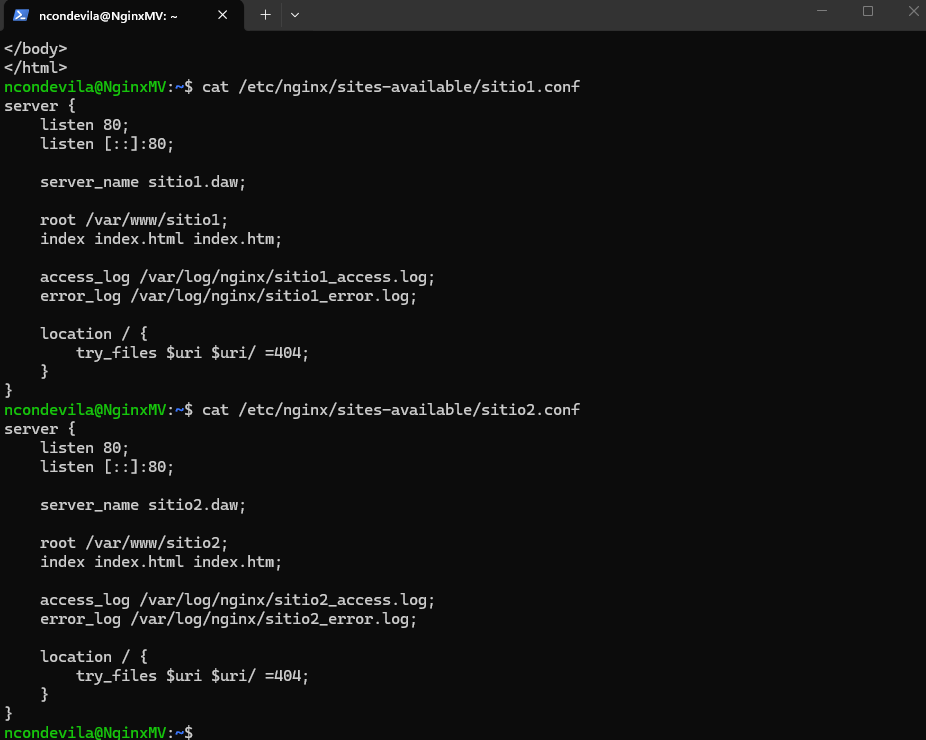  
<small>_Archivos de configuración de los sitios._</small>

### Paso 4: Habilitar sitios (enlaces simbólicos)

En Nginx los sitios se habilitan creando enlaces desde `sites-available` a `sites-enabled` con el comando `ln -sf`.

```bash
sudo ln -sf /etc/nginx/sites-available/sitio1.conf /etc/nginx/sites-enabled/
sudo ln -sf /etc/nginx/sites-available/sitio2.conf /etc/nginx/sites-enabled/
ls -l /etc/nginx/sites-enabled/
```

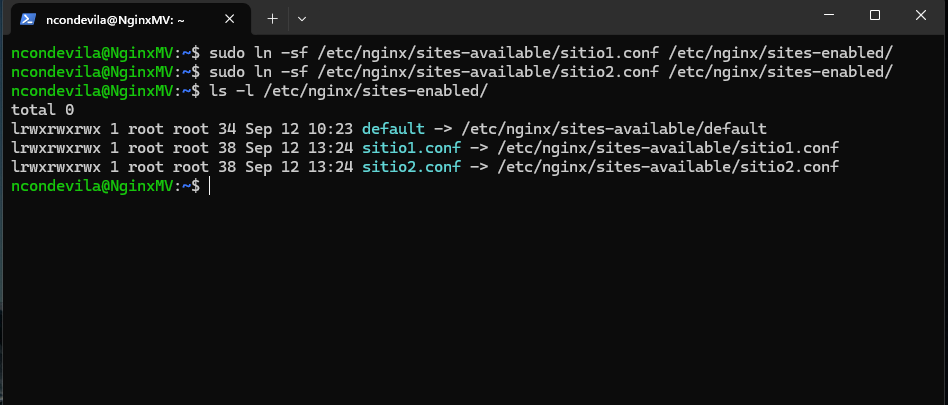  
<small>_Enlaces simbólicos en sites-enabled._</small>

### Paso 5: Comprobación por terminal (curl)

Comprobamos la configuración y la sintaxis, y hacemos un curl a ambos después de resetear el servidor.

```bash
sudo nginx -t
sudo systemctl reload nginx
curl -H "Host: sitio1.daw" http://localhost
curl -H "Host: sitio2.daw" http://localhost
```

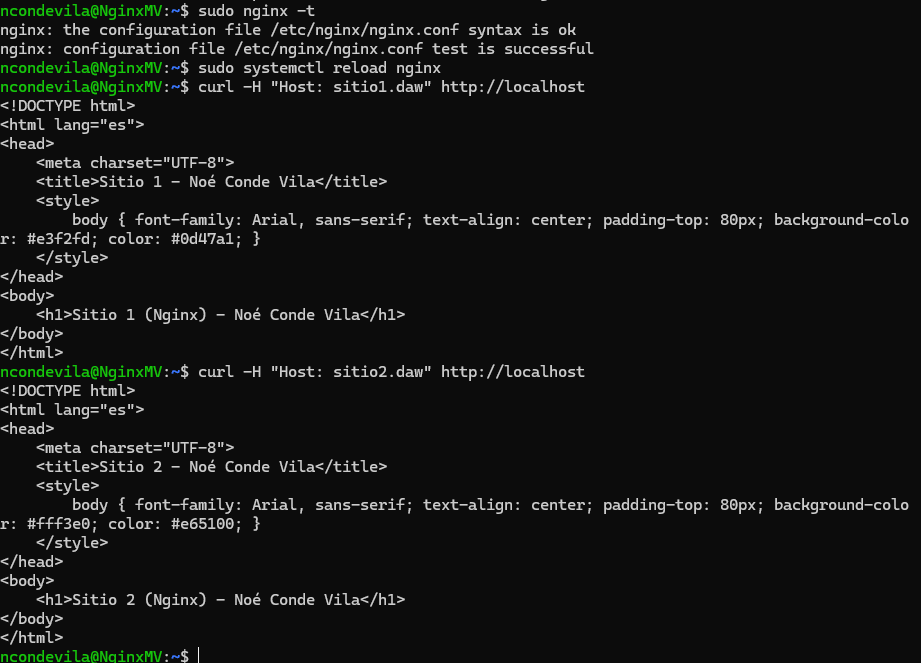  
<small>_Comprobación mediante curl._</small>

### Paso 6: Comprobación en navegador (sitios simultáneos)

Para este paso debemos añadir las IP en el archivo `hosts` de nuestra máquina anfitrión, entrando al Bloc de notas como administrador y accediendo a la ruta `C:\Windows\System32\drivers\etc\`, donde añadimos las IP y sus URL en el archivo hosts.

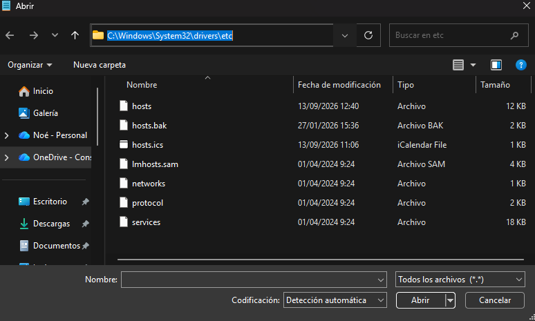  
<small>_Apertura del archivo hosts en el Bloc de notas como administrador._</small>

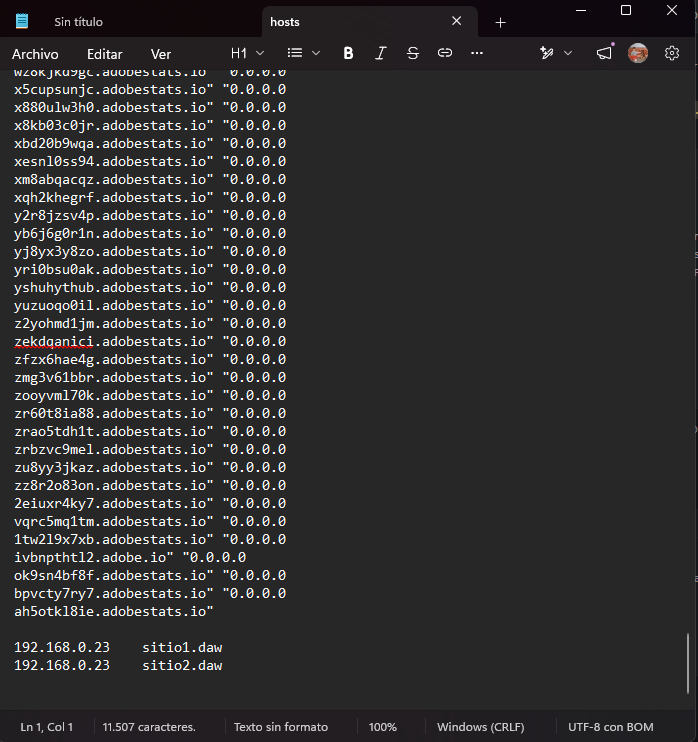  
<small>_Líneas añadidas al archivo hosts con las IP y dominios de los sitios._</small>

Finalmente comprobamos en el navegador ambas direcciones:

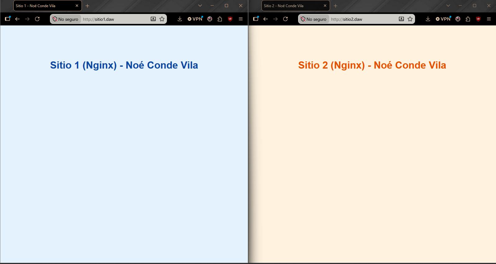  
<small>_Ambos sitios funcionando simultáneamente desde el navegador._</small>

<div style="page-break-after: always;"></div>

---

## Ejercicio 4

> _Sobre una de las máquinas virtuales (es indiferente cuál), instala el otro servidor, configura multisitio en ambos de tal forma que en la misma máquina virtual tengamos dos servidores funcionando de forma simultánea (Apache + Nginx), teniendo cada uno de ellos más de un sitio funcionando (como mínimo tendremos 4 sitios en la misma máquina). Incluye capturas de los pasos más importantes con una mini-explicación de los pasos que has dado, así como capturas de los ficheros de configuración involucrados y de las webs funcionando de forma simultánea._

Para crear un servidor adicional al existente que ya ocupa el puerto 80 con los sitios.daw de ejercicios anteriores, tenemos que cambiar los puertos del nuevo servidor.

Una vez instalado y comprobado que ambos funcionan simultáneamente, accedemos al archivo de configuración de puertos para cambiar el 80 por defecto a 8181 y 8282.

```bash
# Verificar que ambos servicios están activos
sudo systemctl status nginx apache2 --no-pager
```

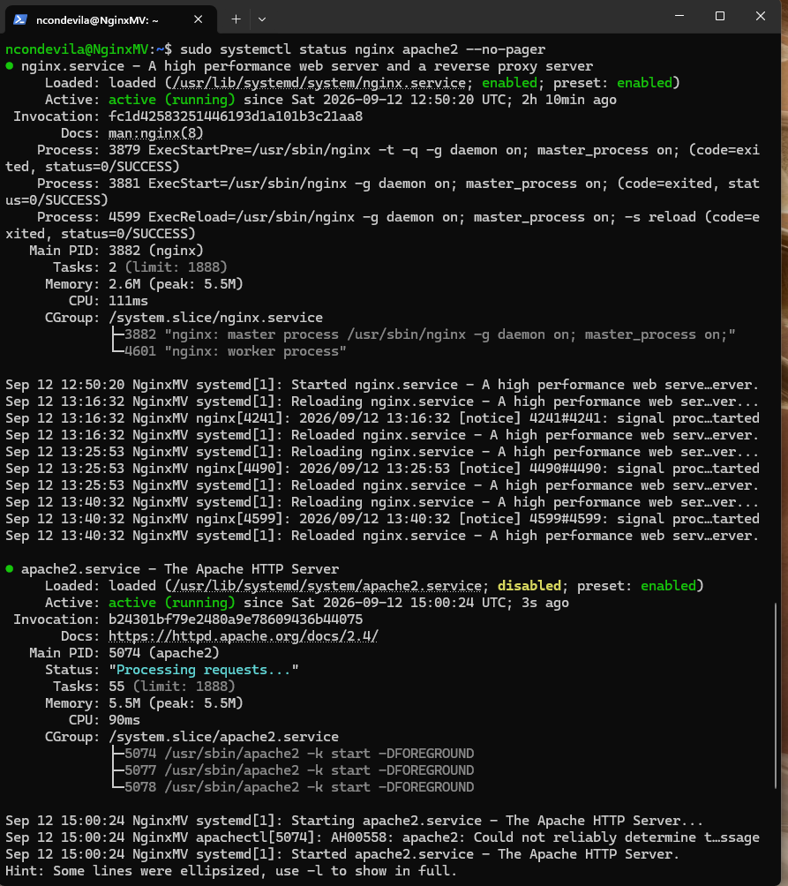  
<small>_Servicios Nginx y Apache activos simultáneamente en la misma máquina._</small>

```bash
# Cambiar puertos de Apache para evitar conflicto con Nginx (puerto 80)
sudo nano /etc/apache2/ports.conf
# → Listen 8181
# → Listen 8282
```

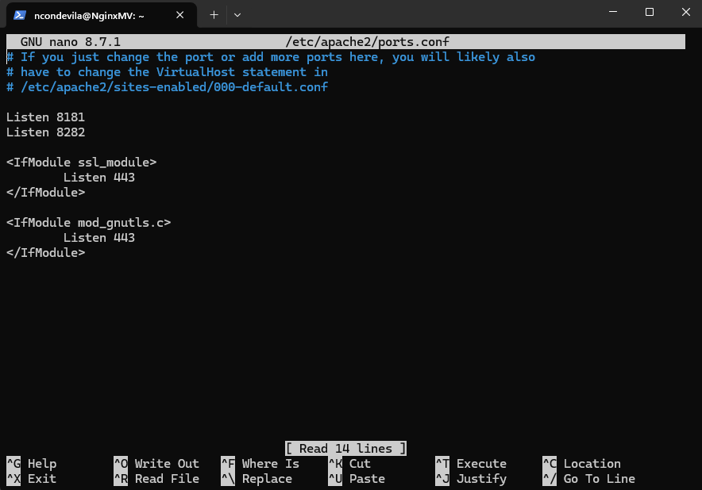  
<small>_Configuración de ports.conf en Apache con los puertos 8181 y 8282 para evitar conflictos con Nginx._</small>

Una vez tenemos los puertos, creamos los directorios y sus correspondientes index, dando los permisos necesarios a ambos. En la captura se puede ver que tenemos los dos nuevos apache, los dos 'sitio' de nginx y 'miproyecto' de ejercicios anteriores.

```bash
sudo mkdir -p /var/www/apache1 /var/www/apache2
sudo chown -R www-data:www-data /var/www/apache1 /var/www/apache2
sudo nano /var/www/apache1/index.html
sudo nano /var/www/apache2/index.html
ls -l /var/www/
```

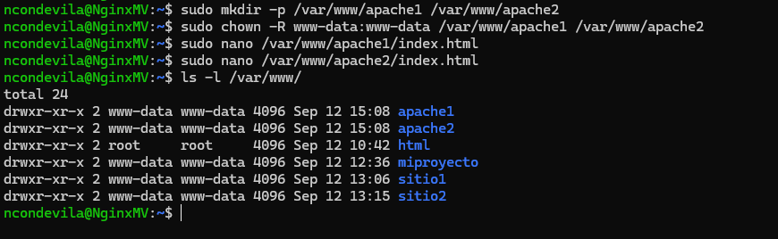  
<small>_Creación de directorios y páginas web index.html para Apache._</small>

El siguiente paso es crear los archivos de configuración para ambos apache cada uno con su propio puerto, abajo en la captura se puede ver las dos configuraciones, con 'a2ensite' los activamos y con 'configtest' comprobamos que esté todo correcto.

```bash
sudo nano /etc/apache2/sites-available/apache1.conf
# → <VirtualHost *:8181>  DocumentRoot /var/www/apache1
sudo nano /etc/apache2/sites-available/apache2.conf
# → <VirtualHost *:8282>  DocumentRoot /var/www/apache2
sudo a2ensite apache1.conf apache2.conf
sudo apachectl configtest
sudo systemctl reload apache2
# Verificar configuraciones:
cat /etc/apache2/sites-available/apache1.conf
cat /etc/apache2/sites-available/apache2.conf
```

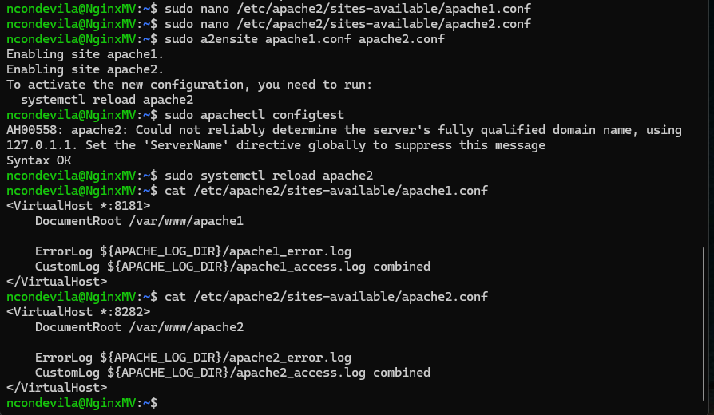  
<small>_Archivos de configuración de los VirtualHosts de Apache (apache1.conf y apache2.conf)._</small>

```bash
# Comprobar los 4 sitios respondiendo a la vez
curl -H "Host: sitio1.daw" http://localhost   # Nginx sitio1
curl -H "Host: sitio2.daw" http://localhost   # Nginx sitio2
curl http://localhost:8181                    # Apache 1
curl http://localhost:8282                    # Apache 2
```

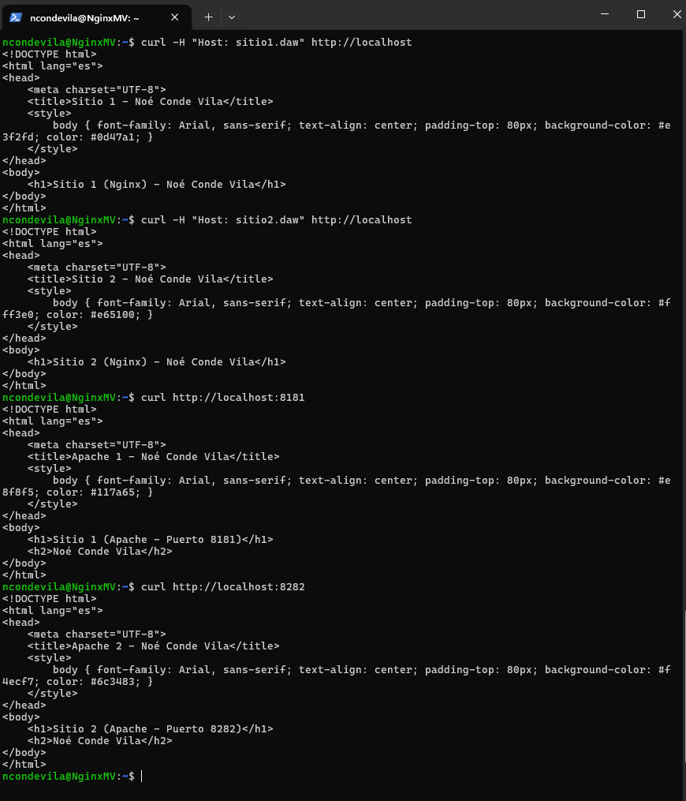  
<small>_Comprobación mediante curl de los 4 sitios respondiendo a la vez._</small>

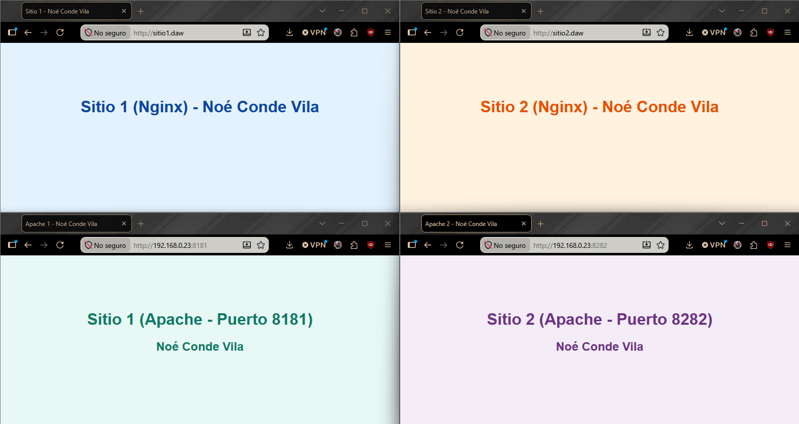  
<small>_Las 4 webs funcionando de forma simultánea desde el navegador._</small>

<div style="page-break-after: always;"></div>

---

## Ejercicio 5

> _A. Conéctate al servidor de Nginx por SSH desde la máquina anfitriona (u otra de la red). Añade capturas con la conexión correctamente realizada._  
> _B. Sube un fichero al servidor Nginx a través de FTP desde la máquina anfitriona (u otra de la red). Añade capturas con la transferencia correctamente realizada._

### A. Conexión SSH

Para poder conectarse con SSH primero hay que instalar el servicio en la MV. Aquí se muestra ya instalado porque en ejercicios anteriores ya he estado trabajando así.

```bash
# Instalar openssh-server en la MV Nginx
sudo apt install -y openssh-server
```

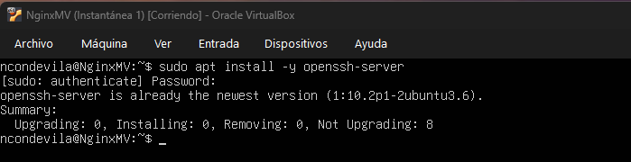  
<small>_Instalación y estado del servicio openssh-server en la máquina virtual._</small>

Accedemos con `ssh usuario@ip` desde PowerShell para comprobar que funciona.

```powershell
# Desde PowerShell en la máquina anfitrión:
ssh ncondevila@192.168.0.23
```

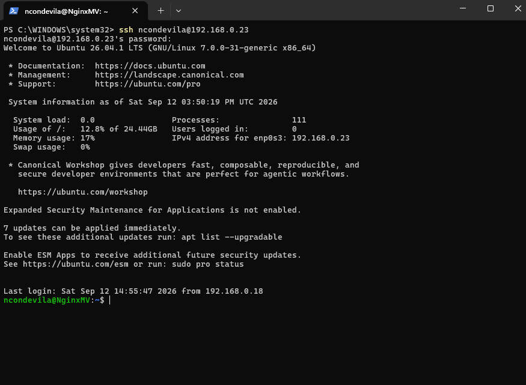  
<small>_Conexión SSH realizada desde PowerShell en la máquina anfitriona._</small>

### B. Transferencia FTP

En FileZilla accedemos con los mismos datos: nombre de usuario, IP, contraseña y puerto 22 correspondiente a SSH. Creamos un simple `.txt` y lo movemos a la carpeta de usuario de la MV por ejemplo.

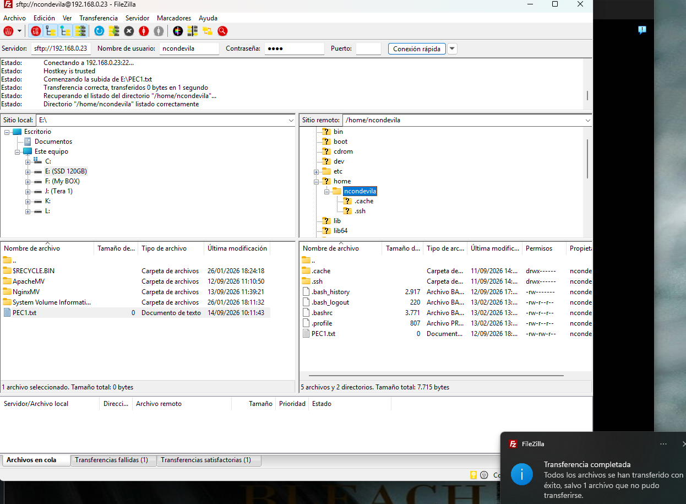  
<small>_Conexión y transferencia de archivo mediante FileZilla por protocolo SFTP._</small>

Comprobamos en terminal para asegurarnos de que el archivo se ha movido correctamente.

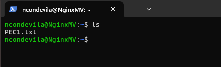  
<small>_Comprobación en la terminal del archivo transferido en el servidor._</small>
