<style>
  body {
    font-family: Arial, Helvetica, sans-serif;
    line-height: 1.45;
    color: #24292f;
    margin-bottom: 0 !important;
    padding-bottom: 0 !important;
  }
  /* Evitar líneas huérfanas o viudas en párrafos */
  p {
    margin: 4px 0 6px 0;
    orphans: 3;
    widows: 3;
  }
  /* Bloques de código completos sin partirse */
  pre, pre code {
    page-break-inside: avoid;
    break-inside: avoid;
  }
  /* Imágenes que no se corten entre páginas y tamaño nítido */
  img {
    max-width: 90%;
    max-height: 280px;
    object-fit: contain;
    display: block;
    margin: 8px auto 4px auto;
    border: 1px solid #d0d7de;
    border-radius: 4px;
    page-break-inside: avoid;
    break-inside: avoid;
  }
  /* Imagen de build ampliada para leer perfectamente las capas del terminal */
  .img-grande {
    max-height: 480px !important;
    max-width: 95% !important;
  }
  /* Pie de foto: siempre unido a la imagen precedente sin saltar solo de página */
  small {
    display: block;
    text-align: center;
    color: #57606a;
    margin-bottom: 12px;
    font-size: 0.85em;
    page-break-before: avoid;
    break-before: avoid;
    page-break-inside: avoid;
    break-inside: avoid;
  }
  /* Títulos: nunca al final de una página sin contenido */
  h1, h2, h3, h4 {
    page-break-after: avoid;
    break-after: avoid;
  }
  /* Cuadros de enunciado: fluidos para que no fuercen saltos de página vacíos */
  blockquote {
    background-color: #f6f8fa;
    border-left: 4px solid #0969da;
    padding: 6px 12px;
    margin: 8px 0 10px 0;
    color: #57606a;
  }
  /* Reglas de impresión / PDF */
  @media print {
    body {
      margin-bottom: 0 !important;
      padding-bottom: 0 !important;
    }
    *:last-child {
      margin-bottom: 0 !important;
      padding-bottom: 0 !important;
    }
    pre, img, small {
      page-break-inside: avoid;
      break-inside: avoid;
    }
    h1, h2, h3, h4 {
      page-break-after: avoid;
      break-after: avoid;
    }
  }
  /* Explicaciones y respuestas del alumno en azul marino oscuro y discreto */
  .resp {
    color: #1e3a8a;
  }
  @media print {
    .resp {
      color: #1e3a8a !important;
      -webkit-print-color-adjust: exact;
      print-color-adjust: exact;
    }
  }
</style>

# DAW — Unidad 2: PEC 2

**Alumno:** Noé Conde Vila  
**Curso:** 2º DAW (Semipresencial) — IES Maria Enríquez  
**Asignatura:** Despliegue de Aplicaciones Web  
**Profesor:** Juanra Collado

---

## Ejercicio 1 (4 pts)

> **Clona el siguiente repositorio:**  
> `https://github.com/JuanraCollado/octopus-underwater-app`  
> **Modifica el fichero Dockerfile para que la imagen esté basada en un servidor Apache sobre SO Alpine.**  
> **Al igual que hicimos con nginx, forzaremos que el Dockerfile realice la copia de los ficheros de la carpeta static a la carpeta principal del servidor Apache.**  
> **Una vez todo configurado, crearemos y arrancaremos la aplicación mapeando el puerto 80 del contenedor a nuestro puerto 9090.**  
> **Añade capturas de:**
>
> - _Fichero Dockerfile_
> - _Creación del contenedor_
> - _Contenedor corriendo (docker ps y ejecutándose en navegador)_

### 1.1. Modificación del Dockerfile

```dockerfile
FROM httpd:alpine
COPY static /usr/local/apache2/htdocs/
```

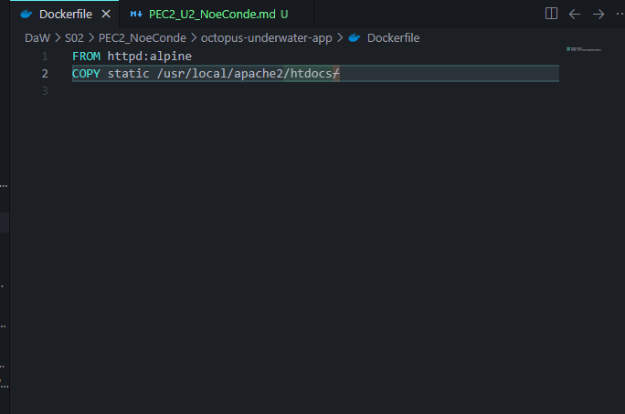
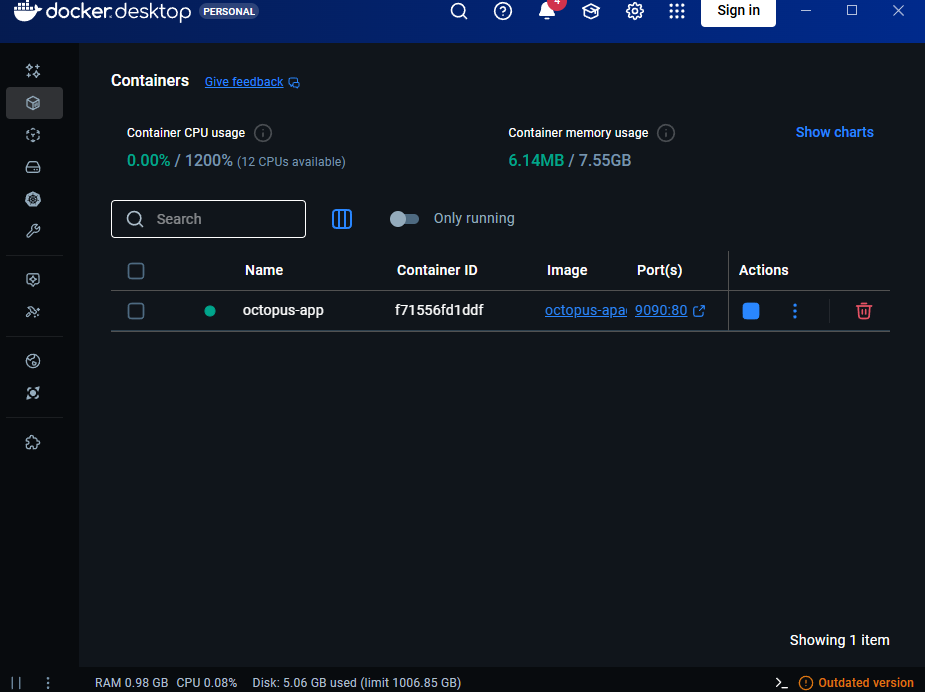

### 1.2. Construcción de la imagen y creación del contenedor
- <span class="resp">Preparamos la imagen con build -t para que se guarde con el nombre octopus-apache y . para que lo haga en la misma carpeta.</span>
- <span class="resp">Arrancamos el contenedor con run -d para que lo haga en segundo plano, redireccionamos puertos con -p, nombramos el contenedor con --name y usamos la imagen preparada.</span>
```bash
cd octopus-underwater-app
docker build -t octopus-apache .
docker run -d -p 9090:80 --name octopus-app octopus-apache
```

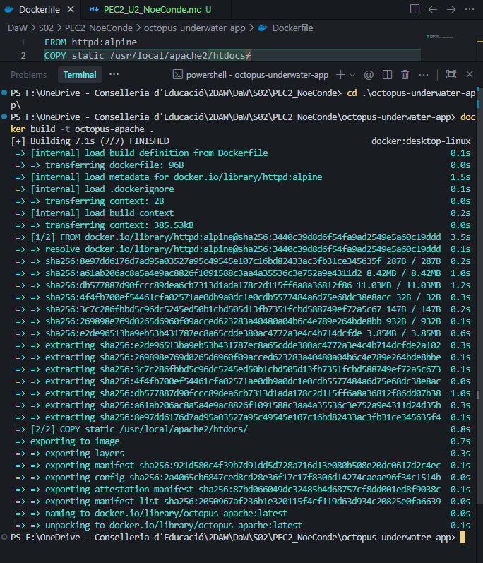
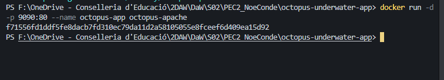

### 1.3. Contenedor corriendo y acceso web

```bash
docker ps
```

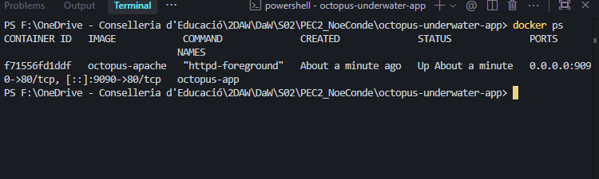
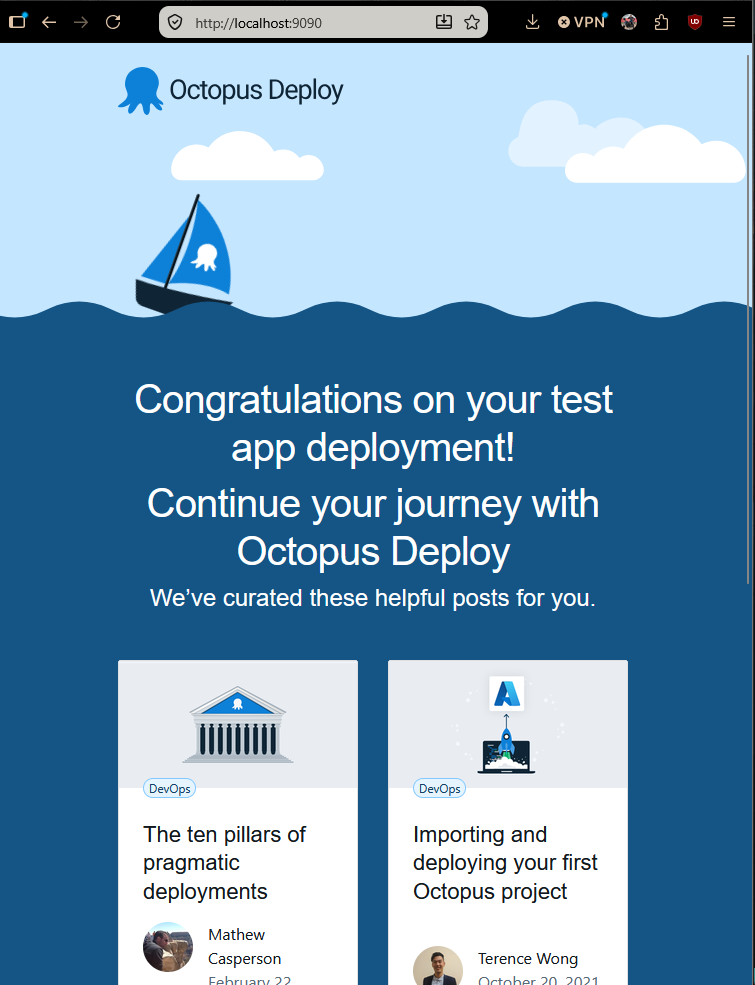

---

## Ejercicio 2 (6 pts)

> **Vas a montar un pequeño entorno web en Docker compuesto por dos contenedores (lee hasta el final antes de empezar):**
>
> - _Un contenedor con MySQL que guarde sus datos en un volumen persistente._
> - _Un contenedor con phpMyAdmin que te permita administrar la base de datos desde el navegador._
> - _Puedes utilizar las siguientes imágenes o buscar las tu por tu cuenta: mysql:5.7 y phpmyadmin/phpmyadmin_
>
> **Hay que cumplir las siguientes condiciones:**
>
> - _Deberás crear tu red Docker._
> - _phpMyAdmin debe estar accesible en el puerto 8080 del host._
> - _MySQL debe utilizar un volumen con nombre para almacenar sus datos, de forma que la información no se pierda al borrar el contenedor._
> - _Accede desde el navegador a phpmyadmin (localhost:8080) y comprueba la conectividad con la base de datos creando una tabla._
>
> **Añade las siguientes capturas:**
>
> - _Creación de ambos contenedores_
> - _Ejecución de docker ps con ambos contenedores lanzados._
> - _Comprobación de conectividad mediante exec_
> - _Comprobación de conectividad mediante acceso por web_

### 2.1. Creación de red y volumen

- <span class="resp">Creamos la red y el volumen:</span>

```bash
docker network create red-pec2
docker volume create mysql_data
```

### 2.2. Creación de los contenedores MySQL y phpMyAdmin

- <span class="resp">Creamos y arrancamos el contenedor, conectamos a la red, conectamos al volumen, establecemos la contraseña del root, la base de datos y usamos la imagen de mysql:5.7</span>

```bash
docker run -d --name mysql-server --network red-pec2 -v mysql_data:/var/lib/mysql -e MYSQL_ROOT_PASSWORD=rootpassword -e MYSQL_DATABASE=pec2_db mysql:5.7
```

- <span class="resp">Creamos el segundo contenedor, conectamos a la red, redireccionamos el puerto, le damos conexión a la bd y usamos la imagen de phpmyadmin</span>

```bash
docker run -d --name phpmyadmin-web --network red-pec2 -p 8080:80 -e PMA_HOST=mysql-server phpmyadmin/phpmyadmin
```

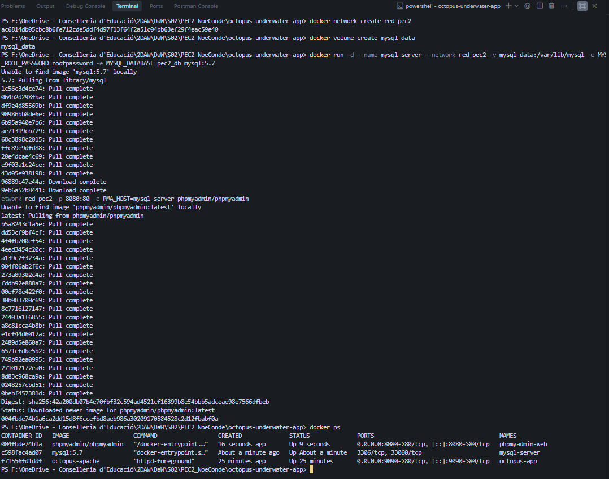

- <span class="resp">Finalmente con docker ps vemos ambos activos además del octopus lanzado anteriormente.</span>

### 2.4. Comprobación de conectividad mediante exec

<p class="resp">Como la imagen de phpmyadmin viene totalmente vacía para ser muy ligera, la mayoría de funciones debemos instalarlas con el comando de ping.</p>

```bash
docker exec -it phpmyadmin-web apt update
docker exec -it phpmyadmin-web apt install -y iputils-ping
```

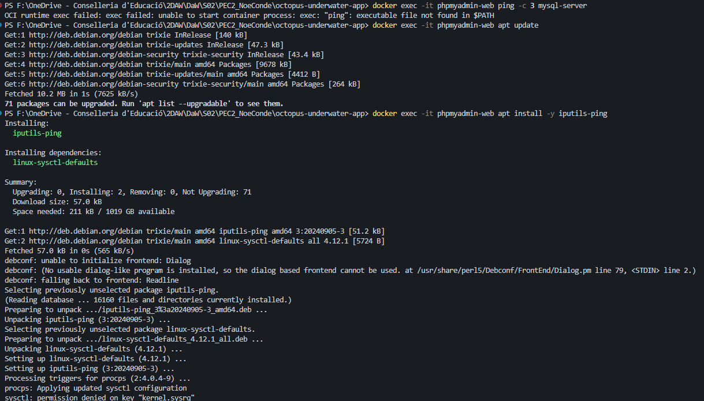

- <span class="resp">Ping a MySQLServer</span>

```bash
docker exec -it phpmyadmin-web ping -c 3 mysql-server

```

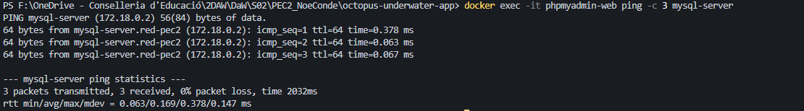

### 2.5. Comprobación de conectividad mediante acceso por web
- <span class="resp">Acceso a phpmyadmin por localhost, se puede ver la bd pec2 creada.</span>
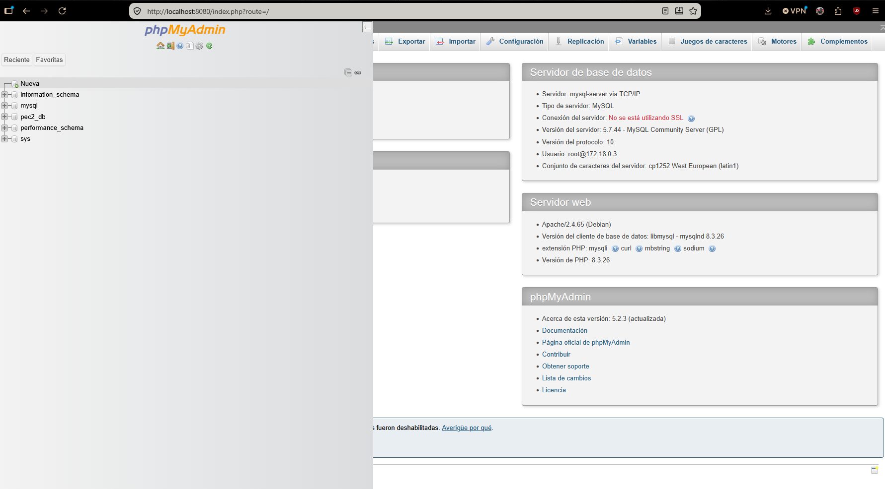
- <span class="resp">Se crea la una tabla llamada Alumnos con cuatro campos simples.</span>
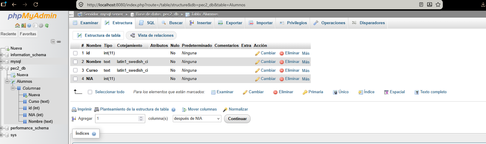
