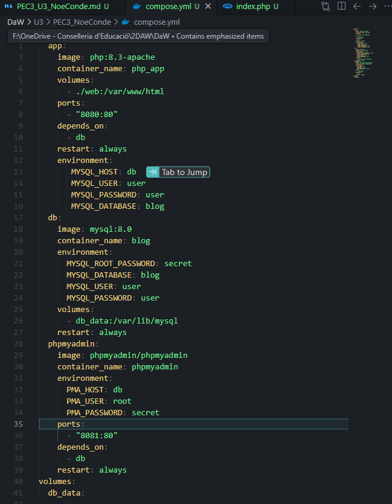
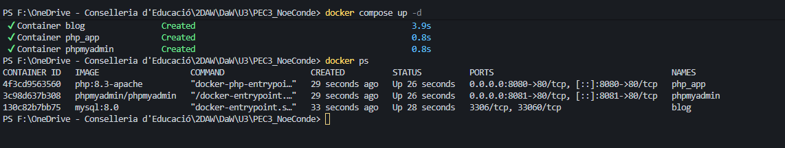
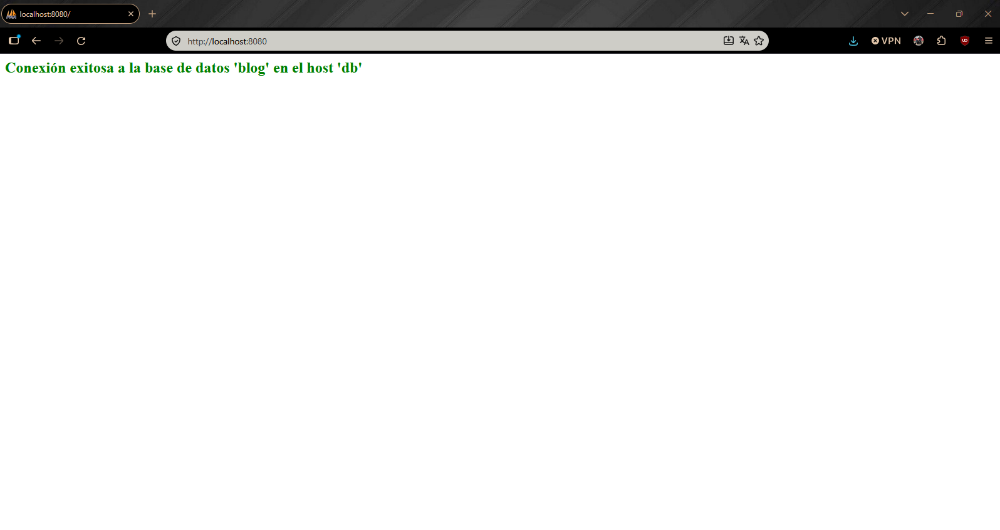
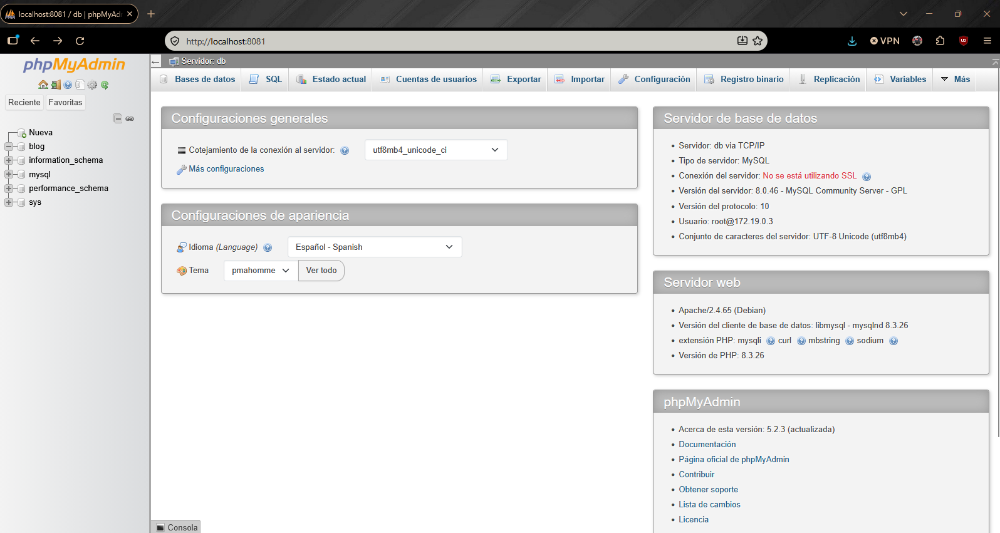
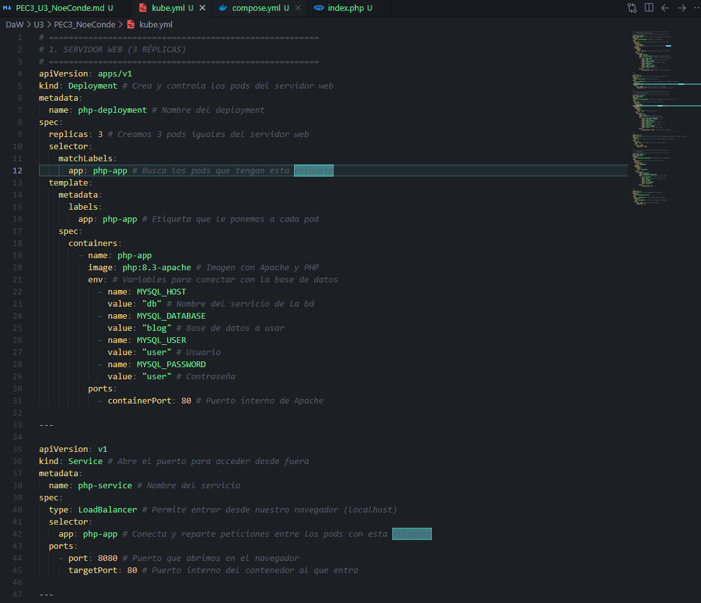
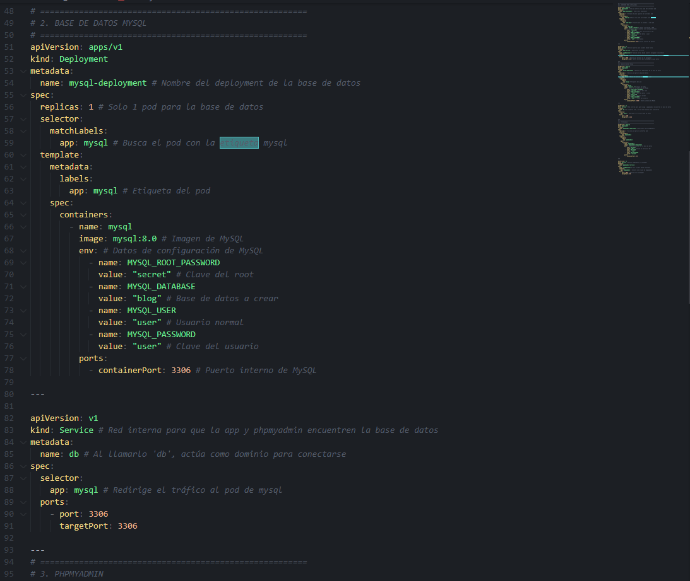
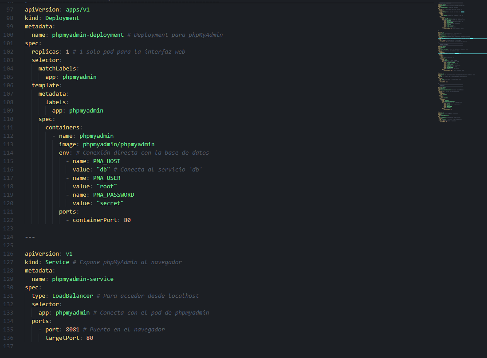
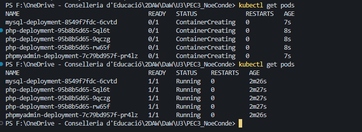

<style>
  body {
    font-family: Arial, Helvetica, sans-serif;
    line-height: 1.45;
    color: #24292f;
    margin-bottom: 0 !important;
    padding-bottom: 0 !important;
  }
  /* Evitar líneas huérfanas o viudas en párrafos */
  p {
    margin: 4px 0 6px 0;
    orphans: 3;
    widows: 3;
  }
  /* Bloques de código completos sin partirse */
  pre, pre code {
    page-break-inside: avoid;
    break-inside: avoid;
  }
  /* Imágenes que no se corten entre páginas y tamaño nítido */
  img {
    max-width: 90%;
    max-height: 520px;
    object-fit: contain;
    display: block;
    margin: 8px auto 4px auto;
    border: 1px solid #d0d7de;
    border-radius: 4px;
    page-break-inside: avoid;
    break-inside: avoid;
  }
  /* Imagen ampliada para capturas especialmente altas */
  .img-grande {
    max-height: 650px !important;
    max-width: 95% !important;
  }
  /* Pie de foto: siempre unido a la imagen precedente */
  small {
    display: block;
    text-align: center;
    color: #57606a;
    margin-bottom: 12px;
    font-size: 0.85em;
    page-break-before: avoid;
    break-before: avoid;
    page-break-inside: avoid;
    break-inside: avoid;
  }
  /* Títulos: nunca al final de una página sin contenido */
  h1, h2, h3, h4 {
    page-break-after: avoid;
    break-after: avoid;
  }
  /* Cuadros de enunciado: fluidos */
  blockquote {
    background-color: #f6f8fa;
    border-left: 4px solid #0969da;
    padding: 6px 12px;
    margin: 8px 0 10px 0;
    color: #57606a;
  }
  /* Reglas de impresión / PDF */
  @media print {
    body {
      margin-bottom: 0 !important;
      padding-bottom: 0 !important;
    }
    *:last-child {
      margin-bottom: 0 !important;
      padding-bottom: 0 !important;
    }
    pre, img, small {
      page-break-inside: avoid;
      break-inside: avoid;
    }
    h1, h2, h3, h4 {
      page-break-after: avoid;
      break-after: avoid;
    }
  }
  /* Explicaciones y respuestas del alumno en azul marino oscuro */
  .resp {
    color: #1e3a8a;
  }
  @media print {
    .resp {
      color: #1e3a8a !important;
      -webkit-print-color-adjust: exact;
      print-color-adjust: exact;
    }
  }
</style>

# DAW — Unidad 3: PEC 3

**Alumno:** Noé Conde Vila  
**Curso:** 2º DAW (Semipresencial) — IES Maria Enríquez  
**Asignatura:** Despliegue de Aplicaciones Web  
**Profesor:** Juanra Collado

---

## Ejercicio 1

> **Dado el siguiente fichero de docker-compose, explica con tus palabras qué contiene de forma general. Después punto por punto explica qué se está configurando. Puedes hacerlo sobre el propio código en formato de comentarios.**
>
> ```yaml
> services: #Servicios a ejecutar
>   app: # Primer sercivio app con imagen apache y php
>     image: php:8.3-apache
>     container_name: php_app
>     volumes: #Volumenes local:docker
>       - ~/Escritorio/projectesPHP:/var/www/html
>     ports: #Puertos
>       - "8080:80"
>     depends_on: #Depende de la bd para iniciar reiniciandose siempre
>       - db
>     restart: always
>   db: # Segundo servicio bd, imagen y nombre contenedor
>     image: mysql:8.0
>     container_name: mysql_db
>     environment: # Variables de entorno
>       MYSQL_ROOT_PASSWORD: rootpass
>       MYSQL_DATABASE: testdb
>       MYSQL_USER: user
>       MYSQL_PASSWORD: userpass
>     volumes: #Volumenes local:docker
>       - db_data:/var/lib/mysql
>     restart: always
>   phpmyadmin: # Tercer servicio phpmyadmin, imagen y nombre contenedor
>     image: phpmyadmin/phpmyadmin
>     container_name: phpmyadmin
>     environment: #Variables de entorno
>       PMA_HOST: db
>       PMA_USER: root
>       PMA_PASSWORD: rootpass
>     ports: #Puertos
>       - "8081:80"
>     depends_on: #Depende de la bd para iniciar reiniciandose siempre
>       - db
>     restart: always
> volumes: #Volumen local para la persistencia de datos de la bd
>   db_data:
> ```

### 1.1. Explicación general

<p class="resp"> Este compose contiene tres servicios. Una app de servidor php en apache accesible por el puerto 8080, una base de datos mysql sin puerto accesible desde fuera, con variables de entorno ya declaradas así nos ahorramos algo de configuración una vez creado, y por último un servidor phpmyadmin para poder acceder y consultar la bd por el puerto 8081, tambíen con sus variables de entorno declaradas para la conexión, y por último un volumen local para la persistencia de datos de la bd.</p>

## Ejercicio 2

> **Monta un entorno web completo utilizando Docker Compose, simulando un pequeño entorno de desarrollo profesional.**
>
> **El objetivo es desplegar tres servicios que trabajen juntos:**
>
> **a. Un servidor web Apache con PHP, que servirá una aplicación escrita en PHP desde la carpeta local `./web`.**
>
> - El servidor debe ser accesible desde el navegador a través del puerto 8080.
> - Los archivos de la aplicación deben residir en tu máquina, de forma que cualquier cambio en los archivos PHP se vea reflejado al instante en el contenedor.
>
> **b. Una base de datos MySQL, que almacenará los datos de la aplicación.**
>
> - La base de datos se llamará `blog`.
> - Debe tener una contraseña de root (`secret`) y conservar los datos entre ejecuciones usando un volumen persistente.
>
> **c. phpMyAdmin, para administrar la base de datos.**
>
> - Debe ser accesible desde el navegador en el puerto 8081.
>
> _La aplicación PHP deberá conectarse a la base de datos y mostrar un mensaje indicando si la conexión ha sido exitosa o no._
>
> _Cuando todo funcione, podrás acceder a:_
>
> - _Tu aplicación en http://localhost:8080_
> - _phpMyAdmin en http://localhost:8081_
>
> **Añade capturas de:**
>
> - _Fichero compose.yml_
> - _`docker ps` donde se vean los tres contenedores funcionando simultáneamente._
> - _Capturas de acceso a través del navegador a web y phpMyAdmin (dentro)._

### `compose.yml`



<small>Fichero compose.yml</small>

### `Arranque y verificación`


<small>docker ps — tres contenedores corriendo simultáneamente</small>

### `Acceso web`


<small>Acceso web puerto 8080</small>

### `Acceso a phpMyAdmin`


<small>Acceso phpMyAdmin puerto 8081</small>

---

## Ejercicio 3

> **Utilizando Kubernetes, crea la misma infraestructura que en el ejercicio anterior y lánzalo teniendo 3 pods para la parte del servidor web.**
>
> _Añade una captura de los pods funcionando y del manifiesto yml._

### `Manifiesto kube.yml`





<small>Manifiesto kube.yml</small>

### `Pods en funcionamiento`


<small>3 pods del servidor web Creating i después en Running mas el mysql y phpmyadmin</small>
