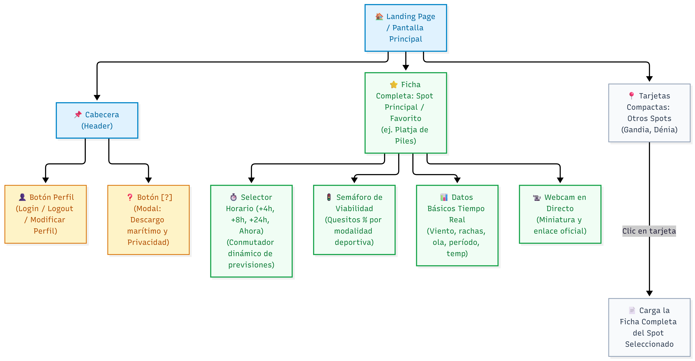
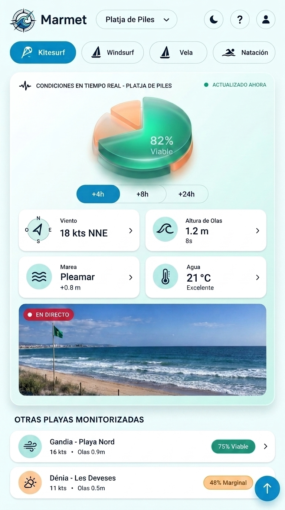
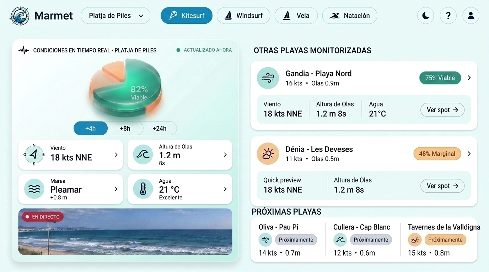
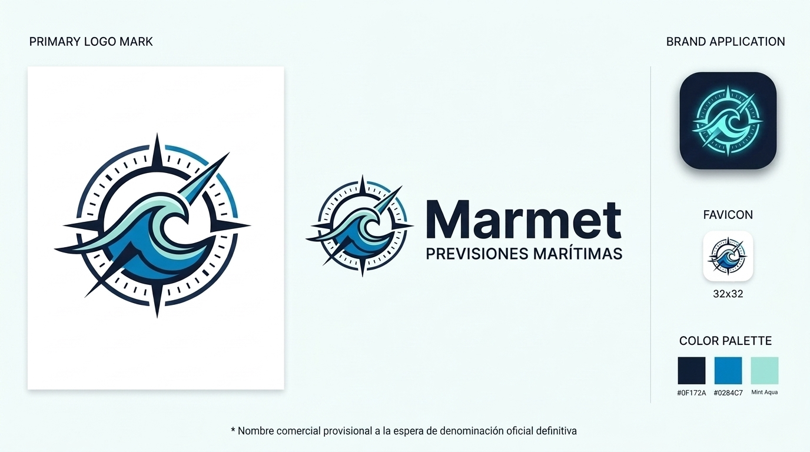
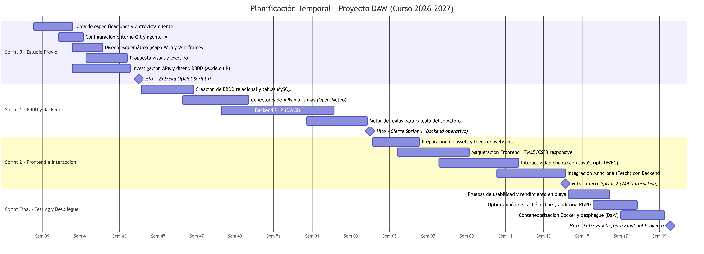
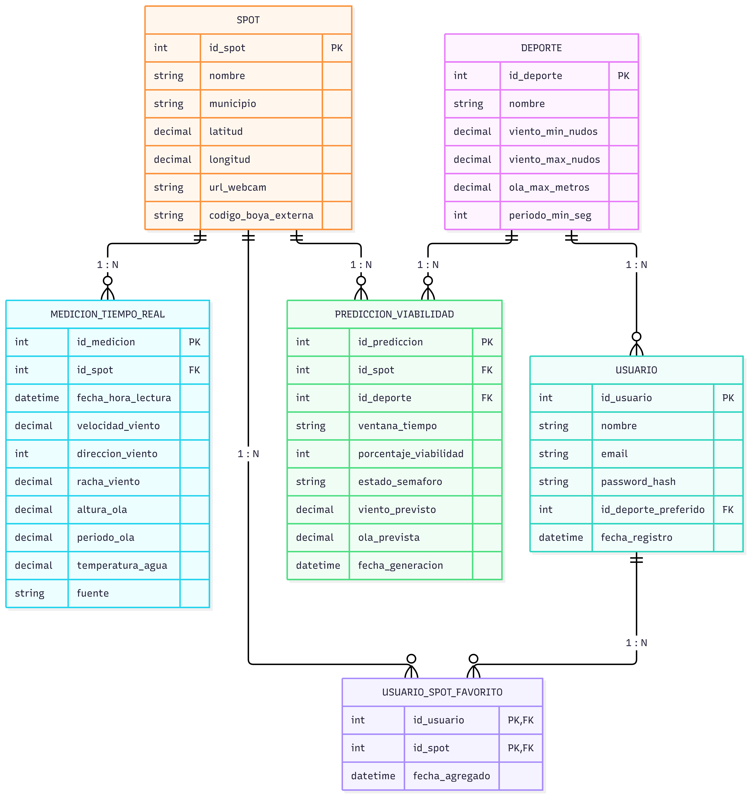

  
DOCUMENTO DE ESTUDIO PREVIO DE LA INTERFAZ Y MEMORIA TÉCNICA

  
Proyecto de Previsión Marítima Inteligente para Deportes Náuticos

  

    

      
<strong>Módulo:</strong> Projecte Intermodular (PIM)

      
<strong>Actividad:</strong> Sprint 0 — Entregable Final de Sprint

      
<strong>Ciclo:</strong> 2º DAW (Semipresencial)

      
<strong>Centro:</strong> IES Maria Enríquez (Gandia)

    

    

      
<strong>Alumno:</strong> Noé Conde Vila

      
<strong>Profesor / Cliente:</strong> Quique Savall

      
<strong>Fecha de entrega:</strong> 8 de noviembre de 2026

    

  

  <h3>Índice de Contenidos</h3>
  <ul>
    <li><strong>PARTE 1: DOCUMENTO DE ESTUDIO PREVIO DE LA INTERFAZ</strong>
      <ul>
        <li><a href="#sec-1-1">1.1. Introducción al Proyecto y Público Objetivo</a></li>
        <li><a href="#sec-1-2">1.2. Listado de Especificaciones del Sistema (RF, RT, RV, RL)</a></li>
        <li><a href="#sec-1-3">1.3. Arquitectura de Información y Diseño Esquemático</a>
          <ul>
            <li><a href="#sec-1-3-mapa">1.3.1. Mapa Web y Navegación</a></li>
            <li><a href="#sec-1-3-mobile">1.3.2. Wireframes: Landing Page (Versión Móvil)</a></li>
            <li><a href="#sec-1-3-pc">1.3.3. Wireframes: Landing Page (Versión PC)</a></li>
          </ul>
        </li>
        <li><a href="#sec-1-4">1.4. Propuesta Visual e Identidad de Marca</a>
          <ul>
            <li><a href="#sec-1-4-referencias">1.4.1. Referencias e Inspiración Visual</a></li>
            <li><a href="#sec-1-4-colores">1.4.2. Paleta de Colores y Justificación</a></li>
            <li><a href="#sec-1-4-tipografia">1.4.3. Tipografías e Iconografía</a></li>
            <li><a href="#sec-1-4-logo">1.4.4. Propuesta de Logotipo</a></li>
          </ul>
        </li>
        <li><a href="#sec-1-5">1.5. Planificación y Estimación Temporal (Diagrama de Gantt)</a></li>
      </ul>
    </li>
    <li><strong>PARTE 2: ANEXO CONSOLIDADO DEL SPRINT 0</strong>
      <ul>
        <li><a href="#sec-2-1">2.1. Preparación de la Entrevista y Recopilación de Especificaciones</a>
          <ul>
            <li><a href="#sec-2-1-guion">2.1.1. Guion y Preparación Previa de la Entrevista</a></li>
            <li><a href="#sec-2-1-specs">2.1.2. Especificaciones Consolidadas del Sistema</a></li>
          </ul>
        </li>
        <li><a href="#sec-2-2">2.2. Repositorio de Control de Versiones e Integración con IA</a>
          <ul>
            <li><a href="#sec-2-2-repo">2.2.1. Estructura y Parámetros del Repositorio Git</a></li>
            <li><a href="#sec-2-2-ia">2.2.2. Asistencia del Agente IA en el Entorno de Desarrollo</a></li>
          </ul>
        </li>
        <li><a href="#sec-2-3">2.3. Fuentes de Datos Marítimas y Modelo de Base de Datos</a>
          <ul>
            <li><a href="#sec-2-3-datos">2.3.1. Referencias y Análisis de Datos (API, JSON, CSV)</a></li>
            <li><a href="#sec-2-3-tablas">2.3.2. Vistas de las Tablas de la Base de Datos (MySQL)</a></li>
            <li><a href="#sec-2-3-er">2.3.3. Esquema del Diseño Entidad-Relación (Modelo ER)</a></li>
          </ul>
        </li>
      </ul>
    </li>
  </ul>

<h2 id="sec-parte-1">PARTE 1: DOCUMENTO DE ESTUDIO PREVIO DE LA INTERFAZ</h2>

<h3 id="sec-1-1">1.1. Introducción al Proyecto y Público Objetivo</h3>

La práctica de deportes náuticos en la costa de la Safor y la Marina Alta (kitesurf, wingfoil, windsurf, vela ligera o natación en aguas abiertas) depende críticamente del viento y el mar. Actualmente, los deportistas consultan múltiples fuentes independientes (Windy, AEMET, boyas) con tablas numéricas densas y difíciles de interpretar en la playa bajo el sol. A petición de <strong>Quique Savall</strong> (<em>Dunes Kite Piles / Gandia Surf</em>), esta aplicación web centraliza mediciones reales de boyas oficiales y previsiones matemáticas abiertas (Open-Meteo), traduciendo las condiciones en un <strong>semáforo visual de viabilidad (verde, amarillo y rojo)</strong> representado mediante un indicador circular porcentual («quesito») que cambia de color para <strong>Piles, Gandia y Dénia</strong>.

<strong>Público objetivo prioritario:</strong>

<ul>
  <li><strong>Deportistas náuticos individuales:</strong> Practicantes que necesitan saber en 3 segundos si las condiciones justifican desplazarse y cargar el material.</li>
  <li><strong>Escuelas náuticas y monitores:</strong> Instructores que planifican cursos diarios y necesitan evaluar ventanas seguras a 4h, 8h y 24h.</li>
  <li><strong>Bañistas y usuarios costeros:</strong> Aficionados que desean consultar temperatura, estado del mar y webcams en directo.</li>
</ul>

<h3 id="sec-1-2">1.2. Listado de Especificaciones del Sistema</h3>

A continuación se presenta el resumen ejecutivo de las especificaciones acordadas en la fase de investigación inicial, categorizadas según su ámbito técnico y funcional:

<table>
  <thead>
    <tr>
      <th style="width: 25%;">Categoría</th>
      <th>Especificaciones Clave</th>
    </tr>
  </thead>
  <tbody>
    <tr>
      <td><strong>Funcionales (RF)</strong></td>
      <td>
        <strong>RF-01 a RF-07:</strong> Selección entre los 3 spots oficiales (Piles, Gandia, Dénia) &bull; Consulta de mediciones en tiempo real de boyas (viento, rachas, ola, período, temperatura) &bull; Selector de previsión horaria (+4h, +8h, +24h, Ahora) con refresco dinámico &bull; Indicador circular de viabilidad tipo semáforo (quesito dinámico de 0% a 100% que cambia de color según las condiciones) &bull; Acceso directo a webcams oficiales &bull; Guardado de spot y deporte favoritos &bull; Filtro de interfaz por disciplina.
      </td>
    </tr>
    <tr>
      <td><strong>Visuales (RV)</strong></td>
      <td>
        <strong>RV-01 a RV-04:</strong> Diseño <em>mobile-first</em> vertical en una sola columna para uso con una mano &bull; Indicadores circulares («quesitos») en lugar de tablas densas &bull; Alto contraste y tipografía nítida para lectura bajo luz solar intensa &bull; Código de color semafórico universal (Verde: óptimo, Amarillo: precaución, Rojo: peligroso).
      </td>
    </tr>
    <tr>
      <td><strong>Técnicos (RT)</strong></td>
      <td>
        <strong>RT-01 a RT-04:</strong> Aplicación web adaptable sin instalación &bull; Conexión con APIs públicas gratuitas (Open-Meteo Marine y Puertos del Estado) &bull; Capa de caché local en BBDD relacional MySQL/MariaDB (DWES) para evitar saturación de peticiones externas &bull; Invocación en backend a motor de evaluación de reglas deportivas.
      </td>
    </tr>
    <tr>
      <td><strong>Legales (RL)</strong></td>
      <td>
        <strong>RL-01 a RL-02:</strong> Botón de información <code>[?]</code> con aviso visible de descargo de responsabilidad marítima (datos meramente estimativos) &bull; Cumplimiento de RGPD: contraseñas cifradas en BCRYPT y minimización en la recogida de datos personales.
      </td>
    </tr>
  </tbody>
</table>

<h3 id="sec-1-3">1.3. Arquitectura de Información y Diseño Esquemático</h3>

<h4 id="sec-1-3-mapa">1.3.1. Mapa Web y Navegación</h4>

La estructura de la aplicación se ha concebido siguiendo el principio de <em>simplicidad, navegación plana y acceso inmediato</em> en una sola pantalla principal (Landing Page):

<ul>
  <li><strong>Cabecera (Header):</strong>
    <ul>
      <li><strong>Botón de Perfil de Usuario:</strong> Permite iniciar sesión, registrarse, cerrar sesión o modificar los datos del perfil (nombre, deporte preferido guardado en <code>USUARIO.id_deporte_preferido</code> y contraseña).</li>
      <li><strong>Botón de Información y Ayuda [?]:</strong> Abre una ventana modal flotante con el descargo legal de responsabilidad marítima, recomendaciones de seguridad en el agua y la política de privacidad (RGPD).</li>
    </ul>
  </li>
  <li><strong>Zona Principal (Spot Destacado / Favorito):</strong> Muestra directamente la ficha completa de tu playa predeterminada (ej. Platja de Piles):
    <ul>
      <li><strong>Indicador de viabilidad («Quesito» dinámico):</strong> Gráfico circular que actúa como propio semáforo visual; cambia dinámicamente de color (verde, amarillo o rojo) y muestra el porcentaje de idoneidad deportiva (del 0% al 100%) para la disciplina elegida.</li>
      <li><strong>Selector de previsión horaria:</strong> Botones de selección rápida (<em>Ahora / En vivo</em>, <em>+4 Horas</em>, <em>+8 Horas</em> y <em>+24 Horas</em>) que actualizan al instante tanto el semáforo como las cifras de la pantalla.</li>
      <li><strong>Datos básicos en tiempo real:</strong> Tarjetas con viento en nudos, dirección cardinal, rachas, altura de ola en metros, período en segundos y temperatura del agua/aire.</li>
      <li><strong>Webcam en directo:</strong> Miniatura con el estado visual real de la playa y botón para abrir la cámara a pantalla completa.</li>
    </ul>
  </li>
  <li><strong>Zona Inferior (Listado de Otros Spots):</strong> Tarjetas compactas de las restantes playas monitorizadas (Gandia, Dénia) mostrando su nombre, su etiqueta de viabilidad (semáforo en verde, amarillo o rojo con el porcentaje) y un botón para cargar su ficha completa en la vista principal.</li>
  <li><strong>Enlaces e Integraciones Externas (requisito DIW):</strong> El mapa web incorpora puntos de salida hacia plataformas externas clave:
    <ul>
      <li><strong>Portales oficiales de datos marítimos:</strong> Enlaces a la API abierta de <strong>Open-Meteo Marine</strong> y a los registros de boyas en tiempo real de <strong>Puertos del Estado (Portus)</strong>.</li>
      <li><strong>Feeds de cámaras web institucionales:</strong> Enlaces a las retransmisiones públicas de la <strong>Generalitat Valenciana (Turisme Comunitat Valenciana)</strong> y a la red <strong>Oceanía</strong>.</li>
      <li><strong>Escuelas náuticas colaboradoras:</strong> Enlaces institucionales a <strong>Dunes Kite Piles</strong> y <strong>Gandia Surf</strong> para la consulta de actividades y cursos.</li>
    </ul>
  </li>
</ul>

  
  
<em>Figura 1: Mapa web y flujo de navegación de la aplicación de previsiones marítimas (incluyendo enlaces externos).</em>

<h4 id="sec-1-3-mobile">1.3.2. Wireframes: Landing Page (Versión Móvil)</h4>

La versión móvil está pensada para usarse directamente a pie de playa con una sola mano, concentrando toda la información esencial en una sola página con desplazamiento vertical continuo:

<ul>
  <li><strong>Cabecera:</strong> Incorpora un logotipo y nombre ficticios a modo de ejemplo (<em>Marmet</em>, nombre provisional de maqueta previo a la identidad de marca definitiva), un menú desplegable para cambiar rápidamente de playa, el conmutador de tema claro/oscuro <code>[🌙]</code>, el botón de ayuda legal <code>[?]</code> y el acceso al perfil de usuario <code>[👤]</code>.</li>
  <li><strong>Filtro de disciplinas:</strong> Pestañas rápidas para alternar entre deportes (Kitesurf, Windsurf, Vela y Natación), recalculando al instante la idoneidad de las condiciones según las necesidades concretas de cada actividad.</li>
  <li><strong>Tarjeta principal del spot activo:</strong> Agrupa todo el contenido de la playa seleccionada en un único bloque visual para no dispersar la información: 
    <ul>
      <li><strong>Indicador de viabilidad («Quesito» dinámico):</strong> Gráfico circular central que actúa como propio semáforo visual; su color cambia a verde (óptimo), amarillo (precaución) o rojo (no viable) según el porcentaje calculado (0% a 100%), permitiendo saber si entrar al agua sin descifrar tablas meteorológicas.</li>
      <li><strong>Selector de pronóstico integrado:</strong> Botones compactos (<em>+4h</em>, <em>+8h</em>, <em>+24h</em>) para consultar cómo evolucionará el tiempo a lo largo del día sin abandonar la pantalla.</li>
      <li><strong>Mediciones en tiempo real:</strong> Cuatro tarjetas limpias con los datos clave del mar: fuerza y dirección del viento, altura del oleaje, estado de la marea y temperatura del agua.</li>
      <li><strong>Cámara web en directo:</strong> Ventana de vídeo panorámica para comprobar visualmente la orilla y la bandera de seguridad antes de desplazarse o entrar al mar.</li>
    </ul>
  </li>
  <li><strong>Otras playas monitorizadas (zona inferior):</strong> Al hacer scroll hacia abajo, se presentan tarjetas resumidas del resto de playas (Gandia, Dénia) con su nivel de viabilidad para poder comparar opciones cercanas, junto a un botón flotante en la esquina inferior derecha <code>[↑]</code> para regresar al inicio de forma inmediata.</li>
</ul>

  
  
<em>Figura 2: Prototipo esquemático de la interfaz móvil (Landing Page).</em>

<h4 id="sec-1-3-pc">1.3.3. Wireframes: Landing Page (Versión PC)</h4>

En pantallas de escritorio, el diseño aprovecha la mayor amplitud horizontal adoptando una distribución tipo <em>dashboard</em> a dos columnas que permite consultar toda la información simultáneamente sin necesidad de hacer desplazamiento vertical:

<ul>
  <li><strong>Barra de navegación integrada:</strong> Extiende la cabecera a lo ancho de la pantalla, incorporando el selector de playa, el filtro de deportes (kitesurf, windsurf, vela, natación) y los accesos rápidos de usuario, modo oscuro y ayuda en una sola línea.</li>
  <li><strong>Columna izquierda (Spot Activo):</strong> Mantiene la misma ficha estructurada que en el móvil, con el indicador de viabilidad («quesito» dinámico que cambia de color según el semáforo), los botones de previsión (<em>+4h</em>, <em>+8h</em>, <em>+24h</em>), las cuatro mediciones clave del mar y la ventana con la cámara web en directo.</li>
  <li><strong>Columna derecha (Comparativa y Expansión):</strong>
    <ul>
      <li><strong>Otras playas monitorizadas:</strong> Muestra las fichas resumidas de Gandia y Dénia con sus datos principales y un botón directo (<em>Ver spot</em>) para cambiar la playa activa con un solo clic.</li>
      <li><strong>Próximas playas:</strong> Tarjetas compactas de nuevos puntos de la costa en fase de estudio (Oliva, Cullera, Tavernes), dejando preparada la interfaz para futuras incorporaciones a la red de boyas.</li>
    </ul>
  </li>
</ul>

  
  
<em>Figura 3: Prototipo esquemático de la interfaz de escritorio (Landing Page PC).</em>

<h3 id="sec-1-4">1.4. Propuesta Visual e Identidad de Marca</h3>

<h4 id="sec-1-4-referencias">1.4.1. Referencias e Inspiración Visual</h4>

Para concebir la identidad visual y la experiencia de usuario, nos hemos basado en tres referencias concretas del ámbito digital y marítimo:

<ul>
  <li><strong>Windy.com (Visualización dinámica y rosa náutica):</strong> Referente internacional en la representación ágil del viento mediante partículas en movimiento. De esta plataforma adoptamos la orientación cardinal gráfica y la necesidad de asociar cada cifra de nudos a una dirección intuitiva (N, NE, E, SE...).</li>
  <li><strong>Apple Weather y Dribbble Marine Cards (Diseño modular de tarjetas):</strong> Adopción de la filosofía <em>card-based UI</em> con microtarjetas limpias, esquinas redondeadas y datos atómicos legibles. Al aislar cada dato (viento, ola, marea, temperatura) en un bloque individual de alto contraste, el usuario puede interpretarlo en menos de dos segundos bajo la luz del sol.</li>
  <li><strong>Portus — Puertos del Estado (Rigor de telemetría física):</strong> Portal oficial del sistema portuario estatal del que tomamos como referencia la precisión técnica de boyas de aguas profundas (Boya de Valencia y Cabo de la Nao), trasladando su terminología especializada (altura significante de ola, período de pico y rachas) a un formato accesible para el deportista.</li>
</ul>

<h4 id="sec-1-4-colores">1.4.2. Paleta de Colores y Justificación</h4>

La selección de colores se basa en los tonos naturales del entorno de playa y en un sistema de colores complementarios de énfasis para destacar el estado del mar de forma intuitiva, incluyendo las muestras visuales de cada tono:

<table>
  <thead>
    <tr>
      <th style="width: 25%;">Color / Tono</th>
      <th style="width: 18%;">Código HEX</th>
      <th>Función y Uso en la Aplicación</th>
    </tr>
  </thead>
  <tbody>
    <tr>
      <td><strong>Azul Océano</strong></td>
      <td><code>#0284C7</code></td>
      <td>Color principal de la marca, representando el mar y el cielo despejado. Se utiliza en botones de acción, filtros activos y detalles destacados.</td>
    </tr>
    <tr>
      <td><strong>Azul Marino Oscuro</strong></td>
      <td><code>#0F172A</code></td>
      <td>Color para textos, cifras y contornos de iconos, asegurando un contraste fuerte y nítido sobre fondos claros.</td>
    </tr>
    <tr>
      <td><strong>Blanco Niebla / Menta</strong></td>
      <td><code>#F0F9FF</code> / <code>#FFFFFF</code></td>
      <td>Fondo general y tarjetas limpias. Transmite luminosidad y frescura, facilitando la lectura en exteriores.</td>
    </tr>
    <tr>
      <td><strong>Verde Esmeralda</strong></td>
      <td><code>#10B981</code></td>
      <td>Color de énfasis para estados positivos. Se aplica en el indicador de buenas condiciones, en etiquetas de playas viables (ej. <em>75% Viable</em>) y en puntos de estado activo (<em>Actualizado ahora</em>).</td>
    </tr>
    <tr>
      <td><strong>Ámbar / Melocotón Pastel</strong></td>
      <td><code>#F59E0B</code> / <code>#FED7AA</code></td>
      <td>Color de énfasis cálido inspirado en la arena. Sirve para avisos de precaución o condiciones intermedias (ej. <em>48% Marginal</em>) para llamar la atención sin resultar alarmante.</td>
    </tr>
    <tr>
      <td><strong>Rojo Coral</strong></td>
      <td><code>#EF4444</code></td>
      <td>Color de énfasis para alertas críticas, condiciones no recomendadas para entrar al agua o avisos de emisión activa (<code>● EN DIRECTO</code>).</td>
    </tr>
  </tbody>
</table>

<h4 id="sec-1-4-tipografia">1.4.3. Tipografías e Iconografía</h4>

El uso principal de la aplicación será al aire libre, por lo que el diseño prioriza una <strong>lectura rápida incluso con reflejos de sol</strong> en la pantalla del móvil:

<ul>
  <li><strong>Tipografía sans-serif limpia:</strong> Se eligen fuentes modernas y directas como <strong>Inter</strong> u <strong>Outfit</strong>. Sus trazos limpios y números bien proporcionados permiten leer al segundo datos esenciales como los nudos de viento o la altura de las olas.</li>
  <li><strong>Iconos sencillos:</strong> Símbolos gráficos claros para cada magnitud (viento, olas, mareas, temperatura), de forma que el usuario identifique el dato de un vistazo antes de leer el texto.</li>
</ul>

  
Muestras visuales de jerarquía tipográfica e iconografía del sistema:

  
  

    Platja de Piles — 82% Viable (Garbí Térmico) 
    [Titular H1/H2 en Outfit / Inter Bold — 700]
  

  
  

    💨 18 kts NNE &nbsp;|&nbsp; 🌊 1.2 m 8s &nbsp;|&nbsp; 🌡️ 23 °C &nbsp;|&nbsp; 〰️ Pleamar +0.3m
     [Cifras numéricas de telemetría en semibold/monospace para máxima legibilidad rápida bajo el sol]
  

  
  

    <em>«Condiciones óptimas para la navegación de kitesurf y wingfoil. Viento térmico constante sin rachas peligrosas.»</em> 
    [Texto de cuerpo y recomendaciones operativas en Inter Regular — 400]
  

  
  

    <strong>Catálogo de iconos funcionales:</strong> &nbsp;
    💨 <code>Viento (nudos/rachas)</code> &nbsp;&bull;&nbsp; 
    🧭 <code>Orientación cardinal</code> &nbsp;&bull;&nbsp; 
    🌊 <code>Oleaje y período</code> &nbsp;&bull;&nbsp; 
    🌡️ <code>Temperatura agua/aire</code> &nbsp;&bull;&nbsp; 
    〰️ <code>Mareas</code> &nbsp;&bull;&nbsp; 
    📹 <code>Webcam en vivo</code> &nbsp;&bull;&nbsp; 
    ℹ️ <code>Aviso legal [?]</code>
  

<h4 id="sec-1-4-logo">1.4.4. Propuesta de Logotipo</h4>

Al concebir la imagen gráfica de la aplicación, se descartó deliberadamente utilizar siluetas de velas o tablas para no excluir modalidades como la natación en aguas abiertas. El elemento común que une a todas las disciplinas es el <strong>mar</strong>.

La propuesta gráfica fusiona dos conceptos esenciales de la plataforma en un único símbolo circular equilibrado y reconocible:

<ul>
  <li><strong>La rosa de los vientos / brújula náutica:</strong> Representa la precisión matemática, la orientación cardinal del viento (N, S, E, W) y la telemetría de las boyas marítimas.</li>
  <li><strong>La ola central en movimiento:</strong> Simboliza la fuerza del agua y el dinamismo deportivo, con su cresta orientada hacia el nordeste en la dirección predominante de navegación.</li>
</ul>

Al ser un símbolo puramente visual que no depende de ninguna letra ni inicial, es <strong>completamente independiente y único</strong>, manteniendo su vigencia y fuerza visual con independencia del nombre comercial que adopte finalmente la aplicación. Su geometría circular encaja de forma natural tanto en avatares y botones de cabecera como en el icono de la aplicación móvil y en el favicon de 32&times;32 píxeles.

  
  
<em>Figura 4: Propuesta de símbolo gráfico (rosa de los vientos con ola) y aplicaciones en icono móvil y favicon.</em>

<h3 id="sec-1-5">1.5. Planificación y Estimación Temporal (Diagrama de Gantt)</h3>

Para garantizar el cumplimiento de los plazos y mantener una coordinación estrecha entre los módulos técnicos del ciclo (DWES, DWEC, DaW y PIM), el desarrollo del proyecto se estructura en un calendario de <strong>30 semanas lectivas</strong> dividido en cuatro fases o <em>sprints</em> consecutivos:

<ul>
  <li><strong>Sprint 0: Estudio Previo y Diseño (Octubre - Noviembre 2026):</strong> Fase de definición inicial que abarca la toma de especificaciones con el cliente (Quique Savall), la configuración del repositorio y agentes de IA, el diseño de la arquitectura de información (mapa web y wireframes), la identidad visual y el estudio preliminar de APIs marítimas junto al modelo de datos.</li>
  <li><strong>Sprint 1: Base de Datos y Backend (Noviembre 2026 - Enero 2027):</strong> Implementación de la base de datos relacional MySQL, programación de los conectores con APIs externas de telemetría (Open-Meteo), desarrollo de la lógica de negocio en PHP y creación del motor de reglas para el cálculo del semáforo de viabilidad deportiva.</li>
  <li><strong>Sprint 2: Frontend e Interacción Cliente (Febrero - Abril 2027):</strong> Maquetación responsive (HTML5 y CSS3), programación de la interactividad en el navegador mediante JavaScript nativo, integración asíncrona (Fetch API) con los endpoints del backend y visualización de webcams e indicadores en tiempo real.</li>
  <li><strong>Sprint Final: Testing, Optimización y Despliegue (Abril - Mayo 2027):</strong> Pruebas de usabilidad en condiciones reales de playa, optimización de carga y consumo de datos móviles, contenedorización en Docker y puesta en producción en servidor web previa a la defensa final.</li>
</ul>

  
  
<em>Figura 5: Cronograma de planificación temporal del proyecto estructurado en cuatro fases a lo largo del curso 2026/2027.</em>

<h2 id="sec-parte-2">PARTE 2: ANEXO CONSOLIDADO DEL SPRINT 0</h2>

<h3 id="sec-2-1">2.1. Preparación de la Entrevista y Recopilación de Especificaciones</h3>

<h4 id="sec-2-1-guion">2.1.1. Guion y Preparación Previa de la Entrevista</h4>

Para la determinación inicial de requisitos se estructuró una sesión técnica de 45 minutos (14 de octubre de 2026 vía Teams) con <strong>Quique Savall</strong> (<em>Dunes Kite Piles / Gandia Surf</em>). El guion preparatorio organizó las preguntas en cinco bloques funcionales:

  <strong>Batería de Preguntas Técnicas Preparadas para la Entrevista:</strong>
  <ul style="margin: 4px 0; padding-left: 18px; font-size: 0.95em;">
    <li><strong>Perfil y destreza de usuarios:</strong> ¿Qué plataformas usan hoy (Windy, Windguru)? ¿Qué les frustra? ¿Tienen conocimiento para interpretar tablas de nudos y períodos o buscan una interfaz visual e intuitiva?</li>
    <li><strong>Telemetría y variables críticas:</strong> ¿Qué datos deciden si se entra al mar (viento, rachas, ola, período)? ¿Qué ventanas de previsión son prioritarias (+4h, +8h, +24h)?</li>
    <li><strong>Ergonomía visual y contexto:</strong> ¿Cómo garantizar la lectura bajo radiación solar intensa a pie de playa? ¿Conviene tipografía sans-serif limpia, cifras de gran escala y código semafórico?</li>
    <li><strong>Acceso y modelo de uso:</strong> ¿Qué contenidos deben ser abiertos sin registro frente a funciones de valor añadido (favoritos, personalización deportiva)?</li>
    <li><strong>Rol de la Inteligencia Artificial:</strong> ¿Qué se espera del motor de IA? Se acordó un motor condicional para traducir telemetría compleja a un indicador porcentual de viabilidad (0% a 100%).</li>
  </ul>

<h4 id="sec-2-1-specs">2.1.2. Especificaciones Consolidadas del Sistema</h4>

A partir de la sesión de requisitos se formalizaron <strong>29 especificaciones del sistema</strong>, priorizadas según el estándar MoSCoW para definir el alcance del Producto Mínimo Viable (MVP):

<ul>
  <li><strong>Requisitos Funcionales (RF-01 a RF-07):</strong> Selección de spot (Piles, Gandia, Dénia), consulta de viento y olas en tiempo real, selector de previsión a 4h/8h/24h, semáforo dinámico de viabilidad, webcams en directo y guardado de favoritos.</li>
  <li><strong>Requisitos Visuales (RV-01 a RV-04):</strong> Disposición vertical <em>mobile-first</em> para uso con una sola mano, indicadores circulares («quesitos») en lugar de tablas densas, alto contraste solar y código de colores universal (verde, amarillo, rojo).</li>
  <li><strong>Requisitos Técnicos (RT-01 a RT-04):</strong> Aplicación web adaptable sin instalación nativa, integración con APIs públicas gratuitas (Open-Meteo, Puertos del Estado), capa de persistencia en MySQL y motor de reglas procesado en backend.</li>
  <li><strong>Requisitos Legales (RL-01 y RL-02):</strong> Botón modal con aviso explícito de descargo de responsabilidad náutica y cifrado seguro de credenciales (BCRYPT) bajo normativa RGPD.</li>
</ul>

<h3 id="sec-2-2">2.2. Repositorio de Control de Versiones e Integración con IA</h3>

<h4 id="sec-2-2-repo">2.2.1. Estructura y Parámetros del Repositorio Git</h4>

Para la gestión del código, control de versiones y trazabilidad de los hitos de entrega, se configuró el repositorio centralizado en GitHub bajo las directrices docentes:

  Ficha Técnica del Repositorio Oficial en GitHub: 
  &bull; <strong>URL del Repositorio:</strong> <a href="https://github.com/ncondeviladev/2DAW.git" target="_blank">https://github.com/ncondeviladev/2DAW.git</a> 
  &bull; <strong>Rama principal:</strong> <code>main</code> (versiones consolidadas y verificadas tras cada hito oficial). 
  &bull; <strong>Estrategia de ramas por Sprint:</strong> Flujo de trabajo en ramas de ciclo (<code>Sprint0</code>, <code>Sprint1</code>, <code>Sprint2</code>) para el desarrollo aislado de tareas previas a su integración en <code>main</code>. 
  &bull; <strong>Colaborador docente vinculado:</strong> Juanra Collado (<code>jr.colladoesteve@edu.gva.es</code>). 
  &bull; <strong>Estructura modular:</strong> Directorio <code>PIM/Sprint0/</code> con la memoria técnica, carpeta <code>multimedia/</code> para diagramas y <code>README.md</code> descriptivo en raíz.

<h4 id="sec-2-2-ia">2.2.2. Asistencia del Agente IA en el Entorno de Desarrollo</h4>

Para optimizar la agilidad del desarrollo se integró un agente inteligente (Google Antigravity) como asistente de programación en el entorno local:

<ul>
  <li><strong>Gestión de credenciales y control manual del repositorio:</strong> Aunque el entorno dispone de credenciales configuradas mediante <strong>Git Credential Manager (GCM)</strong> y claves SSH en Windows para comunicarse con GitHub, por criterio metodológico y de seguridad el control de Git (creación de ramas, commits semánticos y sincronización remota con push y pull) se realiza de forma <strong>estrictamente personal y manual</strong>, evitando delegar automatizaciones autónomas en el agente para mantener un control íntegro y directo del histórico.</li>
  <li><strong>Flujo de Pair-Programming asistido:</strong> La asistencia de la IA se aprovecha como apoyo en tareas de desarrollo: redacción de borradores técnicos, modelado conceptual de datos y depuración de reglas de estilo CSS para salida PDF.</li>
  <li><strong>Supervisión humana continua:</strong> Cada fragmento sugerido o estructurado es analizado, corregido y validado manualmente antes de incorporarse al proyecto.</li>
</ul>

<h3 id="sec-2-3">2.3. Fuentes de Datos Marítimas y Modelo de Base de Datos</h3>

<h4 id="sec-2-3-datos">2.3.1. Referencias y Análisis de Datos (API, JSON, CSV)</h4>

Para fundamentar el motor de telemetría y predicción se investigaron tres fuentes públicas, contrastando su formato, protocolo de consulta y viabilidad operativa:

<table>
  <thead>
    <tr>
      <th style="width: 22%;">Fuente Pública</th>
      <th style="width: 20%;">Acceso / Protocolo</th>
      <th style="width: 22%;">Formato del Dato</th>
      <th>Variables y Rol en el Sistema</th>
    </tr>
  </thead>
  <tbody>
    <tr>
      <td><strong>Open-Meteo Marine</strong> <em>(open-meteo.com)</em></td>
      <td>API REST directa (sin API Key, hasta 10k req/día)</td>
      <td><strong>JSON directo</strong> (parseo nativo inmediato en PHP)</td>
      <td><strong>Fuente principal:</strong> Previsión horaria por coordenadas GPS (viento, rachas, altura de ola, período y dirección).</td>
    </tr>
    <tr>
      <td><strong>Puertos del Estado</strong> <em>(Portus / Boyas)</em></td>
      <td>Visor web y API interna (acceso público abierto)</td>
      <td><strong>Tablas CSV y JSON</strong> (exportaciones de series históricas)</td>
      <td><strong>Fuente de contraste:</strong> Telemetría física real registrada por las boyas costeras de Valencia y Gandia.</td>
    </tr>
    <tr>
      <td><strong>AEMET OpenData</strong> <em>(opendata.aemet.es)</em></td>
      <td>API REST con token (flujo en dos pasos)</td>
      <td><strong>JSON en dos llamadas</strong> (URL temporal de descarga)</td>
      <td><strong>Fuente complementaria:</strong> Avisos oficiales por temporal costero y fenómenos adversos en la Comunidad Valenciana.</td>
    </tr>
  </tbody>
</table>

<h4 id="sec-2-3-tablas">2.3.2. Vistas de las Tablas de la Base de Datos (MySQL)</h4>

La persistencia del backend se diseñó en MySQL normalizado en Tercera Forma Normal (3FN), articulado en 6 tablas relacionales:

<table>
  <thead>
    <tr>
      <th style="width: 24%;">Entidad / Tabla</th>
      <th style="width: 22%;">Clave Primaria (PK)</th>
      <th style="width: 24%;">Claves Foráneas (FK)</th>
      <th>Finalidad Operativa en el Sistema</th>
    </tr>
  </thead>
  <tbody>
    <tr>
      <td><code>USUARIO</code></td>
      <td><code>id_usuario (INT)</code></td>
      <td><code>id_deporte_preferido</code></td>
      <td>Cuentas de usuario, credenciales cifradas (BCRYPT) y preferencia de deporte.</td>
    </tr>
    <tr>
      <td><code>SPOT_PLAYA</code></td>
      <td><code>id_spot (INT)</code></td>
      <td><em>Ninguna</em></td>
      <td>Catálogo de playas (Piles, Gandia, Dénia) con coordenadas GPS y enlace a webcam.</td>
    </tr>
    <tr>
      <td><code>MEDICION_TIEMPO_REAL</code></td>
      <td><code>id_medicion (INT)</code></td>
      <td><code>id_spot</code></td>
      <td>Histórico de telemetría física tomada por boyas (viento, olas, racha, temperatura).</td>
    </tr>
    <tr>
      <td><code>PREDICCION_HORARIA</code></td>
      <td><code>id_prediccion (INT)</code></td>
      <td><code>id_spot, id_deporte</code></td>
      <td>Pronósticos a 4h, 8h y 24h con el porcentaje y estado del semáforo calculado.</td>
    </tr>
    <tr>
      <td><code>CONFIGURACION_DEPORTE</code></td>
      <td><code>id_deporte (INT)</code></td>
      <td><em>Ninguna</em></td>
      <td>Límites y rangos de viento y oleaje configurados para cada disciplina deportiva.</td>
    </tr>
    <tr>
      <td><code>USUARIO_SPOT_FAVORITO</code></td>
      <td><code>(id_usuario, id_spot)</code></td>
      <td><code>id_usuario, id_spot</code></td>
      <td>Tabla puente (relación N:M) para el acceso rápido a los spots guardados del usuario.</td>
    </tr>
  </tbody>
</table>

  <em>Integridad referencial:</em> Cláusulas <code>ON DELETE CASCADE</code> en tablas dependientes (mediciones, predicciones, favoritos) y <code>ON DELETE SET NULL</code> en preferencias de deporte.

<h4 id="sec-2-3-er">2.3.3. Esquema del Diseño Entidad-Relación (Modelo ER)</h4>

El siguiente esquema visual plasma la arquitectura relacional completa, las claves primarias (PK), claves foráneas (FK), tipos de datos y cardinalidades 1:N que sustentan la persistencia del sistema:

  
  
<em>Figura 6: Diagrama Entidad-Relación de la base de datos relacional (MySQL) para el motor de telemetría y reglas de viabilidad.</em>

