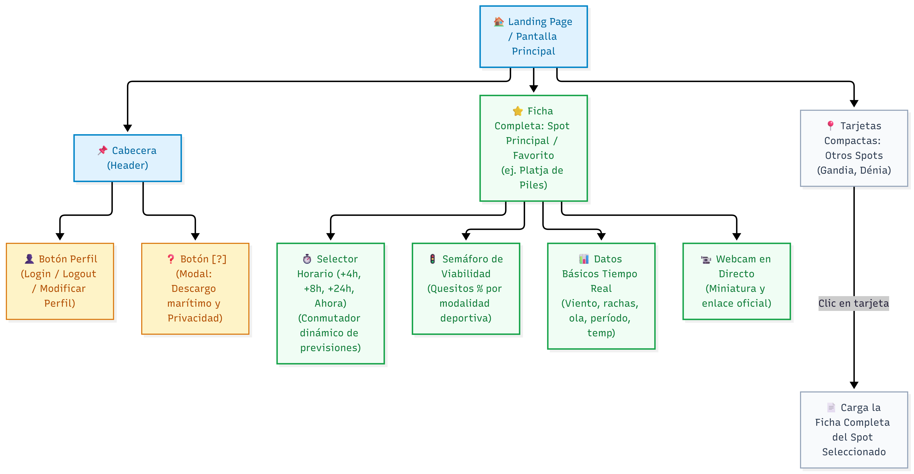
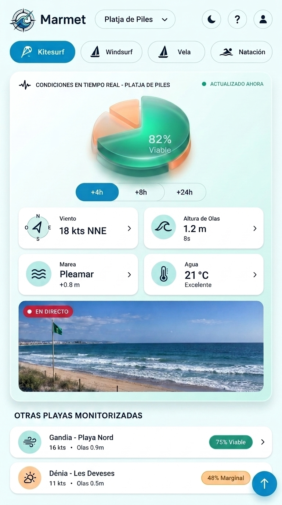
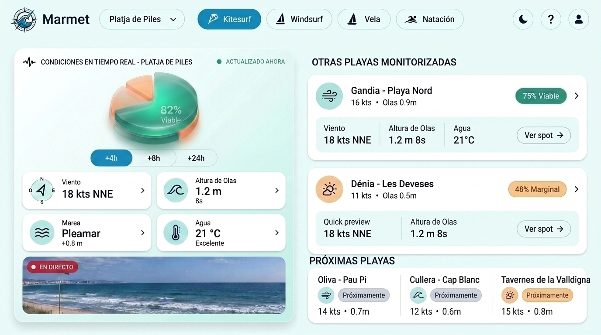
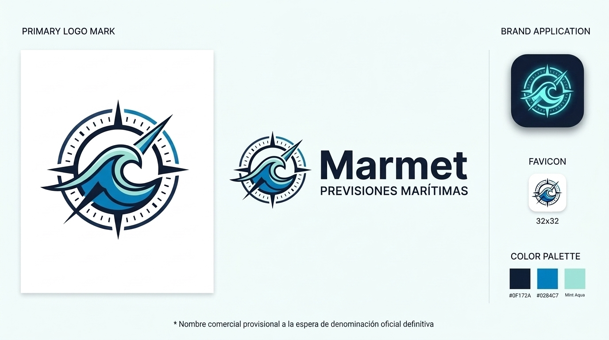

  
Sprint 0 — Reto 3: Estudio Previo de la Interfaz Web (UI)

  
Diseño Esquemático, Wireframes Mobile-First, Identidad Visual y Logotipo

  

    

      
<strong>Módulo:</strong> Projecte Intermodular (PIM) / Disseny d'Interfícies Web (DIW)

      
<strong>Ciclo formativo:</strong> 2º DAW (Semipresencial)

      
<strong>Centro:</strong> IES Maria Enríquez (Gandia) — Curs 2026/2027

    

    

      
<strong>Alumno:</strong> Noé Conde Vila

      
<strong>Profesor / Cliente:</strong> Quique Savall Seguí

      
<strong>Fecha de entrega:</strong> 30 de octubre de 2026

    

  

  <h3>Estructura del Documento (Reto 3)</h3>
  <ul>
    <li><a href="#act1">1. Actividad 1: Mapa Web y Flujo de Navegación (con Enlaces Externos)</a></li>
    <li><a href="#act2">2. Actividad 2: Wireframes Esquemáticos (Versión Móvil y Versión PC)</a>
      <ul>
        <li><a href="#act2-mobile">2.1. Wireframe Landing Page — Filosofía Mobile First</a></li>
        <li><a href="#act2-pc">2.2. Wireframe Landing Page — Dashboard de Escritorio (PC)</a></li>
      </ul>
    </li>
    <li><a href="#act3">3. Actividad 3: Estudio de Colores, Tipografía e Iconografía</a>
      <ul>
        <li><a href="#act3-colores">3.1. Propuesta de Paleta de Colores y Justificación Visual</a></li>
        <li><a href="#act3-tipografia">3.2. Selección Tipográfica y Jerarquía de Lectura</a></li>
        <li><a href="#act3-iconos">3.3. Catálogo de Iconos Funcionales del Sistema</a></li>
      </ul>
    </li>
    <li><a href="#act4">4. Actividad 4: Propuesta de Logotipo e Identidad de Marca</a></li>
  </ul>

---

  <strong>Contexto del Proyecto:</strong> Esta propuesta da respuesta a los requerimientos técnicos y funcionales definidos con <strong>Quique Savall</strong> (<em>Dunes Kite Piles / Gandia Surf</em>). El objetivo es diseñar una plataforma web ágil para practicantes de deportes náuticos (kitesurf, wingfoil, windsurf, vela ligera y natación) en las costas de la Safor y la Marina Alta (<strong>Piles, Gandia y Dénia</strong>), traduciendo telemetría compleja de viento y oleaje en un semáforo visual de viabilidad inmediato.

<h2 id="act1">1. Actividad 1: Mapa Web y Flujo de Navegación</h2>

La arquitectura de la información se ha diseñado bajo el principio de <strong>navegación plana en una única pantalla de aterrizaje (Landing Page)</strong>. De esta manera, el deportista no necesita navegar por menús profundos mientras se encuentra al aire libre con el teléfono en la mano:

<ul>
  <li><strong>Cabecera (Header Superior):</strong>
    <ul>
      <li><strong>Perfil de Usuario / Acceso:</strong> Acceso modal para inicio de sesión, registro o guardado de la playa y deporte preferidos (guardado en base de datos para cargar su spot favorito al entrar).</li>
      <li><strong>Aviso Legal y Ayuda [?]:</strong> Ventana modal emergente con el descargo de responsabilidad náutica (los datos son estimativos y el usuario es responsable final de su seguridad) y política de privacidad RGPD.</li>
      <li><strong>Conmutador de Tema [🌙 / ☀️]:</strong> Selector de modo oscuro para mejorar el contraste según la luminosidad ambiental.</li>
    </ul>
  </li>
  <li><strong>Bloque Principal (Spot Activo — ej. Platja de Piles):</strong>
    <ul>
      <li><strong>Indicador Semafórico («Quesito» dinámico):</strong> Gráfico circular porcentual de viabilidad deportiva (0% a 100%) que cambia de color: Verde (Óptimo), Amarillo (Precaución) o Rojo (No viable).</li>
      <li><strong>Selector de Pronóstico Rápido:</strong> Botones interactivos (<em>Ahora</em>, <em>+4h</em>, <em>+8h</em>, <em>+24h</em>) para evaluar ventanas temporales seguras sin recargar la web.</li>
      <li><strong>Tarjetas de Telemetría:</strong> Cuatro bloques con viento medio, rachas, dirección cardinal, altura de ola, período y temperatura.</li>
      <li><strong>Cámara Web en Directo:</strong> Ventana de retransmisión oficial con opción de maximizar para verificar la bandera de la playa y el estado real del mar.</li>
    </ul>
  </li>
  <li><strong>Bloque Inferior (Comparativa de Spots Cercanos):</strong> Tarjetas compactas con las otras dos playas monitorizadas (Gandia y Dénia) mostrando su porcentaje de viabilidad actual y permitiendo alternar la vista activa con un solo toque.</li>
  <li><strong>Integración de Enlaces Externos Relevantes:</strong> Cumpliendo las directrices docentes, se conectan los servicios oficiales indispensables para el usuario:
    <ul>
      <li><strong>Fuentes de datos meteorológicos y marítimos:</strong> Enlace a la API abierta de <strong>Open-Meteo Marine</strong> y al portal oficial <strong>Portus (Puertos del Estado)</strong> para la consulta técnica de boyas en tiempo real.</li>
      <li><strong>Retransmisiones oficiales:</strong> Enlaces a las webcams públicas de <strong>Turisme Comunitat Valenciana</strong> y la red comarcal <strong>Oceanía</strong>.</li>
      <li><strong>Escuelas y servicios colaboradores:</strong> Enlaces a <strong>Dunes Kite Piles</strong> y <strong>Gandia Surf</strong> para la consulta de partes locales y alquiler de material.</li>
    </ul>
  </li>
</ul>

  
  
<em>Figura 1: Mapa web estructural del sitio y puntos de enlace con servicios externos.</em>

<h2 id="act2">2. Actividad 2: Wireframes Esquemáticos</h2>

<h3 id="act2-mobile">2.1. Wireframe Landing Page — Filosofía Mobile First</h3>

Siguiendo la filosofía <em>Mobile First</em>, la interfaz para teléfonos móviles está concebida para ser manejada cómodamente <strong>con el pulgar de una sola mano bajo luz solar intensa</strong>. Toda la jerarquía se organiza en una columna vertical limpia y sin elementos superfluos:

<ul>
  <li><strong>Cabecera compacta:</strong> Selector de spot desplegable, logotipo nítido, conmutador de tema y accesos a ayuda y perfil.</li>
  <li><strong>Selector de disciplina:</strong> Pestañas deslizables para cambiar entre Kitesurf, Wingfoil, Windsurf, Vela y Natación, recalculando el semáforo visual al instante según los umbrales de cada deporte.</li>
  <li><strong>Semáforo y telemetría atómica:</strong> Indicador circular de gran tamaño en el centro acompañado de los botones de horizonte temporal (<em>+4h</em>, <em>+8h</em>, <em>+24h</em>) y tarjetas individuales para viento, oleaje y temperatura.</li>
  <li><strong>Webcam y comparativa:</strong> Bloque de vídeo en streaming y tarjetas resumidas de Gandia y Dénia al final de la pantalla, con botón flotante <code>[↑]</code> para regresar al inicio.</li>
</ul>

  
  
<em>Figura 2: Maqueta esquemática (wireframe) de la versión móvil.</em>

<h3 id="act2-pc">2.2. Wireframe Landing Page — Dashboard de Escritorio (PC)</h3>

Para pantallas de ordenador o tabletas horizontales, el diseño evoluciona a un formato <strong>dashboard a dos columnas</strong> que aprovecha el ancho visual completo para evitar desplazamientos innecesarios:

<ul>
  <li><strong>Columna Izquierda (Spot Monitorizado):</strong> Presenta la ficha completa de la playa seleccionada, con el indicador circular de viabilidad, los selectores de horas, las mediciones físicas y la webcam en vivo en formato panorámico.</li>
  <li><strong>Columna Derecha (Comparativa Simultánea y Futura Expansión):</strong>
    <ul>
      <li>Permite contrastar en paralelo las condiciones de <strong>Gandia</strong> y <strong>Dénia</strong> con acceso directo para intercambiar la playa principal.</li>
      <li>Reserva espacio modular para futuras integraciones de boyas comarcales (Oliva, Cullera, Tavernes).</li>
    </ul>
  </li>
</ul>

  
  
<em>Figura 3: Maqueta esquemática (wireframe) de la versión de escritorio a dos columnas.</em>

<h2 id="act3">3. Actividad 3: Estudio de Colores, Tipografía e Iconografía</h2>

<h3 id="act3-colores">3.1. Propuesta de Paleta de Colores y Justificación Visual</h3>

La paleta combina tonos marinos naturales para la estructura base con un sistema de colores semafóricos de alto contraste, garantizando una interpretación inmediata de las condiciones bajo el reflejo del sol:

<table>
  <thead>
    <tr>
      <th style="width: 24%;">Muestra / Tono</th>
      <th style="width: 18%;">Código HEX</th>
      <th>Justificación y Función en la Interfaz</th>
    </tr>
  </thead>
  <tbody>
    <tr>
      <td><strong>Azul Océano</strong></td>
      <td><code>#0284C7</code></td>
      <td><strong>Color primario corporativo:</strong> Evoca el mar abierto y el horizonte. Se aplica en botones principales, selector de deporte activo, enlaces y cabeceras.</td>
    </tr>
    <tr>
      <td><strong>Azul Marino Profundo</strong></td>
      <td><code>#0F172A</code></td>
      <td><strong>Contraste de texto y cifras:</strong> Proporciona un contraste óptimo (cumpliendo ratio WCAG AAA) para números de nudos, ráfagas y títulos sobre fondos claros.</td>
    </tr>
    <tr>
      <td><strong>Blanco Niebla / Menta</strong></td>
      <td><code>#F0F9FF</code> / <code>#FFFFFF</code></td>
      <td><strong>Fondo y tarjetas:</strong> Genera una sensación de frescura, orden y luminosidad, evitando sombras pesadas que resten nitidez en exteriores.</td>
    </tr>
    <tr>
      <td><strong>Verde Esmeralda</strong></td>
      <td><code>#10B981</code></td>
      <td><strong>Semáforo Viable (Óptimo):</strong> Indica que el viento y oleaje coinciden con el rango ideal del deporte seleccionado (ej. <em>82% Viable</em>). Transmite seguridad inmediata.</td>
    </tr>
    <tr>
      <td><strong>Ámbar / Arena Cálida</strong></td>
      <td><code>#F59E0B</code></td>
      <td><strong>Semáforo Marginal (Precaución):</strong> Tono cálido inspirado en la arena para advertir condiciones límite o cambios de viento próximos, alertando sin ser alarmista.</td>
    </tr>
    <tr>
      <td><strong>Rojo Coral</strong></td>
      <td><code>#EF4444</code></td>
      <td><strong>Semáforo No Recomendado (Alerta):</strong> Condiciones de temporal, mar cruzada o viento en calma absoluta no aptos para la actividad. También para el indicador de streaming en vivo (<code>● EN DIRECTO</code>).</td>
    </tr>
  </tbody>
</table>

<h3 id="act3-tipografia">3.2. Selección Tipográfica y Jerarquía de Lectura</h3>

Se han seleccionado familias tipográficas sans-serif modernas optimizadas para pantallas digitales (Google Fonts: <strong>Inter</strong> y <strong>Outfit</strong>):

<ul>
  <li><strong>Titulares y Nombres de Spots (Outfit SemiBold / Bold):</strong> Tipografía geométrica de líneas abiertas y modernas que aporta personalidad deportiva y excelente presencia en pantalla.</li>
  <li><strong>Telemetría y Métricas (Inter Bold / Monospace):</strong> Diseñada específicamente para interfaces de usuario, garantizando que números como <code>18 kts</code>, <code>1.2 m</code> o <code>23 °C</code> mantengan proporciones idénticas y se lean al milisegundo.</li>
  <li><strong>Texto descriptivo y consejos de navegación (Inter Regular):</strong> Lectura cómoda para las recomendaciones meteorológicas y textos del modal de ayuda.</li>
</ul>

  
<strong>Ejemplo visual de jerarquía tipográfica:</strong>

  
Platja de Piles — 82% Viable (Garbí Térmico)

  

    💨 18 kts NNE &nbsp;|&nbsp; 🌊 1.2 m 8s &nbsp;|&nbsp; 🌡️ 23 °C &nbsp;|&nbsp; 〰️ Pleamar +0.3m
  

  

    «Condiciones térmicas óptimas y estables para la práctica de kitesurf y wingfoil.»
  

<h3 id="act3-iconos">3.3. Catálogo de Iconos Funcionales</h3>

Para simplificar el reconocimiento visual sin sobrecargar de texto, se emplea una biblioteca coherente inspirada en <em>FontAwesome</em> y símbolos estándar de meteorología marítima:

<ul>
  <li>💨 <code>Viento:</code> Velocidad sostenida y rachas máximas.</li>
  <li>🧭 <code>Rosa náutica:</code> Dirección cardinal y orientación respecto a la línea de costa (onshore / offshore).</li>
  <li>🌊 <code>Oleaje:</code> Altura significativa de ola y período en segundos.</li>
  <li>🌡️ <code>Termómetro:</code> Temperatura ambiente y del agua de mar.</li>
  <li>〰️ <code>Mareas:</code> Coeficiente de marea, pleamar y bajamar.</li>
  <li>📹 <code>Cámara:</code> Acceso a la webcam y transmisión en directo.</li>
  <li>ℹ️ <code>Ayuda [?]:</code> Aviso legal y descargo de responsabilidad.</li>
</ul>

<h2 id="act4">4. Actividad 4: Propuesta de Logotipo e Identidad de Marca</h2>

En el diseño de la identidad visual de la aplicación se descartó el uso de figuras deportivas particulares (como siluetas de tablas o cometas) para no excluir a disciplinas como la natación en aguas abiertas o la vela. El elemento unificador indiscutible es el <strong>mar</strong>.

La propuesta gráfica desarrollada sintetiza dos conceptos fundamentales en un isotipo circular nítido:

<ul>
  <li><strong>La Rosa de los Vientos / Brújula Náutica:</strong> Simboliza la precisión métrica, la orientación cardinal (Norte, Sur, Este, Oeste) y la procedencia de los vientos dominantes recogidos en las boyas marítimas.</li>
  <li><strong>La Ola Central en Movimiento:</strong> Representa la fuerza dinámica del mar, con una cresta estilizada orientada hacia el nordeste en sintonía con las trayectorias de navegación de la comarca.</li>
</ul>

  <strong>Criterios de versatilidad técnica y denominación comercial:</strong>
  <ul>
    <li><strong>Nombre provisional de maqueta (<em>Marmet</em>):</strong> Como se aprecia en la composición y en los wireframes previos, se ha empleado la denominación de prueba <em>«Marmet»</em> a modo de ejemplo y marcador de posición provisional. No obstante, la identidad se adaptará formalmente al nombre comercial definitivo que valide el cliente en fases posteriores.</li>
    <li><strong>Independencia del naming:</strong> Al ser un isotipo puramente conceptual (rosa de los vientos + ola) sin letras ni iniciales incrustadas, funciona como un sello gráfico autónomo con total independencia de la denominación que adopte finalmente la app.</li>
    <li><strong>Escalabilidad:</strong> Su geometría circular equilibrada permite su uso perfecto como icono de aplicación móvil (PWA/Android/iOS), favicon de navegador (32&times;32 px) y aplicaciones en serigrafía o rotulación deportiva sobre material técnico.</li>
  </ul>

  
  
<em>Figura 4: Propuesta oficial de logotipo e isotipo para la plataforma de previsiones marítimas.</em>

---

  <em>Documento de entrega parcial — Sprint 0: Reto 3 (Estudio Previo UI Web) &bull; 2º DAW Semipresencial &bull; IES Maria Enríquez</em>

