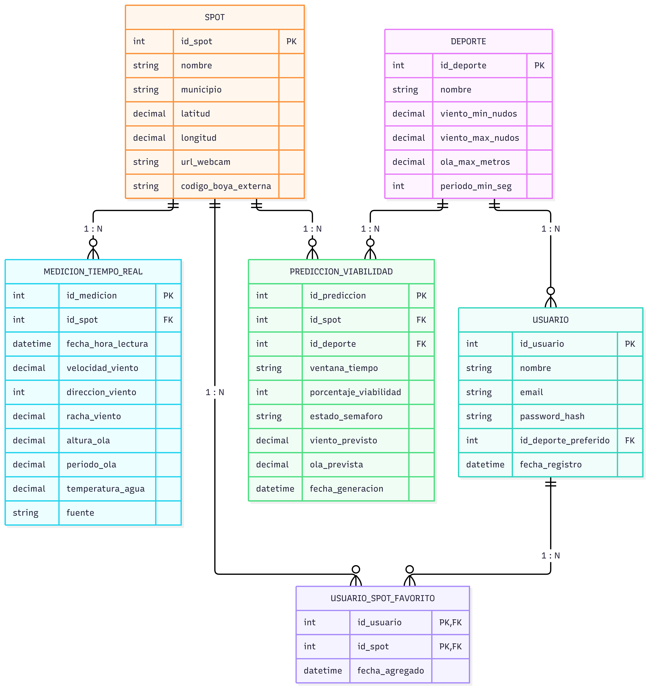

  
ESTUDIO Y DISEÑO DE LA ESTRUCTURA DE DATOS

  
Proyecto de Previsiones Marítimas — Módulo DWES

  

    

      
<strong>Módulo:</strong> Proyecto Intermodular (PIM) / DWES

      
<strong>Actividad:</strong> Sprint 0 — Reto 4: DWS BBDD

      
<strong>Ciclo:</strong> 2º DAW (Semipresencial)

      
<strong>Centro:</strong> IES Maria Enríquez (Gandia)

    

    

      
<strong>Alumno:</strong> Noé Conde Vila

      
<strong>Profesor:</strong> Quique Savall

      
<strong>Fecha de entrega:</strong> 19 de octubre de 2026

    

  

  <h3>Índice de Contenidos</h3>
  <ul>
    <li><a href="#sec-1">1. Análisis de Necesidades y Estudio de APIs de Terceros</a></li>
    <li><a href="#sec-2">2. Propuesta de Entidades, Atributos y Relaciones</a></li>
    <li><a href="#sec-3">3. Diseño del Diagrama Entidad-Relación (ER)</a></li>
  </ul>

<h2 id="sec-1">1. Análisis de Necesidades y Estudio de APIs de Terceros</h2>

Para alimentar nuestra aplicación con datos fiables de viento, olas y estado del mar sin costes de licencia, hemos analizado y comparado las tres fuentes públicas más relevantes:

<table>
  <thead>
    <tr>
      <th style="width: 22%;">Criterio de análisis</th>
      <th style="width: 26%;">API 1: Open-Meteo Marine</th>
      <th style="width: 26%;">API 2: AEMET OpenData</th>
      <th style="width: 26%;">API 3: Puertos del Estado (Portus)</th>
    </tr>
  </thead>
  <tbody>
    <tr>
      <td><strong>Formato de los datos</strong></td>
      <td>JSON directo. Devuelve un archivo de texto con los datos listos para leer directamente en PHP o JavaScript.</td>
      <td>JSON en dos pasos. La primera consulta devuelve un enlace temporal y, al abrirlo, se descarga el archivo final en formato JSON.</td>
      <td>JSON y tablas web. Permite consultar datos en JSON o descargar registros históricos en tablas CSV.</td>
    </tr>
    <tr>
      <td><strong>Variables capturadas para el análisis</strong></td>
      <td>
        <ul>
          <li><strong>Viento:</strong> Predicción horaria de velocidad en nudos, dirección y rachas.</li>
          <li><strong>Oleaje:</strong> Predicción matemática de altura de ola (metros) y período (segundos).</li>
          <li><strong>Temperatura:</strong> Temperatura del aire y de la superficie marina.</li>
        </ul>
      </td>
      <td>
        <ul>
          <li><strong>Viento:</strong> Predicción de viento medio y rachas en estaciones costeras.</li>
          <li><strong>Oleaje:</strong> Descripción del estado del mar (marejada, mar gruesa).</li>
          <li><strong>Temperatura:</strong> Temperatura ambiente y sensación térmica.</li>
          <li><strong>Avisos oficiales:</strong> Alertas por temporal marítimo (amarilla/naranja/roja).</li>
        </ul>
      </td>
      <td>
        <ul>
          <li><strong>Viento:</strong> Velocidad y dirección real medida por el anemómetro de la boya.</li>
          <li><strong>Oleaje:</strong> Medición física real de la altura de ola y período registrada en el agua.</li>
          <li><strong>Temperatura:</strong> Temperatura real del agua tomada directamente por la boya.</li>
        </ul>
      </td>
    </tr>
    <tr>
      <td><strong>¿Cubre nuestros 3 spots?</strong></td>
      <td>Sí, al 100%. Funciona por coordenadas GPS exactas (latitud y longitud), por lo que cubre perfectamente Gandia, Piles, Dénia y Calpe.</td>
      <td>Sí. Ofrece información por municipios costeros y zonas marítimas oficiales.</td>
      <td>Sí. Dispone de boyas oficiales fondeadas frente a Valencia, Gandia y Dénia.</td>
    </tr>
    <tr>
      <td><strong>Autenticación y coste</strong></td>
      <td>Gratuita para uso educativo y personal. No requiere registro ni clave de acceso.</td>
      <td>Gratuita. Obliga a registrarse con un email en su web para obtener una clave personal (API Key).</td>
      <td>Gratuita y pública. Acceso abierto a través del portal estatal de puertos.</td>
    </tr>
    <tr>
      <td><strong>Límite de peticiones</strong></td>
      <td>Hasta 10.000 consultas al día. Margen más que suficiente para actualizar nuestra base de datos.</td>
      <td>Límite estricto por minuto para evitar saturación de sus servidores.</td>
      <td>Sin límite estricto de llamadas, pero las boyas actualizan sus mediciones una vez por hora.</td>
    </tr>
    <tr>
      <td><strong>Web oficial</strong></td>
      <td><a href="https://open-meteo.com/en/docs/marine-weather-api" target="_blank">open-meteo.com/marine</a></td>
      <td><a href="https://opendata.aemet.es/centrodedescargas/inicio" target="_blank">opendata.aemet.es</a></td>
      <td><a href="https://www.puertos.es/es-es/oceanografia/Paginas/portus.aspx" target="_blank">puertos.es (Portus)</a></td>
    </tr>
  </tbody>
</table>

  <strong>Conclusión y decisión técnica:</strong> 
  La mejor solución para nuestro proyecto es utilizar <strong>Open-Meteo Marine</strong> como motor principal de predicción a 4h, 8h y 24h (por su rapidez, precisión por GPS y porque no exige claves ni registros), complementada con las boyas de <strong>Puertos del Estado</strong> para contrastar la altura real de las olas en la costa de la Safor y la Marina.

<h2 id="sec-2">2. Propuesta de Entidades, Atributos y Relaciones</h2>

A partir de los requisitos acordados con Quique y para evitar sobrecargar las APIs meteorológicas externas con llamadas continuas, hemos estructurado la base de datos en <strong>6 tablas</strong>. El objetivo es almacenar la información básica (usuarios, spots y deportes) y utilizar la base de datos como una <strong>capa de caché local</strong>: en ella guardamos tanto las últimas mediciones de las boyas como las previsiones procesadas por la IA, consiguiendo que la aplicación web responda de forma inmediata al usuario.

<h3>2.1. Definición detallada de tablas y atributos</h3>

<h4>1. Tabla <code>USUARIO</code></h4>

Guarda las cuentas de los deportistas registrados, sus credenciales de acceso y el deporte que practican habitualmente para personalizar su pantalla de inicio.

<table>
  <thead>
    <tr>
      <th style="width: 25%;">Atributo</th>
      <th style="width: 20%;">Tipo SQL</th>
      <th style="width: 20%;">Restricción</th>
      <th>Descripción</th>
    </tr>
  </thead>
  <tbody>
    <tr>
      <td><code>id_usuario</code></td>
      <td><code>INT</code></td>
      <td><code>PRIMARY KEY AUTO_INCREMENT</code></td>
      <td>Identificador único del usuario.</td>
    </tr>
    <tr>
      <td><code>nombre</code></td>
      <td><code>VARCHAR(100)</code></td>
      <td><code>NOT NULL</code></td>
      <td>Nombre o alias del deportista.</td>
    </tr>
    <tr>
      <td><code>email</code></td>
      <td><code>VARCHAR(150)</code></td>
      <td><code>UNIQUE NOT NULL</code></td>
      <td>Correo electrónico para iniciar sesión y avisos.</td>
    </tr>
    <tr>
      <td><code>password_hash</code></td>
      <td><code>VARCHAR(255)</code></td>
      <td><code>NOT NULL</code></td>
      <td>Contraseña cifrada con BCRYPT antes de guardarla.</td>
    </tr>
    <tr>
      <td><code>id_deporte_preferido</code></td>
      <td><code>INT</code></td>
      <td><code>FOREIGN KEY NULL</code></td>
      <td>Deporte favorito seleccionado por defecto (apunta a <code>DEPORTE.id_deporte</code>).</td>
    </tr>
    <tr>
      <td><code>fecha_registro</code></td>
      <td><code>DATETIME</code></td>
      <td><code>DEFAULT CURRENT_TIMESTAMP</code></td>
      <td>Fecha y hora en que se creó la cuenta.</td>
    </tr>
  </tbody>
</table>

<h4>2. Tabla <code>SPOT</code></h4>

Almacena las playas y zonas de navegación monitorizadas (Piles, Gandia, Dénia...), con sus coordenadas GPS para consultar las APIs y el enlace a la cámara en directo.

<table>
  <thead>
    <tr>
      <th style="width: 25%;">Atributo</th>
      <th style="width: 20%;">Tipo SQL</th>
      <th style="width: 20%;">Restricción</th>
      <th>Descripción</th>
    </tr>
  </thead>
  <tbody>
    <tr>
      <td><code>id_spot</code></td>
      <td><code>INT</code></td>
      <td><code>PRIMARY KEY AUTO_INCREMENT</code></td>
      <td>Identificador único del spot.</td>
    </tr>
    <tr>
      <td><code>nombre</code></td>
      <td><code>VARCHAR(100)</code></td>
      <td><code>NOT NULL</code></td>
      <td>Nombre de la playa (ej. «Platja de Piles», «Les Marines»).</td>
    </tr>
    <tr>
      <td><code>municipio</code></td>
      <td><code>VARCHAR(100)</code></td>
      <td><code>NOT NULL</code></td>
      <td>Población o comarca a la que pertenece.</td>
    </tr>
    <tr>
      <td><code>latitud</code></td>
      <td><code>DECIMAL(9, 6)</code></td>
      <td><code>NOT NULL</code></td>
      <td>Coordenada de latitud GPS para Open-Meteo.</td>
    </tr>
    <tr>
      <td><code>longitud</code></td>
      <td><code>DECIMAL(9, 6)</code></td>
      <td><code>NOT NULL</code></td>
      <td>Coordenada de longitud GPS para Open-Meteo.</td>
    </tr>
    <tr>
      <td><code>url_webcam</code></td>
      <td><code>VARCHAR(255)</code></td>
      <td><code>NULL</code></td>
      <td>Enlace directo a la emisión de la cámara o webcam.</td>
    </tr>
    <tr>
      <td><code>codigo_boya_externa</code></td>
      <td><code>VARCHAR(50)</code></td>
      <td><code>NULL</code></td>
      <td>Identificador de la boya más próxima en Puertos del Estado.</td>
    </tr>
  </tbody>
</table>

<h4>3. Tabla <code>DEPORTE</code></h4>

Define los límites y condiciones ideales de viento y mar para cada disciplina, de modo que las reglas no queden fijadas a fuego en el código PHP.

<table>
  <thead>
    <tr>
      <th style="width: 25%;">Atributo</th>
      <th style="width: 20%;">Tipo SQL</th>
      <th style="width: 20%;">Restricción</th>
      <th>Descripción</th>
    </tr>
  </thead>
  <tbody>
    <tr>
      <td><code>id_deporte</code></td>
      <td><code>INT</code></td>
      <td><code>PRIMARY KEY AUTO_INCREMENT</code></td>
      <td>Identificador de la modalidad deportiva.</td>
    </tr>
    <tr>
      <td><code>nombre</code></td>
      <td><code>VARCHAR(50)</code></td>
      <td><code>NOT NULL</code></td>
      <td>Nombre del deporte («Aguas abiertas», «Vela ligera», «Kite/Windsurf»).</td>
    </tr>
    <tr>
      <td><code>viento_min_nudos</code></td>
      <td><code>DECIMAL(4, 1)</code></td>
      <td><code>NOT NULL</code></td>
      <td>Viento mínimo necesario (0.0 para nadar, 12.0 para kitesurf).</td>
    </tr>
    <tr>
      <td><code>viento_max_nudos</code></td>
      <td><code>DECIMAL(4, 1)</code></td>
      <td><code>NOT NULL</code></td>
      <td>Límite máximo de viento seguro antes de marcar aviso rojo.</td>
    </tr>
    <tr>
      <td><code>ola_max_metros</code></td>
      <td><code>DECIMAL(3, 2)</code></td>
      <td><code>NOT NULL</code></td>
      <td>Altura máxima de ola tolerable (0.40m para nadar, 1.80m para vela).</td>
    </tr>
    <tr>
      <td><code>periodo_min_seg</code></td>
      <td><code>INT</code></td>
      <td><code>NULL</code></td>
      <td>Segundos mínimos entre olas para asegurar mar navegable.</td>
    </tr>
  </tbody>
</table>

<h4>4. Tabla <code>MEDICION_TIEMPO_REAL</code></h4>

Registra las mediciones físicas que envían periódicamente las boyas marinas y estaciones costeras. Sirve para mostrarle al usuario el estado real del agua en este momento.

<table>
  <thead>
    <tr>
      <th style="width: 25%;">Atributo</th>
      <th style="width: 20%;">Tipo SQL</th>
      <th style="width: 20%;">Restricción</th>
      <th>Descripción</th>
    </tr>
  </thead>
  <tbody>
    <tr>
      <td><code>id_medicion</code></td>
      <td><code>INT</code></td>
      <td><code>PRIMARY KEY AUTO_INCREMENT</code></td>
      <td>Identificador único del registro de lectura.</td>
    </tr>
    <tr>
      <td><code>id_spot</code></td>
      <td><code>INT</code></td>
      <td><code>FOREIGN KEY NOT NULL</code></td>
      <td>Playa a la que corresponde la lectura (apunta a <code>SPOT.id_spot</code>).</td>
    </tr>
    <tr>
      <td><code>fecha_hora_lectura</code></td>
      <td><code>DATETIME</code></td>
      <td><code>NOT NULL</code></td>
      <td>Momento exacto en el que el sensor tomó la muestra.</td>
    </tr>
    <tr>
      <td><code>velocidad_viento</code></td>
      <td><code>DECIMAL(4, 1)</code></td>
      <td><code>NOT NULL</code></td>
      <td>Viento medio registrado en nudos.</td>
    </tr>
    <tr>
      <td><code>direccion_viento</code></td>
      <td><code>INT</code></td>
      <td><code>NOT NULL</code></td>
      <td>Dirección en grados (0° a 360°) para pintar la flecha cardinal.</td>
    </tr>
    <tr>
      <td><code>racha_viento</code></td>
      <td><code>DECIMAL(4, 1)</code></td>
      <td><code>NULL</code></td>
      <td>Racha más fuerte registrada en nudos.</td>
    </tr>
    <tr>
      <td><code>altura_ola</code></td>
      <td><code>DECIMAL(3, 2)</code></td>
      <td><code>NULL</code></td>
      <td>Altura de ola medida por la boya en metros.</td>
    </tr>
    <tr>
      <td><code>periodo_ola</code></td>
      <td><code>DECIMAL(4, 1)</code></td>
      <td><code>NULL</code></td>
      <td>Tiempo en segundos entre ola y ola (período de pico).</td>
    </tr>
    <tr>
      <td><code>temperatura_agua</code></td>
      <td><code>DECIMAL(3, 1)</code></td>
      <td><code>NULL</code></td>
      <td>Temperatura real del mar en °C.</td>
    </tr>
    <tr>
      <td><code>fuente</code></td>
      <td><code>VARCHAR(50)</code></td>
      <td><code>NOT NULL</code></td>
      <td>Origen del dato («Puertos del Estado» o «AEMET»).</td>
    </tr>
  </tbody>
</table>

<h4>5. Tabla <code>PREDICCION_VIABILIDAD</code></h4>

Actúa como memoria caché para las previsiones futuras (+4h, +8h y +24h). Guarda la estimación calculada por la IA para cada deporte junto con los valores meteorológicos previstos, logrando que la aplicación responda al segundo.

<table>
  <thead>
    <tr>
      <th style="width: 25%;">Atributo</th>
      <th style="width: 20%;">Tipo SQL</th>
      <th style="width: 20%;">Restricción</th>
      <th>Descripción</th>
    </tr>
  </thead>
  <tbody>
    <tr>
      <td><code>id_prediccion</code></td>
      <td><code>INT</code></td>
      <td><code>PRIMARY KEY AUTO_INCREMENT</code></td>
      <td>Identificador único del cálculo de previsión.</td>
    </tr>
    <tr>
      <td><code>id_spot</code></td>
      <td><code>INT</code></td>
      <td><code>FOREIGN KEY NOT NULL</code></td>
      <td>Playa evaluada (apunta a <code>SPOT.id_spot</code>).</td>
    </tr>
    <tr>
      <td><code>id_deporte</code></td>
      <td><code>INT</code></td>
      <td><code>FOREIGN KEY NOT NULL</code></td>
      <td>Deporte para el que se calcula la viabilidad (apunta a <code>DEPORTE.id_deporte</code>).</td>
    </tr>
    <tr>
      <td><code>ventana_tiempo</code></td>
      <td><code>ENUM('4h', '8h', '24h')</code></td>
      <td><code>NOT NULL</code></td>
      <td>Franja horaria calculada (4h, 8h o 24h).</td>
    </tr>
    <tr>
      <td><code>porcentaje_viabilidad</code></td>
      <td><code>INT</code></td>
      <td><code>NOT NULL</code></td>
      <td>Porcentaje de idoneidad (0 a 100%) para pintar el quesito.</td>
    </tr>
    <tr>
      <td><code>estado_semaforo</code></td>
      <td><code>ENUM('verde', 'amarillo', 'rojo')</code></td>
      <td><code>NOT NULL</code></td>
      <td>Color del semáforo resultante (verde, amarillo o rojo).</td>
    </tr>
    <tr>
      <td><code>viento_previsto</code></td>
      <td><code>DECIMAL(4, 1)</code></td>
      <td><code>NULL</code></td>
      <td>Viento medio previsto en nudos por Open-Meteo.</td>
    </tr>
    <tr>
      <td><code>ola_prevista</code></td>
      <td><code>DECIMAL(3, 2)</code></td>
      <td><code>NULL</code></td>
      <td>Altura de ola estimada en metros.</td>
    </tr>
    <tr>
      <td><code>fecha_generacion</code></td>
      <td><code>DATETIME</code></td>
      <td><code>DEFAULT CURRENT_TIMESTAMP</code></td>
      <td>Fecha y hora del cálculo para controlar la caducidad de la caché.</td>
    </tr>
  </tbody>
</table>

<h4>6. Tabla <code>USUARIO_SPOT_FAVORITO</code></h4>

Tabla intermedia para resolver la relación muchos a muchos entre usuarios y playas, permitiendo a cada deportista guardar sus spots habituales.

<table>
  <thead>
    <tr>
      <th style="width: 25%;">Atributo</th>
      <th style="width: 20%;">Tipo SQL</th>
      <th style="width: 20%;">Restricción</th>
      <th>Descripción</th>
    </tr>
  </thead>
  <tbody>
    <tr>
      <td><code>id_usuario</code></td>
      <td><code>INT</code></td>
      <td><code>PRIMARY KEY, FOREIGN KEY</code></td>
      <td>Usuario que añade el favorito (apunta a <code>USUARIO.id_usuario</code>).</td>
    </tr>
    <tr>
      <td><code>id_spot</code></td>
      <td><code>INT</code></td>
      <td><code>PRIMARY KEY, FOREIGN KEY</code></td>
      <td>Playa guardada (apunta a <code>SPOT.id_spot</code>).</td>
    </tr>
    <tr>
      <td><code>fecha_agregado</code></td>
      <td><code>DATETIME</code></td>
      <td><code>DEFAULT CURRENT_TIMESTAMP</code></td>
      <td>Momento en que se guardó el favorito.</td>
    </tr>
  </tbody>
</table>

<h3>2.2. Relaciones y cardinalidades entre tablas</h3>

En el modelo relacional físico no existen relaciones N:M directas; por eso, la relación muchos a muchos entre usuarios y playas se resuelve mediante la tabla intermedia <code>USUARIO_SPOT_FAVORITO</code>, generando 6 relaciones 1:N que coinciden exactamente con las conexiones del diagrama:

<ul>
  <li><strong>DEPORTE a USUARIO (1 : N):</strong> Cada usuario tiene asignado un único deporte favorito principal para personalizar su interfaz, pero un mismo deporte lo comparten muchos usuarios. Si se diera de baja un deporte, usamos <code>ON DELETE SET NULL</code> para conservar las cuentas.</li>
  <li><strong>SPOT a MEDICION_TIEMPO_REAL (1 : N):</strong> De una misma playa se van guardando las lecturas que envían las boyas periódicamente a lo largo de las horas.</li>
  <li><strong>SPOT a PREDICCION_VIABILIDAD (1 : N):</strong> Para cada playa se almacenan sus predicciones meteorológicas en las ventanas de 4h, 8h y 24h.</li>
  <li><strong>DEPORTE a PREDICCION_VIABILIDAD (1 : N):</strong> Cada registro de previsión evalúa las condiciones para un deporte concreto (el semáforo no es el mismo para vela que para natación).</li>
  <li><strong>USUARIO a USUARIO_SPOT_FAVORITO (1 : N):</strong> Un usuario puede guardar muchas playas en su lista de favoritos. Si el usuario se da de baja, sus favoritos se eliminan en cascada (<code>ON DELETE CASCADE</code>).</li>
  <li><strong>SPOT a USUARIO_SPOT_FAVORITO (1 : N):</strong> Una playa puede estar guardada en la lista de favoritos de muchos usuarios distintos. Si se eliminara un spot, sus registros asociados en favoritos también se eliminan en cascada.</li>
</ul>

<h2 id="sec-3">3. Diseño del Diagrama Entidad-Relación (ER)</h2>

Este es el diagrama Entidad-Relación resultante. Muestra las 6 tablas con sus tipos de datos, sus claves primarias (PK) y foráneas (FK), y las conexiones 1:N que estructuran toda la base de datos:

  

