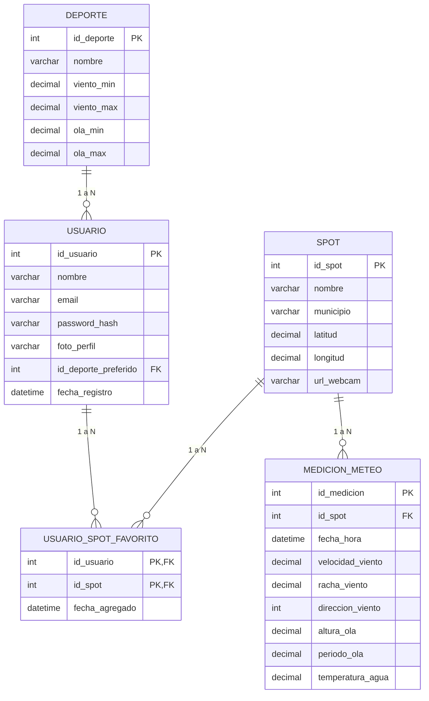

  
ESTUDIO Y DISEÑO DE LA ESTRUCTURA DE DATOS

  
Proyecto de Previsiones Marítimas — Módulo DWES

  

    

      
<strong>Módulo:</strong> Proyecto Intermodular (PIM) / DWES

      
<strong>Actividad:</strong> Sprint 0 — Reto 4: DWS BBDD

      
<strong>Ciclo:</strong> 2º DAW (Semipresencial)

      
<strong>Centro:</strong> IES Maria Enríquez (Gandia)

    

    

      
<strong>Alumno:</strong> Noé Conde Vila

      
<strong>Profesor:</strong> Eloy Gutiérrez / Quique Savall

      
<strong>Fecha de entrega:</strong> 19 de octubre de 2026

    

  

  <h3>Índice de Contenidos</h3>
  <ul>
    <li><a href="#sec-1">1. Análisis de Necesidades y Estudio de APIs de Terceros</a></li>
    <li><a href="#sec-2">2. Propuesta de Entidades, Atributos y Relaciones</a></li>
    <li><a href="#sec-3">3. Diseño del Diagrama Entidad-Relación (ER)</a></li>
  </ul>

<h2 id="sec-1">1. Análisis de Necesidades y Estudio de APIs de Terceros</h2>

Para alimentar nuestra aplicación con datos fiables de viento, olas y estado del mar sin costes de licencia, hemos analizado y comparado las tres fuentes públicas más relevantes:

<table>
  <thead>
    <tr>
      <th style="width: 22%;">Criterio de análisis</th>
      <th style="width: 26%;">API 1: Open-Meteo Marine</th>
      <th style="width: 26%;">API 2: AEMET OpenData</th>
      <th style="width: 26%;">API 3: Puertos del Estado (Portus)</th>
    </tr>
  </thead>
  <tbody>
    <tr>
      <td><strong>Formato de los datos</strong></td>
      <td><strong>JSON directo</strong>. Devuelve un archivo de texto con los datos listos para leer directamente en PHP o JavaScript.</td>
      <td><strong>JSON en dos pasos</strong>. La primera consulta devuelve un enlace temporal y, al abrir ese enlace, se descarga el archivo final también en <strong>formato JSON</strong>.</td>
      <td><strong>JSON y tablas web</strong>. Permite consultar datos en JSON o descargar registros históricos en tablas CSV.</td>
    </tr>
    <tr>
      <td><strong>Variables que capturamos para la «coctelera»</strong></td>
      <td>
        <ul>
          <li><strong>Viento:</strong> Predicción horaria de velocidad en nudos, dirección y rachas.</li>
          <li><strong>Oleaje:</strong> Predicción matemática de altura de ola (metros) y período (segundos).</li>
          <li><strong>Temperatura:</strong> Temperatura del aire y de la superficie marina.</li>
        </ul>
      </td>
      <td>
        <ul>
          <li><strong>Viento:</strong> Predicción de viento medio y rachas en estaciones costeras.</li>
          <li><strong>Oleaje:</strong> Descripción del estado del mar (marejada, mar gruesa).</li>
          <li><strong>Temperatura:</strong> Temperatura ambiente y sensación térmica.</li>
          <li><strong>Avisos oficiales:</strong> Alertas por temporal marítimo (amarilla/naranja/roja).</li>
        </ul>
      </td>
      <td>
        <ul>
          <li><strong>Viento:</strong> Velocidad y dirección real medida por el anemómetro de la boya.</li>
          <li><strong>Oleaje:</strong> Medición física real de la altura de ola y período registrada en el agua.</li>
          <li><strong>Temperatura:</strong> Temperatura real del agua tomada directamente por la boya.</li>
        </ul>
      </td>
    </tr>
    <tr>
      <td><strong>¿Cubre nuestros 3 spots?</strong></td>
      <td><strong>Sí, al 100%</strong>. Funciona por coordenadas GPS exactas (latitud y longitud), por lo que cubre perfectamente Gandia, Piles, Dénia y Calpe.</td>
      <td><strong>Sí</strong>. Ofrece información por municipios costeros y zonas marítimas oficiales.</td>
      <td><strong>Sí</strong>. Dispone de boyas oficiales fondeadas frente a Valencia, Gandia y Dénia.</td>
    </tr>
    <tr>
      <td><strong>Autenticación y coste</strong></td>
      <td><strong>Gratuita</strong> para uso educativo y personal. No requiere registro ni clave de acceso.</td>
      <td><strong>Gratuita</strong>. Obliga a registrarse con un email en su web para obtener una clave personal (API Key).</td>
      <td><strong>Gratuita y pública</strong>. Acceso abierto a través del portal estatal de puertos.</td>
    </tr>
    <tr>
      <td><strong>Límite de peticiones</strong></td>
      <td>Hasta <strong>10.000 consultas al día</strong>. Margen más que suficiente para actualizar nuestra base de datos.</td>
      <td>Límite estricto por minuto para evitar saturación de sus servidores.</td>
      <td>Sin límite estricto de llamadas, pero las boyas actualizan sus mediciones una vez por hora.</td>
    </tr>
    <tr>
      <td><strong>Web oficial</strong></td>
      <td><a href="https://open-meteo.com/en/docs/marine-weather-api" target="_blank">open-meteo.com/marine</a></td>
      <td><a href="https://opendata.aemet.es/centrodedescargas/inicio" target="_blank">opendata.aemet.es</a></td>
      <td><a href="https://www.puertos.es/es-es/oceanografia/Paginas/portus.aspx" target="_blank">puertos.es (Portus)</a></td>
    </tr>
  </tbody>
</table>

  <strong>Conclusión y decisión técnica:</strong> 
  La mejor solución para nuestro proyecto es utilizar <strong>Open-Meteo Marine</strong> como motor principal de predicción a 4h, 8h y 24h (por su rapidez, precisión por GPS y porque no exige claves ni registros), complementada con las boyas de <strong>Puertos del Estado</strong> para contrastar la altura real de las olas en la costa de la Safor y la Marina.

<h2 id="sec-2">2. Propuesta de Entidades, Atributos y Relaciones</h2>

  
<em>(Espacio preparado para definir las tablas de la base de datos, tipos de datos, claves primarias y foráneas, y cardinalidades)</em>

<h2 id="sec-3">3. Diseño del Diagrama Entidad-Relación (ER)</h2>

